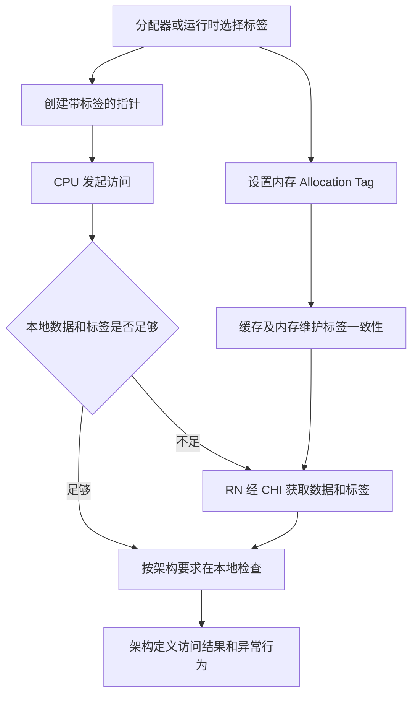
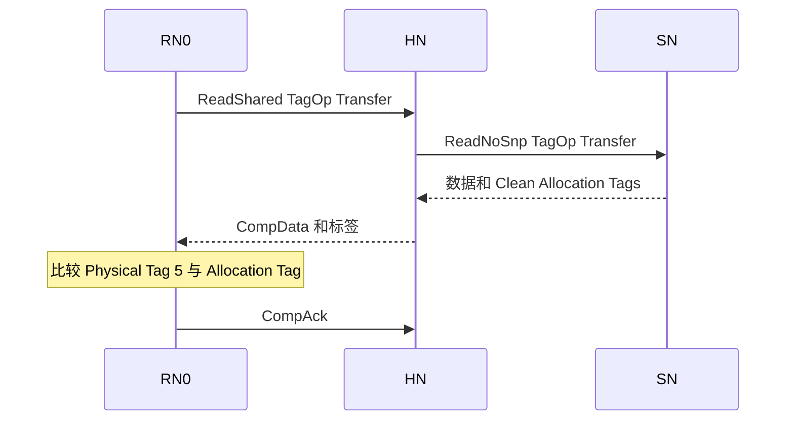
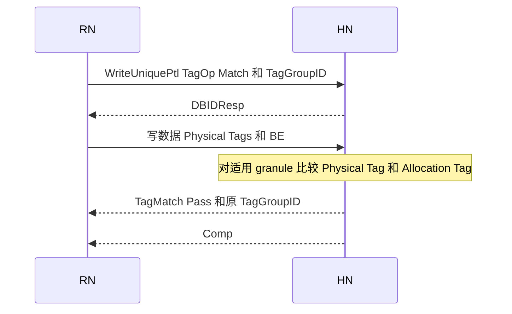

# CHI 与 MTE 协同机制学习指南

MTE 用标签帮助发现内存使用错误；CHI 负责让参与缓存和内存访问的节点正确传递、缓存、更新这些标签。两者交汇的核心是：**Allocation Tag 是与内存关联、需要维护一致性的元数据，不是一次请求上可以随意丢弃的附加标记。**

读完本文，应能回答：指针里的标签由谁产生；缓存已有数据为什么还要发读请求；为什么标签会影响 ReadUnique、snoop 和写回；哪些检查由 RN 做，哪些由 HN/SN 做；怎样从波形判断标签被取回、更新或检查。

正文以 **Arm IHI0050 Issue H** 为协议依据，覆盖 B12 全章，并补充字段和接口能力规则。MTE 作为处理器架构特性，并不以 CHI 为唯一实现方式；这里研究的是它在 CHI 系统中的实现接口。Linux 配置、架构可见异常与 CHI 报文语义分层说明，不能直接相互替代。

> **阅读约定**：标有“例”的地址、值和拓扑均为教学构造；报文顺序展示一种合法理解方式，不是唯一实现。图中省略与当前问题无关的 DBID、Retry、CompAck 和数据分包。硬件内部标签存储布局、流水级、指令到 CHI 的一一映射，未由规范确定的地方均注明“实现相关”或“待确认”。文末脚注提供章节及原文位置。

## 阅读路线

- 建立整体模型：第 1 至 3 节。
- 看懂 CHI 波形：第 4 至 8 节。
- 理解 CMO、Atomic、Stash 和接口能力：第 9 至 11 节。
- 串起完整场景：第 12 节。
- 用于设计和验证：第 13 至 15 节。
- 按章节回查原文：第 16 节。

先备知识可查 [[CHI-Cache状态模型]]、[[CHI-所有权与Dirty责任]]、[[CHI-通道与方向]]。已有简明入口为 [[CHI-MTE与Tag一致性]]，本文集中提供系统学习和案例，不再拆出重复概念笔记。

## 1 从一次内存访问看两者如何分工

### 1.1 三种标签叫法

| 名称 | 位于哪里 | 表达什么 | 由谁维护 |
| --- | --- | --- | --- |
| Logical Tag | AArch64 指针的标签位 | 这次访问期望匹配的标签 | 软件生成并保留，硬件使用 |
| Physical Address Tag 或 Physical Tag | CHI 对访问期望标签的称呼；需要时随写数据等传送 | 本次访问拿来比较的值 | Requester 提供 |
| Allocation Tag | 与内存的 16-byte granule 关联，可被缓存 | 这块内存当前的标签 | 软件通过架构机制设置，内存系统维护一致性 |

Logical Tag 与 CHI 的 Physical Tag 在这里是不同层面对“访问携带的期望标签”的表述，不应理解成还要另随机生成一个新标签。**Physical Tag 也不是 cache tag RAM 中用于匹配物理地址的地址标记。**[^C1][^S1]

同一个 DAT 的 `Tag` 字段，可能承载 Allocation Tags，也可能承载用于 Match 的 Physical Tags，必须结合消息类型和 `TagOp` 判断。[^C2][^C16]

### 1.2 哪一层做什么



这个图中的“本地”是机制边界，不指定比较器位于 L1、L2 还是哪个流水级。CHI 把读返回标签的检查责任交给 Requester，把 `TagOp=Match` 的写检查责任交给 Completer；具体处理器怎样把这些结果变成异常，由架构与实现决定。[^C1]

### 例 1 地址 0x1000 的标签 5 从哪里来

假设运行时分配一块 16-byte 内存，选择标签 `5`，完成两件相互配套的事：

```text
给程序的指针：地址部分 0x1000，Logical Tag=5
内存的元数据：AllocationTag[0x1000..0x100F]=5
```

在一个简化的低地址 AArch64 示例中，带标签的指针可写成 `0x0500000000001000`，标签位为 `[59:56]`。这里不讨论其他高位功能及具体虚拟地址配置。

程序之后保留或传递的是这个带标签指针。**硬件不会每次看到裸地址 0x1000，就自动把正确的 5 补进普通指针。** 否则悬空指针每次都能获得最新标签，检查便失去意义。标签的产生、保存和传递属于软件使用约定。[^S1][^S2]

### 例 2 同一地址重新分配后为什么能发现旧指针

```text
第一次分配：A 的标签=5，旧指针 p 的标签=5
释放及重新分配：A 的标签改为9，新指针 q 的标签=9
旧指针 p 仍然携带5
```

使用 `p` 访问时，比较为 `5 != 9`。如果软件反而先读取当前 Allocation Tag，再把所有旧指针都改成 `9`，就破坏了原来的检测目的。MTE 的 4-bit 标签空间有限，检测能力还取决于软件选择标签的策略，不能把它当成绝对的内存访问权限系统。[^S2]

## 2 标签粒度与软件侧基础

### 2.1 每 16 字节一个标签

每个对齐的 16-byte 数据区域对应一个 4-bit Allocation Tag。以 64-byte cache line 为例：[^C1]

| 数据范围 | Allocation Tag |
| --- | --- |
| 0x1000–0x100F | T0 |
| 0x1010–0x101F | T1 |
| 0x1020–0x102F | T2 |
| 0x1030–0x103F | T3 |

**一个 64-byte line 有四个标签，不是整条 line 只能有一个标签。** CHI 在这些标签之上维护与数据协调的一致性状态。

### 例 3 越界是否一定被发现

假设相邻两个 granule 的标签分别为 `5`、`9`。带标签 `5` 的指针从第一块越界进入第二块，可能因 `5 != 9` 被检测。

但如果错误访问仍在同一个 16-byte granule 内，或者跨到的 granule 恰好也使用标签 `5`，单凭这次标签比较不能区分它是否越界。这里说明的是粒度和有限标签空间的限制，不给出适用于所有分配器的固定检测概率。[^C1][^S2]

### 2.2 生成指针标签与设置内存标签是不同动作

| 软件动作 | 代表机制 | 容易混淆的地方 |
| --- | --- | --- |
| 产生带标签指针 | `IRG`，或 ACLE 的随机标签 intrinsic | 改变指针不等于设置内存标签 |
| 设置一个 granule 的 Allocation Tag | `STG` | 不等于把标签写进普通数据字节 |
| 设置标签并清零数据 | `STZG` | 同时改变标签和数据 |
| 显式取回 Allocation Tag | ACLE 的 `__arm_mte_get_tag` | 是显式获取动作，不是普通解引用自动修复指针 |

下面仅为操作顺序示意，不是可直接运行的初始化程序：

```text
确认 CPU、OS、映射和检查模式允许使用 MTE
选择标签，建立带标签指针 p
设置 p 所指 granule 的 Allocation Tag
通过 p 执行需要检查的普通读写
```

Linux 下通常还涉及支持能力检测、`PROT_MTE` 映射和线程的标签检查配置；只设置指针高位并不足以启用检查。[^S1][^S2][^S3]

### 例 4 STG 为什么不一定立刻产生一笔 CHI 写

如果缓存已经拥有所需的数据、标签和权限，设置标签可以先在缓存中完成，之后在 snoop 或写回时才对外传送。若缺少权限或所需信息，则可能先发起相应事务。

因此，不能建立“执行一条 STG，外部必有一笔 WriteNoSnp”的固定对应。CHI 规定节点间的合法通信；指令如何拆分到 cache 操作，属于具体核的实现问题。标签的 Unique 约束及 Dirty 保存要求见第 3 节。[^C3][^C9]

### 2.3 必须区分架构检查与协议响应

Linux 的同步检查模式可以使失败访问不执行并同步报告；异步模式则延后报告。CHI B12 对已经发出的 `Match` 写或原子事务规定了独立的处理和回报机制，不能据此推出所有 MTE 故障都会在总线上取消访问。[^S1][^C14]

特别是：**CPU 可以在架构层阻止一个错误访问成为正常结果，而已发出的 CHI 事务仍有必须完成的协议流程。** 第 6 节会用写事务说明这个边界。

## 3 数据状态与标签状态必须一起看

### 3.1 两套状态信息及其约束

数据的常见状态是 `I/SC/SD/UC/UD/UDP/UCE`。标签自身使用 `Invalid/Clean/Dirty`，Unique 或 Shared 属性随 cache line 的权限协调，不构成一套能任意组合的独立 MOESI。[^C3]

核心约束如下：

1. 标签有效要求数据也有效；数据有效时标签可以无效。
2. line 为 Unique 时，数据和标签都按 Unique 处理；line 为 Shared 时，两者都按 Shared 处理。
3. 驱逐带 Dirty 标签的 line 时，数据和标签都必须按 Dirty 处理；标签必须写回或由 Home 将 Dirty 责任传给其他缓存。
4. Clean 标签在允许的驱逐中可以传递，也可以静默丢弃。

下表摘取 B12.4.2 的读请求起始组合，用于理解状态关系；不是所有 opcode 的通用合法性表。[^C6]

| 已有数据状态 | 相关读请求中可见的标签状态 | 理解重点 |
| --- | --- | --- |
| I、UCE | Invalid | 没有可配套的有效数据副本 |
| UC、SC | Invalid 或 Clean | 数据有效不等于标签有效 |
| UD、SD | Invalid、Clean 或 Dirty | 数据或标签的最新责任不能丢失 |
| UDP | 在相关允许请求中为 Invalid | 不能按完整有效数据和标签处理 |

### 例 5 数据 hit 但标签 miss

```text
RN0：Data[A] 有效，状态 UC
RN0：AllocationTags[A] 无效
待执行访问：需要进行标签检查
```

普通 data hit 只能说明数据存在，不能据此判定 MTE 检查通过。RN0 还需要取得 Allocation Tags。标签到达后才能按架构要求完成检查。**这就是“数据已经在 cache 里，为什么还发读”的主要场景之一。**[^C5]

### 例 6 数据字节没有改过，为什么驱逐还可能要写回

假设 payload 仍与下层相同，但本地把某个 Allocation Tag 从 `5` 改为 `9`，下层仍保存 `5`。若驱逐时把整条 line 当成完全 Clean 而静默丢弃，最新的 `9` 就丢了。

所以，判断是否能 Clean eviction 时，不能只比较 payload 是否修改。**Dirty 标签本身也形成需要保存的责任。** 这里只讨论驱逐责任，不推断处理器内部一定用哪几个 dirty bit 编码。[^C3]

## 4 CHI 用哪些字段传递标签

### 4.1 字段所在通道

| 字段 | 所在位置 | 含义 |
| --- | --- | --- |
| Tag | DAT | 每个对应 16-byte 数据区域一组 4-bit 标签 |
| TU | DAT | Tag Update，每个标签一位，指示要更新的 Allocation Tags |
| TagOp | REQ、DAT，特定 RSP | 解释标签的操作意图或状态，宽度为 2 bit |
| TagGroupID | 需要 Match 的请求及 TagMatch 响应 | 关联标签检查结果的组标识，内容由实现定义 |

**SNP 通道没有 TagOp 字段。** 发起请求的标签需求不能简单原样塞进 snoop；HN 必须选择合法流程，Snoopee 根据状态和 snoop 规则返回必要标签。[^C2][^C15][^C16]

### 4.2 同一个编码在请求和响应中含义不同

| TagOp 编码 | 名称 | 常见使用语境 |
| --- | --- | --- |
| 00 | Invalid | 标签无效或当前消息不进行相应标签操作；不等于 cache line 为 I |
| 01 | Transfer | 读请求要求返回标签；DAT 中表示传递 Clean Allocation Tags |
| 10 | Update | DAT 中表示 Dirty Allocation Tags，需要按 TU 更新；特定写请求也可声明此意图 |
| 11 | Fetch 或 Match | 读请求中为 Fetch；写或原子请求中为 Match |

先看 opcode 和通道，再解释 `TagOp`。**不能只看到 `11` 就说这是一次写标签比较，也不能把请求 Transfer 理解为返回标签必为 Clean。** 读请求 Transfer 的返回 DAT 可以为 Transfer，也可以为 Update，取决于标签的实际状态。[^C4][^C16]

### 例 7 ReadShared 的请求 Transfer 与响应 Update

```text
RN0 -> HN：ReadShared，TagOp=Transfer
HN 取得带 Dirty 标签的数据
HN -> RN0：合法的读数据响应，TagOp=Update，并携带相应 PassDirty
```

RN0 请求的是“把标签取回来”，不是“强制标签变 Clean”。返回 Update 表示 Dirty 标签责任随合法的数据响应移交；不能收了标签值却把责任当成 Clean。具体可返回的数据状态还须满足 ReadShared 的规则。[^C4]

### 4.3 Tag 与 TU 的宽度

对于宽度为 W bit 的 DAT 数据字段：

```text
Tag 宽度 = W / 32 bit
TU 宽度  = W / 128 bit
标签数量 = W / 128
```

| DAT 数据宽度 | 该数据字段覆盖字节数 | Tag 位数 | TU 位数 |
| --- | --- | --- | --- |
| 128 bit | 16 B | 4 | 1 |
| 256 bit | 32 B | 8 | 2 |
| 512 bit | 64 B | 16 | 4 |

这是字段容量关系，不代表每笔请求都使用所有 tag 位。消息大小、DataID、有效字节及具体打包方式仍需联合解释。[^C2][^C16]

### 例 8 256-bit DAT 如何携带四个标签

假设一次常规 64-byte line 传输分成两个 32-byte 数据包：

```text
包0：Data 覆盖 line 的前32 B，Tag 放 T0、T1
包1：Data 覆盖 line 的后32 B，Tag 放 T2、T3
```

每包两组 4-bit 标签，总计四组。实际波形要结合 DataID 等字段确认地址对应关系，不能仅凭到达先后认定哪个是前半条 line。标签并不挤占 payload 的两个普通字节。

### 例 9 TagOp 为 Invalid 是否表示标签值等于 0

不表示。`Invalid` 是操作或有效性语义；数值 `0` 仍可是一种有效的 Allocation Tag。并且不同消息对无效字段有不同约束：例如 TagOp Invalid 的写数据要求 Tag、TU 清零；某些读数据无效标签字段可为不适用值。**应按具体消息检查，不能给所有通道套一个“无效时随便填”规则。**[^C4][^C8]

## 5 读事务如何获取和保存标签

### 5.1 Transfer 与 Fetch 是两种不同承诺

| 比较项 | 读请求 Transfer | 读请求 Fetch |
| --- | --- | --- |
| 必须返回有效标签 | 在支持该操作和地址的正常情形下，是 | 在支持该操作和地址的正常情形下，是 |
| 对返回数据的要求 | 按读请求及本地已有状态规则解释和处理 | 数据可以无效，Requester 必须忽略，不能因匹配通过而使用 |
| 请求大小限制 | 按具体读 opcode | Size 必须为 64 B，返回整条 line 对应的标签 |
| 可用读 opcode | 多种 Read，包括 ReadShared 等 | 仅 ReadUnique、ReadNoSnp、ReadNoSnpSep |
| 适用场景 | 获取数据及标签，或已有数据时补取标签 | 满足规定条件时，只要求标签具有有效意义 |

这里的“Fetch 可以不提供有效数据”不意味着物理上没有 DAT 消息。协议仍通过数据响应格式带回标签，payload 不能被当成有效原数据使用。目标不支持 MTE 时的特殊响应见第 11 节。[^C4][^C15]

### 例 10 普通读 miss 并要求检查标签

初始条件：RN0 对 A 为 I，指针期望标签为 `5`，SN 保存的数据和标签有效，目标支持 MTE。



这个例子选择数据经 HN 转发的路径。若取回 Allocation Tag 为 `5`，比较相等；为 `9`，则产生标签不匹配结果。读数据和标签由内存还是其他 cache 提供，是 HN 要协调的事；**读检查由 Requester 承担，不应想象 HN 会替所有 ReadShared 请求完成指针标签比较。**[^C1][^C4]

### 例 11 UC 数据已存在但标签缺失

```text
RN0：A 为 UC，Data[A]=0x22，Tags[A]=Invalid
访问：要检查标签，但不保证覆盖整条 cache line
选择：ReadPreferUnique + Transfer
```

Issue G 起允许 `ReadPreferUnique + Transfer` 从包括 UC、UD、UDP 在内的起始状态发出；Issue H 保留这一规则。其目的之一就是让已有 Unique 数据的 Requester 更有效地获取 MTE 标签。规范也允许 `ReadClean + Transfer` 或 `ReadUnique + Transfer`，但它们在共享读者、Exclusive 访问等方面存在不同影响。[^C5]

如果 RN0 保持 UC，返回的有效内存数据必须与本地相同；这是补取元数据，不是拿任意新旧数据覆盖已有副本。对 ReadPreferUnique 和 ReadClean，HN 的 Snoop Filter 还不能仅凭返回状态把已知的有效、Unique 或 Dirty 状态错误降级。[^C5][^C7]

### 例 12 UD 数据已存在为什么还能发 ReadUnique

假设：

```text
RN0：A 为 UD，Data[A]=0x22，Tags[A]=Invalid
SN ：Data[A]=0x11，Allocation Tag=5
RN0 的待检查访问期望标签=5
```

在适用条件下，RN0 可选择 `ReadUnique + Transfer` 补取标签。返回数据若来自内存，可能是旧的 `0x11`；因此对 UD，必须丢弃内存返回的数据，保留本地 `0x22`，同时正确接收标签。最终仍承担本地 Dirty 数据的责任。[^C5][^C7]

这说明表 B4.4 的 UC/UD 起始状态为什么有意义：**数据和写权限已经存在，但所需 Allocation Tags 可能尚不存在。** 它不意味着普通写命中 UD 时还要重新申请写权限，也不意味着可以无条件采纳下层旧数据。

### 例 13 Fetch 为什么要求特别小心

假设 RN0 计划覆盖 A 的完整 64 B，并且无论标签检查结果如何，都保证按该场景的规定覆盖整条 line。规范 B12.4.1.2 允许相应的 `ReadUnique + Fetch`。

```text
返回：四个有效 Allocation Tags
返回 payload：允许无效，必须忽略
之后：按既定场景覆盖全部64 B
```

如果实际只写 8 B，却使用 Fetch 并把剩余 56 B 当作读回的原数据，可能损坏未覆盖字节。**“Fetch 更省事”不能代替完整覆盖条件。** 该场景要求的完整覆盖承诺包含标签检查失败的情况，不能先假设“失败就没有后续处理”，再据此选择 Fetch。[^C4][^C5]

### 5.2 已有 Dirty 数据时处理返回值

下面概括表 B4.38 脚注 e 对内存返回数据的约束，须与具体 opcode 的状态表一起使用；Fetch 另有“始终忽略返回 payload”的规则。[^C7]

| 本地状态 | 返回内存数据的处理 |
| --- | --- |
| SC 或 UC | 必须与本地缓存数据相同 |
| SD 或 UD | 丢弃返回内存数据，保留本地 Dirty 数据 |
| UDP | 与本地数据合并，不能丢失已修改字节 |

### 例 14 UDP 合并不能覆盖已写字节

假设 line 只有偏移 `0..7` 已在本地写成 `0xAA`，其余字节尚缺失，状态为 UDP。一个允许的补取完整数据和标签流程返回了下层的 64 B 数据。

```text
最终偏移0..7：保留本地0xAA
其余有效待补字节：按允许的合并规则取返回值
标签：按请求及返回 TagOp、状态规则处理
```

不能整条覆盖，也不能整条丢弃，因为这会分别丢失本地更新或缺失所需数据。这里是合并原则示例，不指定 cache 内部 byte-valid/dirty mask 的编码。[^C7]

### 5.3 MakeReadUnique 与标签

当 Requester 已有 Shared 数据和标签、想转成 Unique，规范预期使用 `MakeReadUnique + Transfer`；也允许 `ReadUnique + Transfer`。**前提包括已经持有数据和标签，不能把 MakeReadUnique 当成任何情况下都能补取缺失标签的操作。**[^C5][^C6]

### 例 15 Shared 标签转成 Unique

RN0 有 A 的 SC 数据和 Clean 标签，另一 RN 有共享副本。RN0 要更新标签，先使用适用的 MakeReadUnique 流程取得 Unique 权限，并使其他副本按规则失效。若期间副本未丢失，可能不需要重新传送 payload；若遇到失效 snoop，则按 MakeReadUnique 的带数据返回规则处理。

无数据响应的 TagOp 也有特定含义，不能看到没有 DAT 就断言没有任何标签责任变化；完整响应组合需回查 B4.7.1.1 与 B12.4.1.3。[^C4][^C6]

## 6 写事务必须区分更新标签与检查标签

### 6.1 四种写意图

| TagOp | DAT 中的标签是什么 | 是否更改 Allocation Tag | 是否要求比较 |
| --- | --- | --- | --- |
| Invalid | 不进行本消息的标签操作 | 否 | 否 |
| Transfer | Clean Allocation Tags | 传递已有值，不表示新的 Dirty 修改 | 否 |
| Update | Dirty Allocation Tags | 按 TU 更新 | 否 |
| Match | 访问携带的 Physical Tags | 不因 Match 本身更改 | 是 |

不是所有写 opcode 都支持四种意图。例如 WriteUniqueFull 不支持 Transfer，WriteBackFull 不支持 Match。必须同时满足 opcode、TagOp、数据大小、BE/TU 和接口能力条件。[^C8][^C15]

### 例 16 带 Physical Tag 的写检查通过

考虑 HN 执行标签检查的简化路径：



图中的 TagMatch 与 Comp 先后仅为示意，不能据此建立固定先后约束。假设访问覆盖的 granule 的期望值和 Allocation Tag 都为 `5`，结果为 Pass。**TagMatch 回答检查结果；Comp 回答事务的完成语义，两者不能互相替代。**[^C8][^C14]

### 例 17 Match 失败为什么不等于 CHI 写被取消

把上例改成 Physical Tag=`5`、Allocation Tag=`9`，结果为 Fail。CHI B12.11.1 要求：事务仍正常推进，TagMatch 独立返回；即使写数据被取消，或实际没有执行比较，也必须提供规定的 TagMatch 响应。[^C14]

因此，下面的理解是错误的：

```text
错误假设：Completer 等 TagMatch Pass 才允许该 CHI 写完成；Fail 就自动撤销写。
协议含义：按规则推进事务，并通过独立 TagMatch 报告标签检查结果。
```

这不是说所有 CPU 的同步 MTE 故障都一定改写内存。同步异常是否阻止架构访问、CPU 何时选择哪种外部事务，属于另一层约束。不能把 CHI 的 Match 当成一个自带回滚能力的权限防火墙。[^S1][^C14]

### 6.2 BE 和 TU 各自控制什么

`BE` 选择有效数据字节，`TU` 选择要更新的 Allocation Tags。两者覆盖粒度不同；是否能独立使用还取决于具体写 opcode。[^C8]

### 例 18 只写两个字节时要比较几个标签

假设 `WriteUniquePtl + Match` 只写 A 的偏移 `2`、`3`，且它们在同一 16-byte granule：

```text
BE[2]=1，BE[3]=1，其余BE=0
只有该granule需要TagMatch
TU 不适用，必须为0
```

如果有效字节横跨两个 granule，则只对包含至少一个有效 BE 的标签执行比较；若所有 BE 都为 0，不能执行 TagMatch。**不能因为 DAT 能放四个 tag，就对四个 granule 全部检查。**[^C8]

### 例 19 不写 payload 只更新一个标签

在支持相应操作的 Full HN–SN 接口上，选择 `WriteNoSnpPtl + Update`：

```text
原标签：[5, 5, 5, 5]
目标标签：[5, 9, 5, 5]
BE：全部0
TU：仅与T1对应的位为1
Tag：T1位置提供9
```

这笔事务只更新选中的标签，不修改普通数据字节。Partial 写的 Update 允许 BE/TU 的相应组合；**不能把同样的单 TU 示例直接搬到 WriteNoSnpFull 或 WriteBackFull**，因为 Full Update 要求所有 TU 为 1。Reduced 接口还不允许直接使用这个 Partial Update，见第 10 节。[^C8][^C13][^C17]

### 例 20 只有一个标签变脏为什么完整写回仍要全 TU

RN0 持有完整 line 的全部数据和四个有效标签，其中 T1 从 `5` 改成 `9`。若用 `WriteBackFull + Update` 驱逐，必须设置所有 TU 为 1，并提供整条 line 的标签值，如 `[5,9,5,5]`。

不能只传 T1，再把其他标签随意清零；未修改的标签也需要提供正确值。**“只改一个标签”和“选定 opcode 后每个 TU 应怎么填”是两个问题。** `WriteBackPtl` 则不支持 Transfer、Update、Match，不能用它规避标签的完整写回规则。[^C8]

### 6.3 写请求和写数据的 TagOp 可能因竞争发生变化

通常二者一致，但发出 REQ 后，line 可能先被 snoop，或写事务被取消。规范允许受限的变化：[^C8]

| 请求 TagOp | 允许的写数据 TagOp | 主要条件 |
| --- | --- | --- |
| Update | Update | 仍在传递 Dirty 标签 |
| Update | Transfer | Dirty 标签已被 snoop 取走，当前提供 Clean 标签 |
| Update | Invalid | 缓存副本已失效，或写被取消 |
| Match | Match | 仍需按规则检查 |
| Match | Invalid | 仅写被取消的情形 |

是否执行标签比较，在允许的不一致情况下应依据实际 WriteData 中的 TagOp 判断，不能只锁存最初 REQ 的值。`WriteCleanFull` 请求为 Transfer 时，写数据不允许改成 Update。

### 例 21 发出写回请求后 Dirty 标签先被 snoop 取走

```text
1. RN0 发出请求：TagOp=Update。
2. 在返回 CopyBackWriteData 前，RN0 响应一个 snoop，Dirty 标签责任已按规则转移。
3. 之后写数据可能使用允许的 Transfer 或 Invalid，而非机械重复 Update。
```

具体使用哪一种取决于 snoop 后是否仍有副本、是否取消及 CopyBack 规则。验证时应联动检查 snoop 后状态、BE、实际 DAT 的 TagOp 和 Dirty 责任，不能只做 REQ 与 DAT 的逐位相等断言。[^C8]

## 7 为什么标签会改变 snoop 选择

### 7.1 需要获取标签的读不能使用 forwarding snoop

当读请求需要获取 Allocation Tags 时，HN 不能选择 Forwarding snoop 让另一个 RN 直接完成该取标签读。可以使用适用的 Non-forwarding snoop，将数据及必要标签收回 HN，再由 HN 组织响应。[^C1][^C12]

这是一条明确的协议限制，不要给它补上“所有实现都因某个固定寄存器不足”之类的硬件原因。其效果是让 HN 能协调标签来源、状态和责任，避免把它们与数据的直接转发拆开处理。

### 例 22 Snoopee 返回数据却没返回 Clean 标签

RN0 请求 `ReadShared + Transfer`，RN1 有数据，标签为 Clean。RN1 的适用 snoop 响应可能只提供数据，没有标签。

HN 不能因为已经拿到 payload 就给 RN0 一个缺标签的成功返回。**HN 必须补齐所需标签后，才能返回请求所要求的数据响应。** 标签可以来自其合法的缓存或下游获取过程；具体来源选择是实现问题。[^C12]

### 7.2 不需要获取标签的请求也可能遇到 Dirty 标签

“请求不需要标签”不代表其他 cache 没有 Dirty 标签。Forwarding snoop 只有在发起请求不需要获取标签时才允许选择；选了之后，Snoopee 仍要按自身标签状态决定能否实际转发。[^C12]

### 例 23 HN 发了 SnpUniqueFwd 但 RN1 不能直接转发

假设发起请求本身不需要获取标签，HN 合法地发送 `SnpUniqueFwd`，但 RN1 持有 Dirty 标签：

```text
RN1 不能把 Dirty 标签直接转发给 RN0。
对于这种 invalidating forwarding snoop，RN1 不能向 RN0 转发数据。
RN1 必须把数据和标签返回 HN。
HN 再按合法流程处理和完成请求。
```

这不是可选优化，而是 Dirty 标签的规定处理方式。规范不允许把标签和数据的 dirtiness 或 uniqueness 拆开。[^C12]

### 7.3 其他 forwarding snoop 的 Dirty 标签处理

| snoop 情形 | Dirty 标签存在时的要求 |
| --- | --- |
| SnpUniqueFwd；按失效处理的 SnpPreferUniqueFwd | 不向 Requester 转发数据；向 HN 返回数据和标签 |
| SnpCleanFwd、SnpSharedFwd、SnpNotSharedDirtyFwd；按非失效处理的 SnpPreferUniqueFwd | 按 SnpCleanFwd 处理，不能沿用忽略标签的脏共享传递思路 |
| SnpOnceFwd | 允许向 HN 返回 Dirty 标签；若不向 HN 传数据，必须在 Snoopee 保留 Dirty 标签；若 line 失效或 Dirty 数据写回 HN，Dirty 标签必须写回 HN |

上述表仍需与对应 snoop 的基本状态转移、RetToSrc 和数据返回规则联合使用；不是替代整个 snoop 响应表。Clean 标签可以被转发；不能把“Dirty 标签不能直接转发”扩大成“所有 MTE 系统都不能有 DCT”。[^C12]

### 例 24 覆盖整条数据为什么还不能随便 SnpMakeInvalid

RN0 的 `ReadUnique + Fetch` 表明它会覆盖整条数据，却**不表示会覆盖旧 Allocation Tags**。

如果 RN1 的 Dirty 标签为 `[5,9,5,5]`，下层还是 `[5,5,5,5]`，HN 不能为丢弃旧 payload 而使用会丢失最新标签的 `SnpMakeInvalid`。规范明确禁止在这个场景使用它。应使用能够保存必要数据和标签责任的合法路径。[^C12]

同理，对 WriteUniqueFull、MakeUnique 等，只有请求具备规定的 Update 意图，或者 HN 能确认 Snoopee 没有 Dirty 标签，才允许按对应规则使用 SnpMakeInvalid。**覆盖全部 payload 和覆盖全部标签，是两种不同承诺。**
