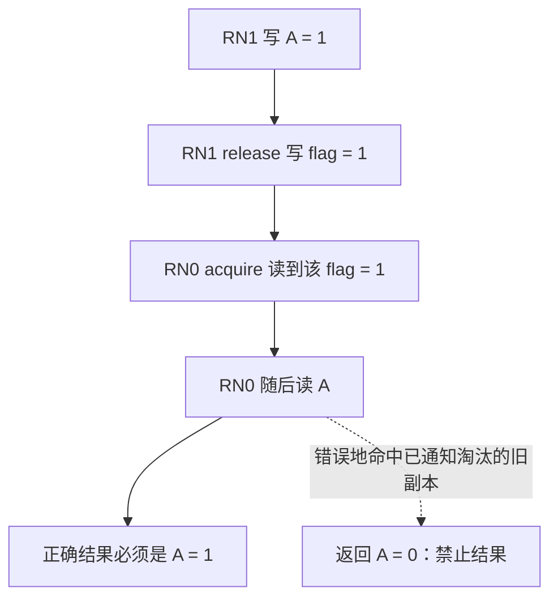

# CHI-EVICT INITIAL STATE只能是I

## 问题

Evict 的 initial state 要求为 I。如果 RN 以 SC 状态发送 Evict，等收到 Comp 后才变成 I，会有什么实际问题？

仅举“其他 RN 已经写入新值，本 RN 随后读到旧值”的时间线还不够严谨：必须说明这个读为什么不能被解释为排在那个写之前。本例通过 release/acquire 同步建立明确的观察顺序。

## 核心结论

**发送 Evict 前，原副本必须已经在协议上失效。收到 Comp 后，可以回收 Evict 事务资源；不能等到此时才撤销旧副本的有效性。**

Evict 表达的是“本 RN 已经不再缓存这条 Clean 行”，不是请求 HN 批准以后再丢弃。规范要求 UC、UCE 或 SC 在发送 Evict 前转为 I，所以初始状态表只列 I。[[CHI-Source-IHI0050H#原文 L8521|B4.2.2.4：发送请求时的初始状态]] [[CHI-Source-IHI0050H#原文 L10921|B4.7.2：发送前转 I]]

但要区分两种“保持 SC”：

| 实际实现行为 | 协议含义与结果 |
| --- | --- |
| 旧行仍有效，后续 CPU Load 可以命中，并且继续按 SC 参与 snoop | 不满足 Evict 的要求，可能产生下面的数据错误 |
| 数据 SRAM 或某些内部状态位仍保留，但旧副本已被屏蔽，不能命中，对 snoop 按 I 处理 | 数据比特残留可以存在；对外协议含义已经是 I，而不是有效 SC |

## 反例的前提

本例只讨论以下条件：

- A 与 flag 是同一一致性域中的正常、可共享、一致性内存，位于不同缓存行。
- 初始 A=0、flag=0；没有其他写者。
- RN0 起初持有 A=0、SC 的缓存行。
- RN0 发出 Evict(A) 后，错误地继续允许这份旧副本命中，计划等 Comp 到达才失效。
- HN 采用 Evict 提示，删除 RN0 对 A 的持有者记录。这是反例选择的一条合法处理路径，不是说 HN 必须更新目录。
- RN0 可以继续处理其他地址的访问；Evict(A) 的 Comp 尚未到达时，flag 的读数据可以先到达。

Evict 是 hint；HN 也可以不更新 Snoop Filter/Directory 就返回 Comp。要证明“保留有效 SC”不能作为通用实现，只需给出一条合法的 HN 处理路径会触发错误即可。[[CHI-Source-IHI0050H#原文 L12361|B5.2.4]]

## 用 release/acquire 建立必须遵守的先后关系

两个核执行如下语义伪代码：

```text
RN1 对应的核：                       RN0 对应的核：

store A = 1                         r1 = load_acquire(flag)
store_release flag = 1              if r1 == 1:
                                        r2 = load(A)
```

在 AArch64 中，可以分别用普通 STR、STLR、LDAR、普通 LDR 表达这些访问。这里不是完整的可运行汇编程序。

当 RN0 的 acquire 读确实读到 RN1 的 release 写所发布的 flag=1 时，后面的 A 必须读到 1，不能读到 0。也就是：

```text
允许的结果：r1 = 1，r2 = 1
禁止的结果：r1 = 1，r2 = 0
```

这里的约束来自 release/acquire 建立的消息传递顺序，不能仅凭墙钟时间，也不能仅凭 CHI 的多副本原子性推导跨地址顺序。[Arm 官方消息传递与 release/acquire 示例，第 2.5 节](https://developer.arm.com/community/arm-community-blogs/b/architectures-and-processors-blog/posts/generate-litmus-tests-automatically-diy7-tool)



## 七步时间线

| 步骤 | RN0、HN 与 RN1 的行为 | 关键含义 |
| --- | --- | --- |
| ① | RN0 发出 Evict(A)，但仍让 A=0 的旧 SC 行有效 | 错误实现已经通知淘汰，却保留可用副本 |
| ② | HN 删除 RN0 的目录记录，发出 Comp_I；该 Comp 尚未到达 RN0 | HN 不再把 RN0 当作 A 的持有者；“已发送”不等于“已收到” |
| ③ | RN1 完成取得 A 的 Unique 权限的流程，并写入 A=1 | HN 已没有 RN0 的持有记录，因此不需要再向 RN0 发出针对这份旧副本的失效 snoop |
| ④ | RN1 执行 release 写 flag=1 | 发布先前对 A 的写入 |
| ⑤ | RN0 通过 acquire 读到 RN1 发布的 flag=1 | 建立了后续读 A 必须遵守的观察顺序 |
| ⑥ | RN0 随后读 A，错误地命中仍有效的旧 SC 行，返回 0 | 得到被禁止的 r1=1、r2=0，构成实际功能错误 |
| ⑦ | Evict(A) 的 Comp 才到达，RN0 将旧行失效 | 无法补救第⑥步已经返回的错误结果 |

**真正的数据错误在第⑥步。** 已经通过同步确认应当观察到 A=1，却仍然从已通知淘汰的旧副本中返回 A=0。此时不能再把 RN0 的读 A 排到 RN1 写 A 之前解释。

第⑤步先于 Evict Comp 到达是可能的：flag 属于另一条缓存行，其读数据可以从 DAT 通道返回，而 Evict 的 Comp 仍在 RSP 路径中延迟。这不要求所有实现都允许这个重叠；它说明标准没有提供一个可供 RN 依赖的“其他访问都会等到 Evict Comp 到达后才推进”的保证。

A=1 的最新数据可以仍保留在 RN1 的 UD 缓存行中，不必先写入 DDR。正确的 RN0 在失去旧副本后，后续读 A 应通过一致性流程取得新值；数据来源可以是 RN1，而不是旧的 DDR 内容。

## 为什么 Comp 的到达不能作为开始失效的时点

Evict 没有 CompAck。HN 发送 Comp_I 并释放相应请求后，不需要再等待 RN0 确认“我已经收到 Comp，并把行失效了”。[[CHI-Source-IHI0050H#原文 L5761|B2.7.3：Evict 不使用 CompAck]] [[CHI-Source-IHI0050H#原文 L12361|B5.2.4：完成与请求资源释放]]

因此，RN 不能依赖以下假设：

```text
只要我的 Comp 还没收到，HN 就仍然替我保护这份 SC 副本。
```

HN 必须能够依据 Evict 的协议含义，认为发送者在请求发出前就已经放弃了这份有效副本。

正确的生命周期是：

```text
旧副本在协议上变为 I
        ↓
发送 Evict
        ↓
保留 Evict 事务上下文，等待 Comp
        ↓
收到 Comp，回收相应事务资源
```

## 如果 Evict pending 时锁住该行，会怎样

如果实现规定：

```text
Evict pending 期间：
    后续 Load 不能从这份旧副本命中取数；
    同地址 snoop 按 I 处理；
    可以保留旧数据比特及事务上下文。
```

那么第⑥步的错误命中路径不会发生。此时可以延迟物理条目回收，或保留内部暂态编码，但这份旧副本从协议角度已经不可用。

下面只是帮助理解的状态示意，不是完整 RTL：

```text
data_ram[A]       = 0     // 旧数据比特可以暂时存在
valid_for_lookup  = 0     // 不能再作为有效副本命中
snoop_state       = I     // 对外表示不持有
evict_pending     = 1     // 保留事务上下文，等待 Comp
```

不能把“内部字段仍写着 SC”与“协议上仍是一条有效 SC 副本”直接画等号。

## 同地址 snoop 提供了更直接的检查点

规范 B5.6.1 明确要求：**与 outstanding Evict 冲突的同地址 snoop，必须回复 SnpResp_I。**[[CHI-Source-IHI0050H#原文 L12841|B5.6.1]]

所以，即使 HN 忽略了 Evict 的目录更新提示，仍然向 RN0 发来 snoop，RN0 也不能因“Comp 尚未到达”而继续报告 SC，或按仍持有旧副本的方式响应。

RN 也不能把等待 Evict 的 Comp 作为处理这个 snoop 的前置依赖。RN-F 的 snoop 处理不得任意依赖未完成请求的完成；Evict 场景已有明确的 I 响应规则。[[CHI-Source-IHI0050H#原文 L11761|B4.11.1]]

**允许延迟的是物理资源回收，不是旧副本在一致性协议中的失效。**

## 相关笔记与原文依据

- [[CHI-Hazard处理]]：同地址请求与 snoop 的竞争处理。
- [[CHI-Comp与CompAck]]：完成响应与完成确认的作用。
- [[CHI-COPYBACK WRITE]]：CopyBack 等待响应期间的状态变化，不能直接套用于 Evict。
- [[CHI-IMMEDIATE WRITE]]：写观察顺序及“完成响应不等于 DDR 已更新”的相关讨论。

| 依据 | 核查内容 | 原文入口 |
| --- | --- | --- |
| B4.2.2.4，表 B4.11 | Evict 发送时的 Requester 初始状态只允许 I | [[CHI-Source-IHI0050H#原文 L8521]] |
| B4.7.2 | UC、UCE、SC 必须在发送 Evict 前转 I | [[CHI-Source-IHI0050H#原文 L10921]] |
| B5.2.4，图 B5.14 | Evict 是 hint；先失效、再发送；Comp 完成请求并释放资源 | [[CHI-Source-IHI0050H#原文 L12361]] |
| B2.7.3 | Evict 不包含 CompAck | [[CHI-Source-IHI0050H#原文 L5761]] |
| B5.6.1 | outstanding Evict 遭遇同地址 snoop，必须回复 SnpResp_I | [[CHI-Source-IHI0050H#原文 L12841]] |
| B4.11.1 | RN-F snoop 响应不得任意依赖 outstanding 请求完成 | [[CHI-Source-IHI0050H#原文 L11761]] |
| Arm 官方消息传递示例，第 2.5 节 | release/acquire 约束先前写与后续读的观察顺序 | [How to generate litmus tests automatically with the diy7 tool](https://developer.arm.com/community/arm-community-blogs/b/architectures-and-processors-blog/posts/generate-litmus-tests-automatically-diy7-tool) |

协议规则依据 Issue H；七步时间线是用于说明失效时机的构造反例。跨地址的同步约束来自 release/acquire，不应仅凭时间先后或 CHI 多副本原子性替代。
