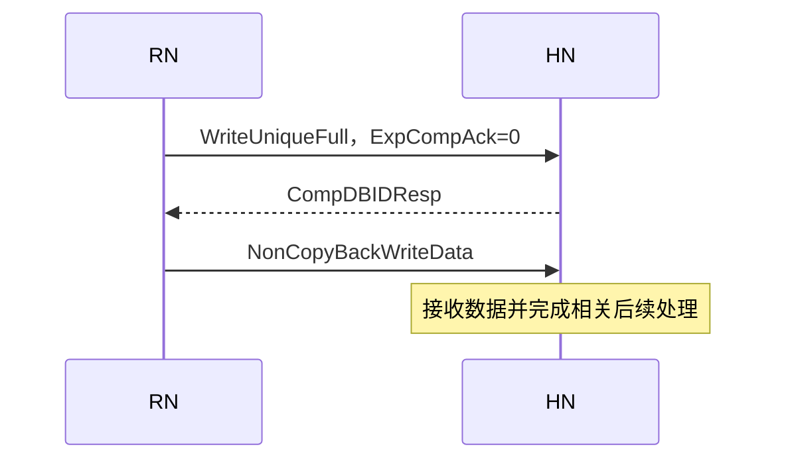
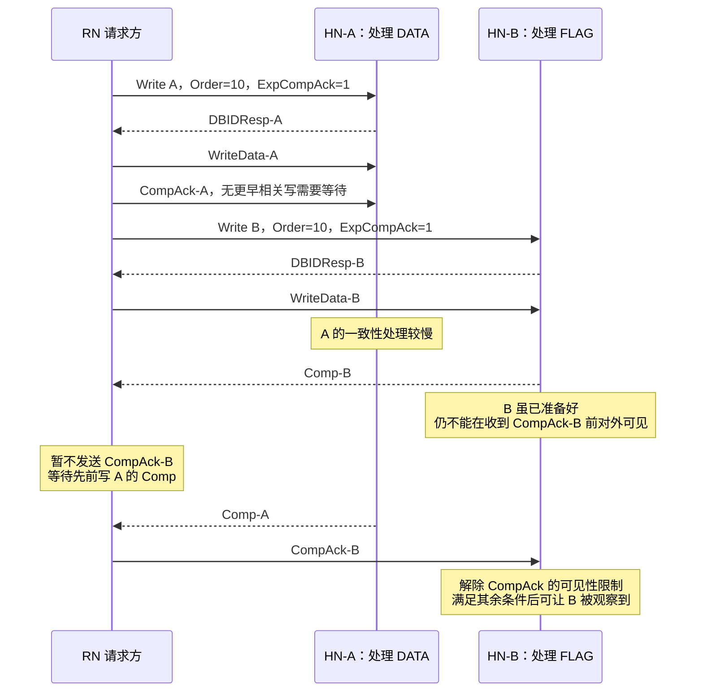
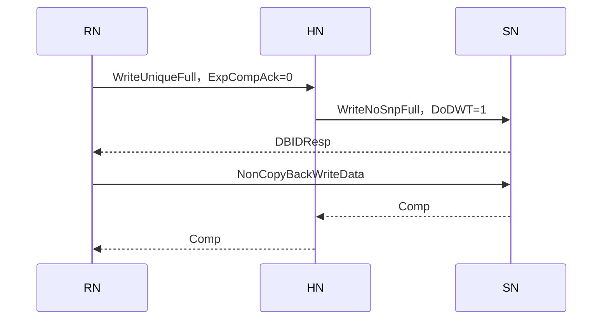

# CHI-IMMEDIATE WRITE

## 问题

Immediate Write 的三条路径分别用于什么场景？

- No DWT，without CompAck。
- No DWT，with CompAck。
- DWT，为什么不能同时使用 CompAck？

重点是理解：**数据经过哪个节点，与写何时可以被其他观察者看到，是两个不同的问题；协议规定了它们可以怎样组合。**

## 核心结论

Immediate Write 又称 Non-CopyBack Write：Requester 不需要先取得数据的一致性所有权，就可以发起写入；事务本身仍可能需要由 HN 发出 snoop 完成一致性处理。它与 [[CHI-COPYBACK WRITE]] 的缓存行写回流程不同。[[CHI-Source-IHI0050H#原文 L8641|B4.2.3.1]]

**Immediate Write 中的 CompAck 用于 OWO（Ordered Write Observation，有序写观察）：控制当前写何时可以对其他观察者可见，保证后面的相关写不能先于前面的写被观察到。**

| 流程 | RN 原始请求的 ExpCompAck | 数据路径 | 使用场景 |
| --- | --- | --- | --- |
| No DWT，without CompAck | 0 | RN → HN；需要时再由 HN → SN | 不使用 OWO 流水机制的写，HN 选择普通数据路径 |
| No DWT，with CompAck | 1 | RN → HN；需要时再由 HN → SN | 使用 OWO，允许多笔写并行处理，同时约束对外观察顺序 |
| DWT | 0 | RN → SN | 不使用 OWO，HN 选择让数据直接送到 SN |

规范明确规定：**Immediate Write 只有在原始请求不使用 OWO 时，才允许采用 DWT。** 写事务使用 CompAck 的相关用途则是 OWO。因此，标准流程中不存在“DWT + OWO CompAck”这一组合。[[CHI-Source-IHI0050H#原文 L8641|B4.2.3.1]] [[CHI-Source-IHI0050H#原文 L5761|B2.7.3]]

两个字段由不同节点设置：

- `ExpCompAck`：由 RN 在原始请求中设置，说明该事务是否包含 CompAck。
- `DoDWT`：由 HN 在发往 SN 的适用写请求中设置，决定 SN 是否把 DBIDResp 直接发给原始 Requester。

`ExpCompAck=0` 不要求 HN 一定使用 DWT；HN 仍可选择 No DWT。`ExpCompAck=1` 的 OWO 写则不能使用 DWT。[[CHI-Source-IHI0050H#原文 L2521|B2.3.2.1]] [[CHI-Source-IHI0050H#原文 L19321|B13.10.24]]

> [!note] 适用范围
> 下文用成功的 `WriteUniqueFull`、`WriteNoSnpFull` 举例。不能给所有 Immediate Write 操作码任意设置 `ExpCompAck=1`；具体属性组合以请求属性表为准。`WriteNoSnpZero` 和 `WriteUniqueZero` 不传输数据，也不允许采用 DWT。TagMatch、取消写等附加义务需结合对应规则处理。

## No DWT without CompAck

### 基本流程

例如 RN 发出一笔不使用 OWO 的 `WriteUniqueFull`，HN 选择合并响应：



- `CompDBIDResp` 同时提供完成响应和发送写数据所需的 DBID。
- RN 根据 DBID 把数据送到 HN。
- 这个事务没有额外的 CompAck 义务。
- HN 如果还要向 SN 发起普通下游写，该下游写是独立的 HN 发起事务；图中省略。[[CHI-Source-IHI0050H#原文 L2401|B2.3.2.1：独立下游事务]] [[CHI-Source-IHI0050H#原文 L2521|B2.3.2.1：No DWT no CompAck]]

HN 也可以分别发送 `DBIDResp` 和 `Comp`。因此，不能把“HN 收到 WriteData”普遍解释为“RN 已收到 Comp”：RN 可能只收到 DBIDResp 就发数据。

### 为什么不需要 CompAck

这条写没有使用“由 RN 通过 CompAck 控制写可见时机”的机制。HN 仍然要满足完成响应、数据接收、一致性与地址冲突的相关规则，但协议没有要求它额外等待 RN 的 CompAck。

不能把读事务中“收到完成响应后再发 CompAck”的认识直接套到每一种写事务上。是否需要 CompAck，要按事务类型及 `ExpCompAck` 的适用规则判断。[[CHI-Source-IHI0050H#原文 L5761|B2.7.3]]

### 不带 CompAck 不等于没有顺序约束

No CompAck 的写仍可能使用 Request Order 或 Endpoint Order。对 RN → HN 的适用请求：

| Order 与 ExpCompAck | 对应含义 |
| --- | --- |
| Order=0b00，ExpCompAck=0 | 不请求该 Order 机制提供额外顺序保证 |
| Order=0b10，ExpCompAck=0 | Request Order |
| Order=0b10，ExpCompAck=1 | OWO |
| Order=0b11，ExpCompAck=0 | 对允许此组合的请求使用 Endpoint Order |

这些编码不是任意 Opcode 都能使用。例如，WriteUnique 的属性限制与 WriteNoSnp 不完全相同。[[CHI-Source-IHI0050H#原文 L5881|B2.7.5：Order 编码与适用条件]] [[CHI-Source-IHI0050H#原文 L8761|B4.2.3：请求属性表]]

如果 RN 要保证写 A、写 B 的观察顺序，也可以采用保守做法：

```text
发出写 A → 收到 Comp-A → 再发写 B
```

这样不需要用 CompAck 控制流水中的后续写，但 A、B 的重叠程度较低。Streaming Ordered Writes 正是为了提高这种有序写流的并行度。[[CHI-Source-IHI0050H#原文 L6001|B2.7.5.3]]

## No DWT with CompAck

### 解决的问题：并行处理，按序被观察

假设 RN 有两笔属于同一有序写流的写：

```text
写 A：DATA = 123
写 B：FLAG = 1

要求：写 B 不能先于写 A 对其他观察者可见。
```

这是生产者发布数据、再发布标志的例子。这里关注写的观察顺序；消费者自身的读顺序仍要由对应的体系结构机制保证。

如果必须等 A 完成才发 B，顺序容易维持，但吞吐量较低。Streaming Ordered Writes 允许提前发送 B，让两笔写的资源分配、数据传输和一致性处理重叠：

```text
A：需要等待一个较慢的 snoop 响应。
B：snoop 很快完成。

B 的内部处理可能比 A 更早准备好。
```

要防止这种处理速度差异变成对外观察顺序的颠倒，RN 对这类请求设置：

```systemverilog
Order      = 2'b10;
ExpCompAck = 1'b1;
```

此时，Completer 是 PoS（Point of Serialization，串行化点）。HN 即使已经收到 B 的数据、完成了 B 的一致性处理，**在收到 CompAck-B 前，也不能使 B 对其他观察者可见。**[[CHI-Source-IHI0050H#原文 L5881|B2.7.5.1：OWO 要求]] [[CHI-Source-IHI0050H#原文 L6001|B2.7.5.3：Streaming Ordered Writes]]

### 跨 HN 示例

下面让 A、B 分别位于 HN-A 和 HN-B；位于同一 HN 时也适用。A 是该示例中第一笔相关有序写，没有更早的写需要等待。



这里有两个不同的进度：

| 事件 | 表达什么 |
| --- | --- |
| HN 已发送 Comp-B | B 已满足相应完成响应的条件 |
| HN 收到 CompAck-B | RN 已满足有序写流对 B 的放行条件，HN 可以解除 CompAck 对可见性的限制 |

**不能看到 Comp-B，就认为 OWO 写 B 可以绕过 CompAck 对外可见。** 规范图 B2.39 本身就允许 Comp-B 先于 Comp-A 返回，但 RN 要推迟 CompAck-B。上图把相同机制用于两个 HN，以突出 RN 对相关写流的协调作用。[[CHI-Source-IHI0050H#原文 L6121|B2.7.5.3 与图 B2.39]]

## CompAck 可以早于当前写的 Comp

### 分清当前写与先前相关写

对于写 B，发送 CompAck-B 要满足两组条件：

| 对象 | 所需进度 |
| --- | --- |
| 当前写 B | 已收到允许触发确认的响应，例如 DBIDResp-B、DBIDRespOrd-B、CompDBIDResp-B 或 Comp-B |
| 所有先前相关有序写 | 已收到它们的 Comp 或 CompDBIDResp |

因此，以下顺序允许出现：

```text
收到 DBIDResp-B
收到先前相关写 A 的 Comp-A
发送 CompAck-B
之后才收到 Comp-B
```

**无需先收到 B 自己的 Comp-B，才能发送 CompAck-B。** RN 已收到当前写的 DBID 响应，且满足发送 CompAck 的其他条件时，不能再把“等待当前写的 Comp”作为发送 CompAck 的前置依赖。[[CHI-Source-IHI0050H#原文 L2521|B2.3.2.1：CompAck 的发送条件]] [[CHI-Source-IHI0050H#原文 L6001|B2.7.5.3：先前相关写与当前写的等待规则]]

这一约束也避免了在某个完成路径需要等待确认时形成循环依赖：

```text
RN：等 Comp-B 才发 CompAck-B。
HN：等 CompAck-B 才能继续推进 B。
```

应当区分：

- **等待先前相关写的 Comp**：用于维持 OWO。
- **在其他条件已就绪后，强制等待当前写的 Comp 才发 CompAck**：不允许这样建立依赖。

### 数据与 CompAck 可以分开，也可以合并

RN 可以分别发送：

```text
NonCopyBackWriteData
CompAck
```

也可以发送合并消息：

```text
NonCopyBackWriteDataCompAck
```

例如，B 的数据已经准备好，但 CompAck-B 还要等待 Comp-A，那么 RN 可以先把普通 WriteData-B 发送给 HN，之后再单独发送 CompAck-B。

若采用合并消息，仍必须满足 CompAck 的相关前序写条件；不能因为数据已准备好，就提前放行 B。规范还要求：同一事务选择合并 WriteData 与 CompAck 时，该事务的所有 WriteData 传输都使用合并形式。[[CHI-Source-IHI0050H#原文 L6001|B2.7.5.3]]

## DWT 为什么不能同时使用 CompAck

### DWT 改变了数据路径

DWT 是 Direct Write-data Transfer。下面是一种合法顺序；图中各响应的先后并非全部都是强制依赖。



两条数据路径的区别是：

```text
No DWT：RN → HN，HN 接收数据并管理后续处理。
DWT：   RN → SN，数据绕过 HN 的数据接收路径。
```

在 DWT 中，SN 的 DBIDResp 为 RN 指定 SN 侧的数据接收资源；RN 必须先收到 DBIDResp，才能发送相应写数据或 WriteDataCancel。[[CHI-Source-IHI0050H#原文 L2521|B2.3.2.1：DWT]]

### 规范明确禁止的组合

三条规则共同决定合法性：

1. WriteUnique、WriteNoSnp 及其适用 Combined Write 变体使用 CompAck 的相关用途是 OWO。
2. OWO 要求 ExpCompAck=1，并且收到 CompAck 前不得让写对其他观察者可见。
3. Immediate Write 只有在原 RN 请求不使用 OWO 时才允许采用 DWT。

因此，**标准 Immediate Write 流程没有 DWT + OWO CompAck 这一组合。**[[CHI-Source-IHI0050H#原文 L5761|B2.7.3]] [[CHI-Source-IHI0050H#原文 L5881|B2.7.5.1]] [[CHI-Source-IHI0050H#原文 L8641|B4.2.3.1]]

### 机制解释：标准 DWT 没有配套的 OWO 放行流程

> [!note] 架构理解
> 以下是对上述规则和消息路径的解释，不是规范给出的唯一设计动机。不能由此推导出“数据直达 SN，在硬件上就绝不可能实现有序写”。

OWO 要维持的承诺是：**RN 尚未放行时，当前写即使已经准备好，也不能被其他观察者看到。**

No DWT 的 OWO 流程把这个控制点设在 HN：数据送给 HN，CompAck 也送给 HN，HN 负责遵守可见性限制。

DWT 中，数据直接送到 SN。标准 DWT 没有定义一套把 RN 的 OWO 放行条件传播到 SN、让 SN 据此控制写可见性的配套流程。规范还明确规定：

- SN 不要求支持 CompAck。
- HN 作为 Requester 向 SN 发事务时，不得发送 CompAck。[[CHI-Source-IHI0050H#原文 L5761|B2.7.3：SN 与 CompAck]]

所以，单纯增加一条消息：

```text
RN → HN：CompAck-B
```

并不会自动建立以下保证：

```text
SN 必须等这条 CompAck-B 才能让 B 被其他观察者看到。
```

例如 A 尚未完成，B 的数据通过 DWT 很快送到 SN。如果强行将其当作 OWO，而 SN 没有配套的放行约束，仅让 HN 等待 RN 的 CompAck，并不能按标准 DWT 流程获得所需的观察顺序保证。

若另行设计发布门控、反馈或其他排序机制，需要另外定义和验证其行为；不能把这些额外机制当作标准 DWT 已提供的保证。

## SN 的 Comp 不能代替 RN 的 CompAck

| 消息 | 发送者 | 作用 |
| --- | --- | --- |
| SN → HN：Comp | 下游 SN | 对下游写事务提供完成响应及相应排序保证 |
| RN → HN：CompAck | 原始 RN | 在 OWO 中结合先前相关写的进度，控制当前写的放行 |

SN 并不知道 RN 的所有先前相关写是否已经完成，尤其当这些写发往不同 HN、不同 SN 时。**SN 的 Comp 不能承担 RN 的有序写流放行职责。**这一区别来自两种响应各自的作用域。[[CHI-Source-IHI0050H#原文 L2521|B2.3.2.1]] [[CHI-Source-IHI0050H#原文 L6001|B2.7.5.3]]

### DWT 的响应不构成固定的逐级等待链

不能这样解释 DWT：

```text
错误推断：SN 必须收到全部写数据后才发 Comp，
          HN 必须等 SN Comp 后才能向 RN 发 Comp，
          所以这条链已经证明数据写进 DDR，无需 CompAck。
```

规范 B2.3.2.1 明确允许：

- SN 可以等待 WriteData 或 WriteDataCancel 后向 HN 返回 Comp，但不要求等待。
- HN 可以等待 SN 的 Comp 后向 RN 返回 Comp，但不要求等待。

这些提前响应仍须满足适用的完成、排序及 EWA 等内存属性要求，不能任意提前返回；它们也不表示数据已经实际写入 DDR。[[CHI-Source-IHI0050H#原文 L2521|B2.3.2.1]] [[CHI-Source-IHI0050H#原文 L6121|B2.8.3.1：EWA]]

**DWT 不与 OWO/CompAck 组合的依据，是协议的组合限制及可见性控制机制，而不是“SN Comp 已经证明 DDR 写完”。**

## 对 HN 与 SN VIP 冲突管理的关联

对于 WriteUnique，HN 发出 completion 后，若要再向同一缓存行发送 snoop，相关等待条件随路径不同而变化：

| WriteUnique 路径 | 发出 completion 后，后续同地址 snoop 的相关等待条件 |
| --- | --- |
| No DWT，without CompAck | 收到相应 WriteData |
| No DWT，with CompAck | 收到相应 WriteData，以及 CompAck |
| DWT | 收到 SN 的 Comp |

这是 B4.11.2 给出的 HN hazard 约束，不是完整的事务资源释放或内存提交条件；还须满足其他适用依赖。特别是 DWT 的 SN Comp 可能早于数据，因此不能把最后一行改写成“确认数据已经写入 DDR”。[[CHI-Source-IHI0050H#原文 L11881|B4.11.2]]

## 相关笔记与原文依据

- [[CHI-Comp与CompAck]]：完成响应、完成确认与后续 snoop 的关系。
- [[CHI-CompAck在OWO中的使用]]：生产者消费者模型与 OWO 的早期个人推理；该页原有内容标记为未核对，具体协议条件按本文所引规范核查。
- [[CHI-COPYBACK WRITE]]：CopyBack 的有数据与无数据完成路径，其 CompAck 规则与 Immediate Write 不同。
- [[CHI-Hazard处理]]：同地址并发与 HN 的响应限制。
- [[CHI-事务与数据路径-MOC]]、[[CHI-顺序与完成-MOC]]：主题导航。

| 规范位置 | 主要依据 | 原文入口 |
| --- | --- | --- |
| B2.3.2.1，图 B2.3 | Immediate Write 三类流程、CompAck 发送条件、DWT 响应时序 | [[CHI-Source-IHI0050H#原文 L2401]]、[[CHI-Source-IHI0050H#原文 L2521]] |
| B2.7.2 | Comp 与完成、观察顺序的关系 | [[CHI-Source-IHI0050H#原文 L5641]] |
| B2.7.3 | 写使用 CompAck 的范围，SN 不要求支持 CompAck | [[CHI-Source-IHI0050H#原文 L5761]] |
| B2.7.5.1 | Order、OWO，以及 CompAck 前的可见性限制 | [[CHI-Source-IHI0050H#原文 L5881]] |
| B2.7.5.3，图 B2.39 | Streaming Ordered Writes，当前写与先前相关写的等待规则 | [[CHI-Source-IHI0050H#原文 L6001]]、[[CHI-Source-IHI0050H#原文 L6121]] |
| B2.8.3.1 | EWA 与写完成响应来源 | [[CHI-Source-IHI0050H#原文 L6121]] |
| B4.2.3.1 | Immediate Write 定义，DWT 仅适用于非 OWO 请求 | [[CHI-Source-IHI0050H#原文 L8641]] |
| B4.11.2 | WriteUnique 后续同地址 snoop 的路径相关等待条件 | [[CHI-Source-IHI0050H#原文 L11881]] |
| B13.10.24 | DoDWT 的适用请求和 DBIDResp 路由 | [[CHI-Source-IHI0050H#原文 L19321]] |

依据 Issue H；规范规则与机制解释已分别标明。
