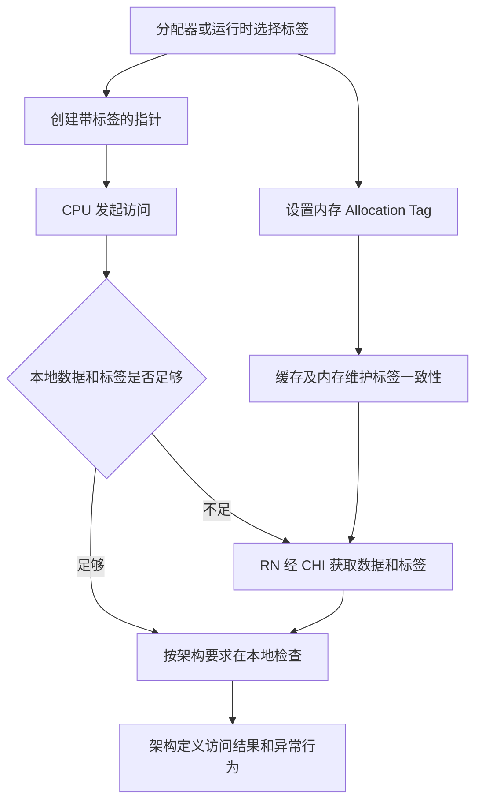
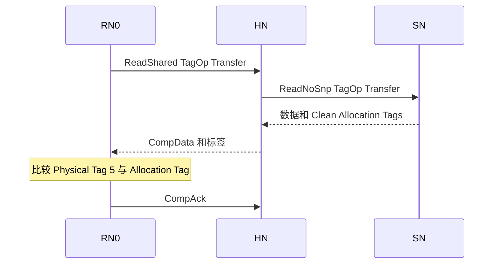
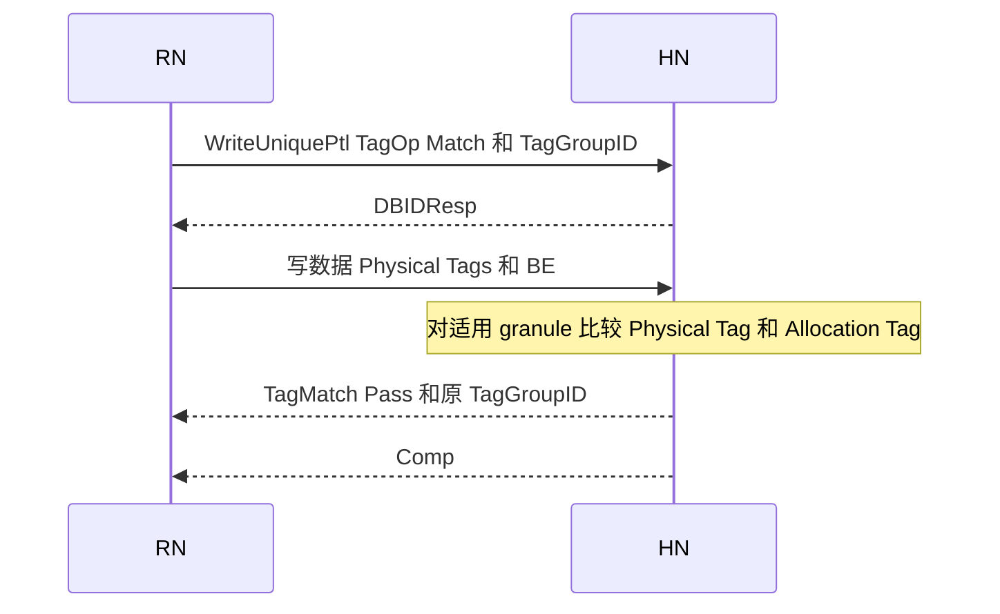
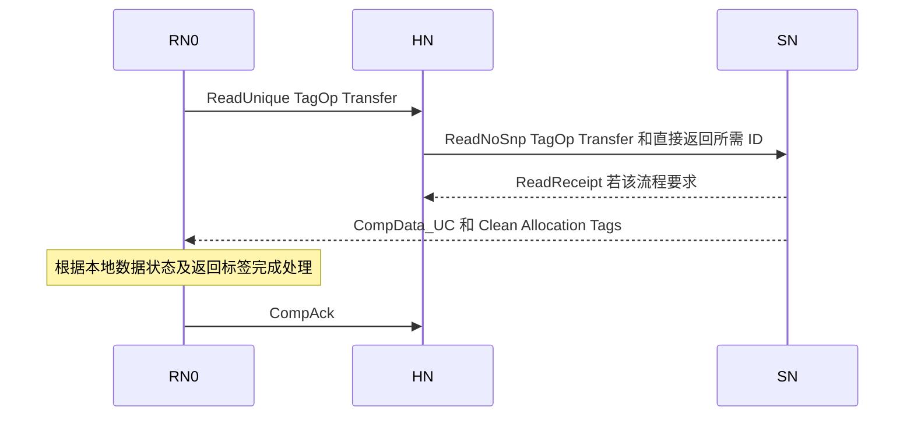
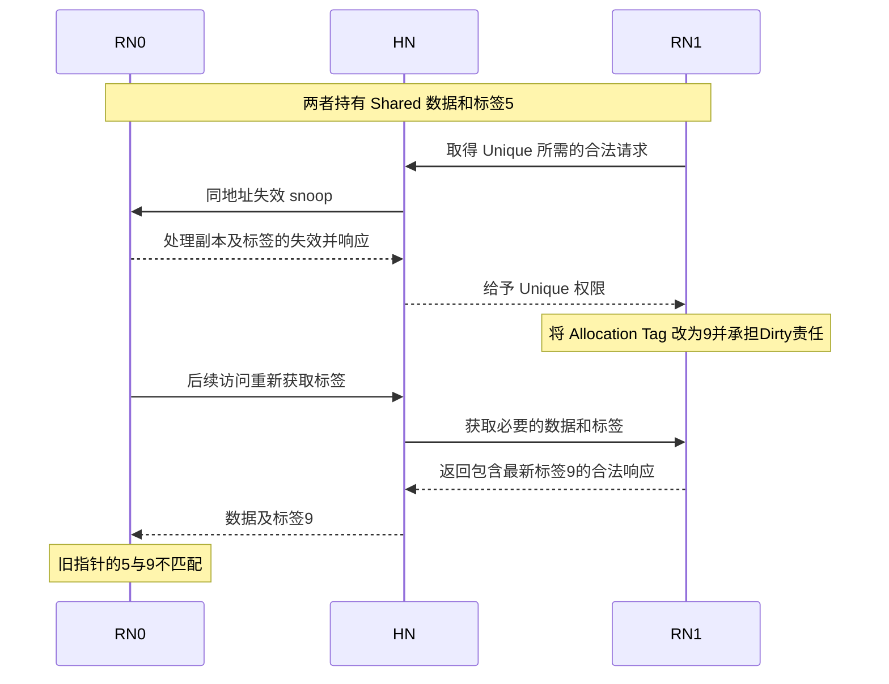

# CHI 与 MTE 协同机制学习指南

MTE 用标签帮助发现内存使用错误；CHI 负责让参与缓存和内存访问的节点正确传递、缓存、更新这些标签。两者交汇的核心是：**Allocation Tag 是与内存关联、需要维护一致性的元数据，不是一次请求上可以随意丢弃的附加标记。**

读完本文，应能回答：指针里的标签由谁产生；缓存已有数据为什么还要发读请求；为什么标签会影响 ReadUnique、snoop 和写回；哪些检查由 RN 做，哪些由 HN/SN 做；怎样从波形判断标签被取回、更新或检查。

正文以 **Arm IHI0050 Issue H** 为协议依据，覆盖 B12 全章，并补充字段和接口能力规则。MTE 作为处理器架构特性，并不以 CHI 为唯一实现方式；这里研究的是它在 CHI 系统中的实现接口。Linux 配置、架构可见异常与 CHI 报文语义分层说明，不能直接相互替代。

> **阅读约定**：标有“例”的地址、值和拓扑均为教学构造；报文顺序展示一种合法理解方式，不是唯一实现。图中省略与当前问题无关的 DBID、Retry、CompAck 和数据分包。硬件内部标签存储布局、流水级、指令到 CHI 的一一映射，未由规范确定的地方均注明“实现相关”或“待确认”。文末脚注提供章节及原文位置。

## 阅读路线

- 建立整体模型：第 1 至 3 节。
- 看懂 CHI 波形：第 4 至 8 节。
- 理解 CMO、Atomic、Stash 和接口能力：第 9 至 11 节。
- 串起完整场景：第 12 节。
- 用于设计和验证：第 13 至 15 节。
- 按章节回查原文：第 16 节。

先备知识可查 [[CHI-Cache状态模型]]、[[CHI-所有权与Dirty责任]]、[[CHI-通道与方向]]。已有简明入口为 [[CHI-MTE与Tag一致性]]，本文集中提供系统学习和案例，不再拆出重复概念笔记。

## 1 从一次内存访问看两者如何分工

### 1.1 三种标签叫法

| 名称 | 位于哪里 | 表达什么 | 由谁维护 |
| --- | --- | --- | --- |
| Logical Tag | AArch64 指针的标签位 | 这次访问期望匹配的标签 | 软件生成并保留，硬件使用 |
| Physical Address Tag 或 Physical Tag | CHI 对访问期望标签的称呼；需要时随写数据等传送 | 本次访问拿来比较的值 | Requester 提供 |
| Allocation Tag | 与内存的 16-byte granule 关联，可被缓存 | 这块内存当前的标签 | 软件通过架构机制设置，内存系统维护一致性 |

Logical Tag 与 CHI 的 Physical Tag 在这里是不同层面对“访问携带的期望标签”的表述，不应理解成还要另随机生成一个新标签。**Physical Tag 也不是 cache tag RAM 中用于匹配物理地址的地址标记。**[^C1][^S1]

同一个 DAT 的 `Tag` 字段，可能承载 Allocation Tags，也可能承载用于 Match 的 Physical Tags，必须结合消息类型和 `TagOp` 判断。[^C2][^C16]

### 1.2 哪一层做什么



这个图中的“本地”是机制边界，不指定比较器位于 L1、L2 还是哪个流水级。CHI 把读返回标签的检查责任交给 Requester，把 `TagOp=Match` 的写检查责任交给 Completer；具体处理器怎样把这些结果变成异常，由架构与实现决定。[^C1]

### 例 1 地址 0x1000 的标签 5 从哪里来

假设运行时分配一块 16-byte 内存，选择标签 `5`，完成两件相互配套的事：

```text
给程序的指针：地址部分 0x1000，Logical Tag=5
内存的元数据：AllocationTag[0x1000..0x100F]=5
```

在一个简化的低地址 AArch64 示例中，带标签的指针可写成 `0x0500000000001000`，标签位为 `[59:56]`。这里不讨论其他高位功能及具体虚拟地址配置。

程序之后保留或传递的是这个带标签指针。**硬件不会每次看到裸地址 0x1000，就自动把正确的 5 补进普通指针。** 否则悬空指针每次都能获得最新标签，检查便失去意义。标签的产生、保存和传递属于软件使用约定。[^S1][^S2]

### 例 2 同一地址重新分配后为什么能发现旧指针

```text
第一次分配：A 的标签=5，旧指针 p 的标签=5
释放及重新分配：A 的标签改为9，新指针 q 的标签=9
旧指针 p 仍然携带5
```

使用 `p` 访问时，比较为 `5 != 9`。如果软件反而先读取当前 Allocation Tag，再把所有旧指针都改成 `9`，就破坏了原来的检测目的。MTE 的 4-bit 标签空间有限，检测能力还取决于软件选择标签的策略，不能把它当成绝对的内存访问权限系统。[^S2]

## 2 标签粒度与软件侧基础

### 2.1 每 16 字节一个标签

每个对齐的 16-byte 数据区域对应一个 4-bit Allocation Tag。以 64-byte cache line 为例：[^C1]

| 数据范围 | Allocation Tag |
| --- | --- |
| 0x1000–0x100F | T0 |
| 0x1010–0x101F | T1 |
| 0x1020–0x102F | T2 |
| 0x1030–0x103F | T3 |

**一个 64-byte line 有四个标签，不是整条 line 只能有一个标签。** CHI 在这些标签之上维护与数据协调的一致性状态。

### 例 3 越界是否一定被发现

假设相邻两个 granule 的标签分别为 `5`、`9`。带标签 `5` 的指针从第一块越界进入第二块，可能因 `5 != 9` 被检测。

但如果错误访问仍在同一个 16-byte granule 内，或者跨到的 granule 恰好也使用标签 `5`，单凭这次标签比较不能区分它是否越界。这里说明的是粒度和有限标签空间的限制，不给出适用于所有分配器的固定检测概率。[^C1][^S2]

### 2.2 生成指针标签与设置内存标签是不同动作

| 软件动作 | 代表机制 | 容易混淆的地方 |
| --- | --- | --- |
| 产生带标签指针 | `IRG`，或 ACLE 的随机标签 intrinsic | 改变指针不等于设置内存标签 |
| 设置一个 granule 的 Allocation Tag | `STG` | 不等于把标签写进普通数据字节 |
| 设置标签并清零数据 | `STZG` | 同时改变标签和数据 |
| 显式取回 Allocation Tag | ACLE 的 `__arm_mte_get_tag` | 是显式获取动作，不是普通解引用自动修复指针 |

下面仅为操作顺序示意，不是可直接运行的初始化程序：

```text
确认 CPU、OS、映射和检查模式允许使用 MTE
选择标签，建立带标签指针 p
设置 p 所指 granule 的 Allocation Tag
通过 p 执行需要检查的普通读写
```

Linux 下通常还涉及支持能力检测、`PROT_MTE` 映射和线程的标签检查配置；只设置指针高位并不足以启用检查。[^S1][^S2][^S3]

### 例 4 STG 为什么不一定立刻产生一笔 CHI 写

如果缓存已经拥有所需的数据、标签和权限，设置标签可以先在缓存中完成，之后在 snoop 或写回时才对外传送。若缺少权限或所需信息，则可能先发起相应事务。

因此，不能建立“执行一条 STG，外部必有一笔 WriteNoSnp”的固定对应。CHI 规定节点间的合法通信；指令如何拆分到 cache 操作，属于具体核的实现问题。标签的 Unique 约束及 Dirty 保存要求见第 3 节。[^C3][^C9]

### 2.3 必须区分架构检查与协议响应

Linux 的同步检查模式可以使失败访问不执行并同步报告；异步模式则延后报告。CHI B12 对已经发出的 `Match` 写或原子事务规定了独立的处理和回报机制，不能据此推出所有 MTE 故障都会在总线上取消访问。[^S1][^C14]

特别是：**CPU 可以在架构层阻止一个错误访问成为正常结果，而已发出的 CHI 事务仍有必须完成的协议流程。** 第 6 节会用写事务说明这个边界。

## 3 数据状态与标签状态必须一起看

### 3.1 两套状态信息及其约束

数据的常见状态是 `I/SC/SD/UC/UD/UDP/UCE`。标签自身使用 `Invalid/Clean/Dirty`，Unique 或 Shared 属性随 cache line 的权限协调，不构成一套能任意组合的独立 MOESI。[^C3]

核心约束如下：

1. 标签有效要求数据也有效；数据有效时标签可以无效。
2. line 为 Unique 时，数据和标签都按 Unique 处理；line 为 Shared 时，两者都按 Shared 处理。
3. 驱逐带 Dirty 标签的 line 时，数据和标签都必须按 Dirty 处理；标签必须写回或由 Home 将 Dirty 责任传给其他缓存。
4. Clean 标签在允许的驱逐中可以传递，也可以静默丢弃。

下表摘取 B12.4.2 的读请求起始组合，用于理解状态关系；不是所有 opcode 的通用合法性表。[^C6]

| 已有数据状态 | 相关读请求中可见的标签状态 | 理解重点 |
| --- | --- | --- |
| I、UCE | Invalid | 没有可配套的有效数据副本 |
| UC、SC | Invalid 或 Clean | 数据有效不等于标签有效 |
| UD、SD | Invalid、Clean 或 Dirty | 数据或标签的最新责任不能丢失 |
| UDP | 在相关允许请求中为 Invalid | 不能按完整有效数据和标签处理 |

### 例 5 数据 hit 但标签 miss

```text
RN0：Data[A] 有效，状态 UC
RN0：AllocationTags[A] 无效
待执行访问：需要进行标签检查
```

普通 data hit 只能说明数据存在，不能据此判定 MTE 检查通过。RN0 还需要取得 Allocation Tags。标签到达后才能按架构要求完成检查。**这就是“数据已经在 cache 里，为什么还发读”的主要场景之一。**[^C5]

### 例 6 数据字节没有改过，为什么驱逐还可能要写回

假设 payload 仍与下层相同，但本地把某个 Allocation Tag 从 `5` 改为 `9`，下层仍保存 `5`。若驱逐时把整条 line 当成完全 Clean 而静默丢弃，最新的 `9` 就丢了。

所以，判断是否能 Clean eviction 时，不能只比较 payload 是否修改。**Dirty 标签本身也形成需要保存的责任。** 这里只讨论驱逐责任，不推断处理器内部一定用哪几个 dirty bit 编码。[^C3]

## 4 CHI 用哪些字段传递标签

### 4.1 字段所在通道

| 字段 | 所在位置 | 含义 |
| --- | --- | --- |
| Tag | DAT | 每个对应 16-byte 数据区域一组 4-bit 标签 |
| TU | DAT | Tag Update，每个标签一位，指示要更新的 Allocation Tags |
| TagOp | REQ、DAT，特定 RSP | 解释标签的操作意图或状态，宽度为 2 bit |
| TagGroupID | 需要 Match 的请求及 TagMatch 响应 | 关联标签检查结果的组标识，内容由实现定义 |

**SNP 通道没有 TagOp 字段。** 发起请求的标签需求不能简单原样塞进 snoop；HN 必须选择合法流程，Snoopee 根据状态和 snoop 规则返回必要标签。[^C2][^C15][^C16]

### 4.2 同一个编码在请求和响应中含义不同

| TagOp 编码 | 名称            | 常见使用语境                                               |
| -------- | ------------- | ---------------------------------------------------- |
| 00       | Invalid       | 标签无效或当前消息不进行相应标签操作；不等于 cache line 为 I                |
| 01       | Transfer      | 读请求要求返回标签；DAT 中表示传递 Clean Allocation Tags            |
| 10       | Update        | DAT 中表示 Dirty Allocation Tags，需要按 TU 更新；特定写请求也可声明此意图 |
| 11       | Fetch 或 Match | 读请求中为 Fetch；写或原子请求中为 Match                           |

先看 opcode 和通道，再解释 `TagOp`。**不能只看到 `11` 就说这是一次写标签比较，也不能把请求 Transfer 理解为返回标签必为 Clean。** 读请求 Transfer 的返回 DAT 可以为 Transfer，也可以为 Update，取决于标签的实际状态。[^C4][^C16]

### 例 7 ReadShared 的请求 Transfer 与响应 Update

```text
RN0 -> HN：ReadShared，TagOp=Transfer
HN 取得带 Dirty 标签的数据
HN -> RN0：合法的读数据响应，TagOp=Update，并携带相应 PassDirty
```

RN0 请求的是“把标签取回来”，不是“强制标签变 Clean”。返回 Update 表示 Dirty 标签责任随合法的数据响应移交；不能收了标签值却把责任当成 Clean。具体可返回的数据状态还须满足 ReadShared 的规则。[^C4]

### 4.3 Tag 与 TU 的宽度

对于宽度为 W bit 的 DAT 数据字段：

```text
Tag 宽度 = W / 32 bit
TU 宽度  = W / 128 bit
标签数量 = W / 128
```

| DAT 数据宽度 | 该数据字段覆盖字节数 | Tag 位数 | TU 位数 |
| --- | --- | --- | --- |
| 128 bit | 16 B | 4 | 1 |
| 256 bit | 32 B | 8 | 2 |
| 512 bit | 64 B | 16 | 4 |

这是字段容量关系，不代表每笔请求都使用所有 tag 位。消息大小、DataID、有效字节及具体打包方式仍需联合解释。[^C2][^C16]

### 例 8 256-bit DAT 如何携带四个标签

假设一次常规 64-byte line 传输分成两个 32-byte 数据包：

```text
包0：Data 覆盖 line 的前32 B，Tag 放 T0、T1
包1：Data 覆盖 line 的后32 B，Tag 放 T2、T3
```

每包两组 4-bit 标签，总计四组。实际波形要结合 DataID 等字段确认地址对应关系，不能仅凭到达先后认定哪个是前半条 line。标签并不挤占 payload 的两个普通字节。

### 例 9 TagOp 为 Invalid 是否表示标签值等于 0

不表示。`Invalid` 是操作或有效性语义；数值 `0` 仍可是一种有效的 Allocation Tag。并且不同消息对无效字段有不同约束：例如 TagOp Invalid 的写数据要求 Tag、TU 清零；某些读数据无效标签字段可为不适用值。**应按具体消息检查，不能给所有通道套一个“无效时随便填”规则。**[^C4][^C8]

## 5 读事务如何获取和保存标签

### 5.1 Transfer 与 Fetch 是两种不同承诺

| 比较项 | 读请求 Transfer | 读请求 Fetch |
| --- | --- | --- |
| 必须返回有效标签 | 在支持该操作和地址的正常情形下，是 | 在支持该操作和地址的正常情形下，是 |
| 对返回数据的要求 | 按读请求及本地已有状态规则解释和处理 | 数据可以无效，Requester 必须忽略，不能因匹配通过而使用 |
| 请求大小限制 | 按具体读 opcode | Size 必须为 64 B，返回整条 line 对应的标签 |
| 可用读 opcode | 多种 Read，包括 ReadShared 等 | 仅 ReadUnique、ReadNoSnp、ReadNoSnpSep |
| 适用场景 | 获取数据及标签，或已有数据时补取标签 | 满足规定条件时，只要求标签具有有效意义 |

这里的“Fetch 可以不提供有效数据”不意味着物理上没有 DAT 消息。协议仍通过数据响应格式带回标签，payload 不能被当成有效原数据使用。目标不支持 MTE 时的特殊响应见第 11 节。[^C4][^C15]

### 例 10 普通读 miss 并要求检查标签

初始条件：RN0 对 A 为 I，指针期望标签为 `5`，SN 保存的数据和标签有效，目标支持 MTE。



这个例子选择数据经 HN 转发的路径。若取回 Allocation Tag 为 `5`，比较相等；为 `9`，则产生标签不匹配结果。读数据和标签由内存还是其他 cache 提供，是 HN 要协调的事；**读检查由 Requester 承担，不应想象 HN 会替所有 ReadShared 请求完成指针标签比较。**[^C1][^C4]

### 例 11 UC 数据已存在但标签缺失

```text
RN0：A 为 UC，Data[A]=0x22，Tags[A]=Invalid
访问：要检查标签，但不保证覆盖整条 cache line
选择：ReadPreferUnique + Transfer
```

Issue G 起允许 `ReadPreferUnique + Transfer` 从包括 UC、UD、UDP 在内的起始状态发出；Issue H 保留这一规则。其目的之一就是让已有 Unique 数据的 Requester 更有效地获取 MTE 标签。规范也允许 `ReadClean + Transfer` 或 `ReadUnique + Transfer`，但它们在共享读者、Exclusive 访问等方面存在不同影响。[^C5]

如果 RN0 保持 UC，返回的有效内存数据必须与本地相同；这是补取元数据，不是拿任意新旧数据覆盖已有副本。对 ReadPreferUnique 和 ReadClean，HN 的 Snoop Filter 还不能仅凭返回状态把已知的有效、Unique 或 Dirty 状态错误降级。[^C5][^C7]

### 例 12 UD 数据已存在为什么还能发 ReadUnique

假设：

```text
RN0：A 为 UD，Data[A]=0x22，Tags[A]=Invalid
SN ：Data[A]=0x11，Allocation Tag=5
RN0 的待检查访问期望标签=5
```

在适用条件下，RN0 可选择 `ReadUnique + Transfer` 补取标签。返回数据若来自内存，可能是旧的 `0x11`；因此对 UD，必须丢弃内存返回的数据，保留本地 `0x22`，同时正确接收标签。最终仍承担本地 Dirty 数据的责任。[^C5][^C7]

这说明表 B4.4 的 UC/UD 起始状态为什么有意义：**数据和写权限已经存在，但所需 Allocation Tags 可能尚不存在。** 它不意味着普通写命中 UD 时还要重新申请写权限，也不意味着可以无条件采纳下层旧数据。

### 例 13 Fetch 为什么要求特别小心

假设 RN0 计划覆盖 A 的完整 64 B，并且无论标签检查结果如何，都保证按该场景的规定覆盖整条 line。规范 B12.4.1.2 允许相应的 `ReadUnique + Fetch`。

```text
返回：四个有效 Allocation Tags
返回 payload：允许无效，必须忽略
之后：按既定场景覆盖全部64 B
```

如果实际只写 8 B，却使用 Fetch 并把剩余 56 B 当作读回的原数据，可能损坏未覆盖字节。**“Fetch 更省事”不能代替完整覆盖条件。** 该场景要求的完整覆盖承诺包含标签检查失败的情况，不能先假设“失败就没有后续处理”，再据此选择 Fetch。[^C4][^C5]

### 5.2 已有 Dirty 数据时处理返回值

下面概括表 B4.38 脚注 e 对内存返回数据的约束，须与具体 opcode 的状态表一起使用；Fetch 另有“始终忽略返回 payload”的规则。[^C7]

| 本地状态 | 返回内存数据的处理 |
| --- | --- |
| SC 或 UC | 必须与本地缓存数据相同 |
| SD 或 UD | 丢弃返回内存数据，保留本地 Dirty 数据 |
| UDP | 与本地数据合并，不能丢失已修改字节 |

### 例 14 UDP 合并不能覆盖已写字节

假设 line 只有偏移 `0..7` 已在本地写成 `0xAA`，其余字节尚缺失，状态为 UDP。一个允许的补取完整数据和标签流程返回了下层的 64 B 数据。

```text
最终偏移0..7：保留本地0xAA
其余有效待补字节：按允许的合并规则取返回值
标签：按请求及返回 TagOp、状态规则处理
```

不能整条覆盖，也不能整条丢弃，因为这会分别丢失本地更新或缺失所需数据。这里是合并原则示例，不指定 cache 内部 byte-valid/dirty mask 的编码。[^C7]

### 5.3 MakeReadUnique 与标签

当 Requester 已有 Shared 数据和标签、想转成 Unique，规范预期使用 `MakeReadUnique + Transfer`；也允许 `ReadUnique + Transfer`。**前提包括已经持有数据和标签，不能把 MakeReadUnique 当成任何情况下都能补取缺失标签的操作。**[^C5][^C6]

### 例 15 Shared 标签转成 Unique

RN0 有 A 的 SC 数据和 Clean 标签，另一 RN 有共享副本。RN0 要更新标签，先使用适用的 MakeReadUnique 流程取得 Unique 权限，并使其他副本按规则失效。若期间副本未丢失，可能不需要重新传送 payload；若遇到失效 snoop，则按 MakeReadUnique 的带数据返回规则处理。

无数据响应的 TagOp 也有特定含义，不能看到没有 DAT 就断言没有任何标签责任变化；完整响应组合需回查 B4.7.1.1 与 B12.4.1.3。[^C4][^C6]

## 6 写事务必须区分更新标签与检查标签

### 6.1 四种写意图

| TagOp | DAT 中的标签是什么 | 是否更改 Allocation Tag | 是否要求比较 |
| --- | --- | --- | --- |
| Invalid | 不进行本消息的标签操作 | 否 | 否 |
| Transfer | Clean Allocation Tags | 传递已有值，不表示新的 Dirty 修改 | 否 |
| Update | Dirty Allocation Tags | 按 TU 更新 | 否 |
| Match | 访问携带的 Physical Tags | 不因 Match 本身更改 | 是 |

不是所有写 opcode 都支持四种意图。例如 WriteUniqueFull 不支持 Transfer，WriteBackFull 不支持 Match。必须同时满足 opcode、TagOp、数据大小、BE/TU 和接口能力条件。[^C8][^C15]

### 例 16 带 Physical Tag 的写检查通过

考虑 HN 执行标签检查的简化路径：



图中的 TagMatch 与 Comp 先后仅为示意，不能据此建立固定先后约束。假设访问覆盖的 granule 的期望值和 Allocation Tag 都为 `5`，结果为 Pass。**TagMatch 回答检查结果；Comp 回答事务的完成语义，两者不能互相替代。**[^C8][^C14]

### 例 17 Match 失败为什么不等于 CHI 写被取消

把上例改成 Physical Tag=`5`、Allocation Tag=`9`，结果为 Fail。CHI B12.11.1 要求：事务仍正常推进，TagMatch 独立返回；即使写数据被取消，或实际没有执行比较，也必须提供规定的 TagMatch 响应。[^C14]

因此，下面的理解是错误的：

```text
错误假设：Completer 等 TagMatch Pass 才允许该 CHI 写完成；Fail 就自动撤销写。
协议含义：按规则推进事务，并通过独立 TagMatch 报告标签检查结果。
```

这不是说所有 CPU 的同步 MTE 故障都一定改写内存。同步异常是否阻止架构访问、CPU 何时选择哪种外部事务，属于另一层约束。不能把 CHI 的 Match 当成一个自带回滚能力的权限防火墙。[^S1][^C14]

### 6.2 BE 和 TU 各自控制什么

`BE` 选择有效数据字节，`TU` 选择要更新的 Allocation Tags。两者覆盖粒度不同；是否能独立使用还取决于具体写 opcode。[^C8]

### 例 18 只写两个字节时要比较几个标签

假设 `WriteUniquePtl + Match` 只写 A 的偏移 `2`、`3`，且它们在同一 16-byte granule：

```text
BE[2]=1，BE[3]=1，其余BE=0
只有该granule需要TagMatch
TU 不适用，必须为0
```

如果有效字节横跨两个 granule，则只对包含至少一个有效 BE 的标签执行比较；若所有 BE 都为 0，不能执行 TagMatch。**不能因为 DAT 能放四个 tag，就对四个 granule 全部检查。**[^C8]

### 例 19 不写 payload 只更新一个标签

在支持相应操作的 Full HN–SN 接口上，选择 `WriteNoSnpPtl + Update`：

```text
原标签：[5, 5, 5, 5]
目标标签：[5, 9, 5, 5]
BE：全部0
TU：仅与T1对应的位为1
Tag：T1位置提供9
```

这笔事务只更新选中的标签，不修改普通数据字节。Partial 写的 Update 允许 BE/TU 的相应组合；**不能把同样的单 TU 示例直接搬到 WriteNoSnpFull 或 WriteBackFull**，因为 Full Update 要求所有 TU 为 1。Reduced 接口还不允许直接使用这个 Partial Update，见第 10 节。[^C8][^C13][^C17]

### 例 20 只有一个标签变脏为什么完整写回仍要全 TU

RN0 持有完整 line 的全部数据和四个有效标签，其中 T1 从 `5` 改成 `9`。若用 `WriteBackFull + Update` 驱逐，必须设置所有 TU 为 1，并提供整条 line 的标签值，如 `[5,9,5,5]`。

不能只传 T1，再把其他标签随意清零；未修改的标签也需要提供正确值。**“只改一个标签”和“选定 opcode 后每个 TU 应怎么填”是两个问题。** `WriteBackPtl` 则不支持 Transfer、Update、Match，不能用它规避标签的完整写回规则。[^C8]

### 6.3 写请求和写数据的 TagOp 可能因竞争发生变化

通常二者一致，但发出 REQ 后，line 可能先被 snoop，或写事务被取消。规范允许受限的变化：[^C8]

| 请求 TagOp | 允许的写数据 TagOp | 主要条件 |
| --- | --- | --- |
| Update | Update | 仍在传递 Dirty 标签 |
| Update | Transfer | Dirty 标签已被 snoop 取走，当前提供 Clean 标签 |
| Update | Invalid | 缓存副本已失效，或写被取消 |
| Match | Match | 仍需按规则检查 |
| Match | Invalid | 仅写被取消的情形 |

是否执行标签比较，在允许的不一致情况下应依据实际 WriteData 中的 TagOp 判断，不能只锁存最初 REQ 的值。`WriteCleanFull` 请求为 Transfer 时，写数据不允许改成 Update。

### 例 21 发出写回请求后 Dirty 标签先被 snoop 取走

```text
1. RN0 发出请求：TagOp=Update。
2. 在返回 CopyBackWriteData 前，RN0 响应一个 snoop，Dirty 标签责任已按规则转移。
3. 之后写数据可能使用允许的 Transfer 或 Invalid，而非机械重复 Update。
```

具体使用哪一种取决于 snoop 后是否仍有副本、是否取消及 CopyBack 规则。验证时应联动检查 snoop 后状态、BE、实际 DAT 的 TagOp 和 Dirty 责任，不能只做 REQ 与 DAT 的逐位相等断言。[^C8]

### 6.4 Clean eviction 与清零操作的边界

`WriteEvictFull` 和 `WriteEvictOrEvict` 可使用 Transfer 传递 Clean 标签，但不支持 Update 或 Match。因此，有 Dirty 标签的 line 不能仅凭 payload 看起来干净，就当成这类 Clean eviction 处理。[^C3][^C8]

`WriteNoSnpZero` 与 `WriteUniqueZero` 只允许 TagOp Invalid。架构上“清零数据并设置标签”的 STZG，并不等于外部一定发一个 Zero opcode 再带 Update。实现必须选择合法的事务或本地操作组合，不能仅凭名称相近建立一一映射。[^C8][^S3]

## 7 为什么标签会改变 snoop 选择

### 7.1 需要获取标签的读不能使用 forwarding snoop

当读请求需要获取 Allocation Tags 时，HN 不能选择 Forwarding snoop 让另一个 RN 直接完成该取标签读。可以使用适用的 Non-forwarding snoop，将数据及必要标签收回 HN，再由 HN 组织响应。[^C1][^C12]

这是一条明确的协议限制，不要给它补上“所有实现都因某个固定寄存器不足”之类的硬件原因。其效果是让 HN 能协调标签来源、状态和责任，避免把它们与数据的直接转发拆开处理。

### 例 22 Snoopee 返回数据却没返回 Clean 标签

RN0 请求 `ReadShared + Transfer`，RN1 有数据，标签为 Clean。RN1 的适用 snoop 响应可能只提供数据，没有标签。

HN 不能因为已经拿到 payload 就给 RN0 一个缺标签的成功返回。**HN 必须补齐所需标签后，才能返回请求所要求的数据响应。** 标签可以来自其合法的缓存或下游获取过程；具体来源选择是实现问题。[^C12]

### 7.2 不需要获取标签的请求也可能遇到 Dirty 标签

“请求不需要标签”不代表其他 cache 没有 Dirty 标签。Forwarding snoop 只有在发起请求不需要获取标签时才允许选择；选了之后，Snoopee 仍要按自身标签状态决定能否实际转发。[^C12]

### 例 23 HN 发了 SnpUniqueFwd 但 RN1 不能直接转发

假设发起请求本身不需要获取标签，HN 合法地发送 `SnpUniqueFwd`，但 RN1 持有 Dirty 标签：

```text
RN1 不能把 Dirty 标签直接转发给 RN0。
对于这种 invalidating forwarding snoop，RN1 不能向 RN0 转发数据。
RN1 必须把数据和标签返回 HN。
HN 再按合法流程处理和完成请求。
```

这不是可选优化，而是 Dirty 标签的规定处理方式。规范不允许把标签和数据的 dirtiness 或 uniqueness 拆开。[^C12]

### 7.3 其他 forwarding snoop 的 Dirty 标签处理

| snoop 情形 | Dirty 标签存在时的要求 |
| --- | --- |
| SnpUniqueFwd；按失效处理的 SnpPreferUniqueFwd | 不向 Requester 转发数据；向 HN 返回数据和标签 |
| SnpCleanFwd、SnpSharedFwd、SnpNotSharedDirtyFwd；按非失效处理的 SnpPreferUniqueFwd | 按 SnpCleanFwd 处理，不能沿用忽略标签的脏共享传递思路 |
| SnpOnceFwd | 允许向 HN 返回 Dirty 标签；若不向 HN 传数据，必须在 Snoopee 保留 Dirty 标签；若 line 失效或 Dirty 数据写回 HN，Dirty 标签必须写回 HN |

上述表仍需与对应 snoop 的基本状态转移、RetToSrc 和数据返回规则联合使用；不是替代整个 snoop 响应表。Clean 标签可以被转发；不能把“Dirty 标签不能直接转发”扩大成“所有 MTE 系统都不能有 DCT”。[^C12]

### 例 24 覆盖整条数据为什么还不能随便 SnpMakeInvalid

RN0 的 `ReadUnique + Fetch` 表明它会覆盖整条数据，却**不表示会覆盖旧 Allocation Tags**。

如果 RN1 的 Dirty 标签为 `[5,9,5,5]`，下层还是 `[5,5,5,5]`，HN 不能为丢弃旧 payload 而使用会丢失最新标签的 `SnpMakeInvalid`。规范明确禁止在这个场景使用它。应使用能够保存必要数据和标签责任的合法路径。[^C12]

同理，对 WriteUniqueFull、MakeUnique 等，只有请求具备规定的 Update 意图，或者 HN 能确认 Snoopee 没有 Dirty 标签，才允许按对应规则使用 SnpMakeInvalid。**覆盖全部 payload 和覆盖全部标签，是两种不同承诺。**

## 8 DMT 和分离响应如何携带标签

### 8.1 DMT 与 DCT 要分开判断

[[CHI-直接数据传输]] 中的两种直接读数据路径，在 MTE 条件下并不相同：

| 路径 | 数据发送者 | 获取标签时的限制 |
| --- | --- | --- |
| DMT | SN 直接发给 Requester | 可以随数据直接带回标签，须满足 DMT 和标签规则 |
| 基于 forwarding snoop 的 DCT | 另一个 RN 直接发给 Requester | 需要获取标签的读不能选择 forwarding snoop |

因此，“需要取标签不能用 forwarding snoop”不等于“带标签数据一律必须经过 HN”。[^C12][^C13]

### 例 25 读标签通过 DMT 直接返回 RN0

初始条件：HN 已确定从 SN 取数的路径满足该请求的一致性条件，SN 支持目标地址的 MTE 操作。



SN 的数据可以绕过 HN，标签与 DAT 同行。HN 仍负责请求排序、合法数据来源和事务管理；不能仅因 SN 有标签就绕过对其他 cache 的一致性检查。[^C13]

### 例 26 RespSepData 先到但标签尚未到

对同样的请求，HN 也可能选择：

```text
HN -> RN0：RespSepData，TagOp字段不适用并为0
HN -> SN ：ReadNoSnpSep，TagOp=Transfer
SN -> HN ：ReadReceipt
SN -> RN0：DataSepResp，携带数据及Allocation Tags
```

**RespSepData 先到，不能据此完成依赖尚未返回标签的比较。** 对图中适用的 Allocating Read，RN0 可以提前 CompAck，但仍必须保存接收数据和标签所需状态；若收到后续同地址 snoop，要按 hazard 规则等待全部数据响应包收齐再回复。[^C4][^C18]

这里需要同时满足三件事：完成响应的排序语义、数据与标签的实际到达、后续 snoop 的正确处理。不能用一个“done”信号替代所有状态。可结合 [[CHI-Comp与CompAck]]、[[CHI-Hazard处理]] 阅读。

## 9 CMO Atomic 与 Stash 的标签规则

### 9.1 CMO 对数据和标签共同生效

Cache Maintenance Operations 必须作用于数据及对应的 memory tags。CMO 请求的 TagOp 为 Invalid，并不意味着可以忽略 Dirty 标签：**操作意图由 CMO opcode 定义，不是所有标签行为都必须靠 TagOp=Update 才能触发。**[^C9][^C15]

### 例 27 MakeInvalid 可以丢 Dirty 数据但不能随便丢 Dirty 标签

假设软件使用适用的 MakeInvalid 场景，并允许丢弃旧 payload。RN1 却持有最新 Allocation Tag=`9`，内存仍为 `5`。

CHI 要求：即使该 MakeInvalid 允许不写回 Dirty 数据，**Dirty 标签仍必须写回内存**。不能从“数据不要了”推导“标签也不要了”。[^C9]

这也解释了为什么只按传统数据一致性规则实现 CMO 不够：维护操作必须覆盖元数据的最新版本及其责任。

### 9.2 MakeUnique 的 Update 是整体更新承诺

MakeUnique 是支持 TagOp 的 Dataless 事务，可取 Invalid 或 Update。Update 表示 Requester 会连同数据更新标签；它与 HN 能否使用 SnpMakeInvalid 的条件关联。其响应的 TagOp 只允许 Invalid。其他 Dataless 事务没有相同的自由度。[^C9]

因此，不要将“只有标签要更新”一律映射为 MakeUnique；要看 Requester 是否承诺完整更新，以及是否已拥有需要保留的数据和标签。

### 9.3 Atomic 的 Match 由执行路径承接

Atomic 请求支持 Invalid 或 Match，不支持借此更新 Allocation Tags。Physical Tags 随原子操作的写数据提供。AtomicLoad、AtomicStore、AtomicSwap 的最大数据大小为 8 B，因此适用数据只对应一组标签位。[^C10]

### 例 28 Far atomic 在 SN 进行标签检查

假设 HN 选择让支持相应能力的 SN 执行 AtomicAdd，并传递 `TagOp=Match`：

```text
RN -> HN -> SN：原子操作请求及操作数，携带Physical Tag
SN：对目标Allocation Tag执行比较，并完成规定的原子事务流程
SN：发送TagMatch结果
SN/HN：按该原子流的规则返回完成及需要的旧数据
```

SN 发出的 TagMatch 的 TgtID 从请求 ReturnNID 获取；它可以指向 RN，也可以指向 HN。若返回给 HN，HN 负责转给 Requester。**不能假设所有 TagMatch 都先回 HN，也不能仅按 CompData 的 TxnID 路径实现标签结果路由。**[^C13][^C14]

若原子在 HN 执行，标签检查和相应责任也要按该执行路径处理，不能因概念上叫 near atomic 就让它绕过 MTE。接口为 Reduced 时，不能把 Match 转交给 SN，见第 10 节。

### AtomicCompare 的特殊大小含义

AtomicCompare 的请求数据最大可为 32 B，但其中 compare 和 swap 数据各为 16 B，目标内存的相应比较并非对两个不同 granule 各做一次更新。Match 所需 Physical Tag 要复制到两组操作数对应的位置，Completer 可使用任一份。不能把“32 B 操作数消息”误判成“对两个独立地址分别检查”。[^C10]

### 9.4 Stash 也要考虑标签预热

StashOnce 和 StashOnceSep 支持 Invalid 或 Transfer；Transfer 表示请求把 Allocation Tags 与数据一同 stash。SNP 没有 TagOp，所以 HN 不能把原 REQ 的标签意图原样传给 Stash target，必须依 B12.9.3 的规则组织 DataPull 返回。[^C11][^C12]

### 例 29 Stash 了数据仍可能发生标签 miss

假设设备或另一个核把 A 的数据预先 stash 到 RN0，但 RN0 没得到标签。随后 CPU 访问 A：data hit，不代表所需标签也 hit，仍可能需要第 5 节的补取流程。

若标签可得，按规范建议随 DataPull 返回 Clean 标签，可以减少后续补取；但文中的建议不能改写成“每个 stash snoop 都必须携带标签”。特别是 `SnpResp` 自身不提供实际 Tag 字段，实际标签要由允许的 DAT 响应传送。[^C12]

对于 `PrefetchTgt`，TagOp 可为 Invalid 或 Transfer；该字段表达标签预取意图，不将一个预取动作变成数据或标签已经抵达的确认。相关预取完成语义仍需按 PrefetchTgt 的完整规则处理。[^C15]

## 10 HN 到 SN 的能力配置决定由谁补足功能

### 10.1 MTE_Support 的适用范围

`MTE_Support` 定义 Home–Subordinate 接口支持多少 MTE 功能。它不是单个应用“有没有启用 MTE”的开关，也不能直接当成整颗 CPU 的 MTE 支持位。[^C17]

| 配置 | 核心能力与限制 |
| --- | --- |
| Full 或未指定 | 在各 opcode 自身限制内支持完整操作，包括 Match、Fetch 和允许的 Update |
| Reduced | 支持取回标签和部分更新路径；不支持下发 Match，不允许 WriteNoSnpPtl 的 Update；仍允许 WriteNoSnpFull 的 Update |
| False | 该接口上的 TagOp 必须为 Invalid |

**Reduced 不等于不能更新标签。** 它限制了 Partial Update 和 Match 等路径，HN 需要承担相应转换或检查工作。[^C17]

### 例 30 Reduced 接口如何更新单个标签

仍使用例 19：只将 T1 从 `5` 改为 `9`，payload 不变。Full 接口可使用适用的 Partial Update，但 Reduced 接口不能直接下发这一操作。

规范指出，HN 需要采用 Read Modify Write，构造完整的数据和标签，并通过 `WriteNoSnpFull + Update` 向 SN 写入。概念上是：

```text
取得需要保留的完整数据和标签
保留未修改字节及其他Allocation Tags
合入T1=9
发出满足Full写规则的WriteNoSnpFull + Update
```

RMW 过程中还必须防止与其他同地址操作发生破坏性竞争；地址 hazard、内部缓冲和序列化的具体实现需按 HN 设计确定，不能把读和写分成两个无保护的普通请求就宣称完成了正确转换。[^C17]

### 例 31 Reduced 接口上的 Match 必须由 HN 承担

RN 发来 `WriteUniquePtl + Match`，但 HN–SN 配置为 Reduced。HN 不能直接把 Match 透传给 SN；它必须代表下游完成 TagMatch，再按允许的事务向 SN 传递数据和需要的标签。

这会影响 HN 的标签获取能力、比较逻辑、TagGroupID 跟踪、错误处理和资源分配。Reduced 减少的是下游接口需要支持的功能，不代表系统整体可以省掉这些责任。[^C17]

### 10.2 互通不等于完整功能一致

规范区分接口组合的协议兼容与完整 MTE 功能。Full Home 不能假设自己可以向 Reduced 或 False SN 发出所有 Full 操作；违规组合可能无法前向进展。Reduced Home 与 False SN 的某些组合虽然协议上兼容，返回 TagOp 可一直为 Invalid，也不等于建立了完整的有效标签存储能力。[^C17]

学习或验证时至少记录：RN 的操作意图、HN 的标签能力、SN 接口属性、目标地址是否支持 MTE。只看其中一个支持位不足以判断整条路径。

## 11 TagMatch 错误及不支持 MTE 的响应

### 11.1 TagGroupID 的用途

TagMatch 必须返回请求中的 TagGroupID，使 Requester 能将结果归到正确的检查组。它的内容由实现定义，可能编码核、Exception Level 或 TTBR 等上下文；不能把这些典型用途当成固定的位分配。[^C16]

TagMatch 不是另一条普通 Comp。检查其路由和归属时，应使用其消息定义，而不是套用 Comp/DBID 的关联方式。

### 例 32 Comp 到了但 TagMatch 还没到

请求带 Match，Completer 已按规则发出 Comp，但独立 TagMatch 尚在路上。Requester 不能因此把该检查结果直接记作 Pass，或释放所有接收结果所需的信息。

实现可以分开管理“主事务资源”和“尚未返回的标签检查组”。规范使用独立消息，正是为了使准确报告不必阻塞 Comp；具体资源怎样分开是实现选择。[^C14]

### 11.2 几种特殊结果

| 情况 | 标签检查响应规则 |
| --- | --- |
| 实际执行比较 | 准确报告 Pass 或 Fail |
| 目标支持 MTE，但因例如访问权限失败而没有实际比较 | 按规定报告 Pass；其他访问错误仍单独处理 |
| 目标不支持 MTE，收到需要 Match 的写 | 仍发送 TagMatch，并报告 Fail；不必等待写数据才回报 |
| 写数据被取消 | 仍必须发送规定的 TagMatch；不能因取消而漏响应 |

“Pass”在部分异常路径只表示没有产生标签比较失败，不能替代访问权限成功、数据无错和整体完成的判断。RespErr 仍有独立意义；标签本身不支持 Poison 机制。[^C14]

### 例 33 要求 Transfer 却收到 Invalid 和全零标签

如果目标地址不支持 MTE，Completer 对 Transfer/Fetch 读按规则返回 `TagOp=Invalid`、零标签。Requester 可以按规定将这些零标签缓存为 Clean。[^C14]

这不表示目标提供了正常的非零 Allocation Tag 存储，也不表示软件可以忽略地址类型和映射约束。对 Non-cacheable 或 Device 的读，返回 TagOp 必须为 Invalid；CHI 的 memory tagging 只允许用于规定的 Normal WriteBack 请求。[^C1][^C14]

因此，看到波形上的标签值是 `0`，至少还要问：它是有效零标签，还是不支持路径返回的零值？不能仅凭数值作结论。

## 12 把规则串起来的完整场景

### 例 34 从带标签指针到第一次读再到本地写

假设软件已按正确的发布和同步顺序，使 A 的数据和 Allocation Tag=`5` 可供使用，并向 RN0 上的软件提供标签为 `5` 的指针。

| 阶段 | RN0 看到的状态或动作 | 需要注意的责任 |
| --- | --- | --- |
| 第一次 load 前 | 本地没有数据和标签 | 不能凭指针标签猜 Allocation Tag |
| ReadNotSharedDirty 或其他适用读 | 请求 Transfer，要求带回标签 | HN 选择支持标签需求的合法路径 |
| 返回数据及 Clean 标签 | 假设数据最终为 UC，Allocation Tag=5 | Requester 执行适用比较 |
| 后续同 granule load | 数据及标签仍有效且 hit | 不必为了每次比较再访问 SN |
| 普通 store 命中 | 已有 Unique 数据和适用标签 | 按架构和缓存规则检查并本地更新，不必每次发 ReadUnique |
| 后续 eviction | 假设数据 Dirty、标签 Clean | 选择合法写回方式；不能把数据 Dirty 误当成标签也已改值 |

这个例子中，最初的 Allocation Tag 不是 CHI 自动选择的；CHI 保证它被正确取得和保存。后续缓存命中时不发外部请求，也不表示 MTE 没有工作。[^C1][^C3][^C4]

### 例 35 另一个核改标签后旧指针如何看到变化

初始条件：RN0 与 RN1 共享 A 的数据及 Clean 标签 `5`。RN1 要将 A 的标签改成 `9`，之后旧指针仍携带 `5`。



这里假设软件已正确安排重标记与后续访问的同步，不是在无同步数据竞争中承诺程序观察顺序。硬件一致性的作用是：RN0 不能永久拿着一个失去有效性的 Clean 标签 `5`，绕过 RN1 维护的最新 `9`。

“标签也是 coherent metadata”具体体现在这条链上：取得 Unique、使其他副本失效、保存 Dirty 标签、向后来访问者提供正确标签。[^C3][^C5][^C12]

### 例 36 Clean 标签被丢弃后再次访问

在合法场景中，RN0 静默丢弃 Clean 标签，但仍保有允许保留的数据副本。之后数据 hit、标签 miss，需要重新获取标签。

这个例子同时解释两个看似冲突的现象：

- 标签曾经被取回，不代表一直驻留在标签缓存中。
- 数据一直没有被驱逐，也不保证后续不会再产生取标签流量。

标签数组是否和数据数组同组、能否独立替换以及容量多大，属于具体实现；上述协议现象不能反推出某个固定的标签缓存结构。[^C3][^C5]

### 例 37 主事务完成后仍要收齐独立检查结果

假设两个 Match 请求分别带不同检查组 G0、G1，结果独立返回：

```text
请求W0，TagGroupID=G0
请求W1，TagGroupID=G1
先收到W0、W1相关完成响应
之后收到TagMatch(G1, Fail)
再收到TagMatch(G0, Pass)
```

这个例子只强调不能依赖跨组固定返回顺序，具体允许的顺序还应满足底层通道和事务规则。接收端需要按照 TagGroupID 和实现的检查组管理方式归属结果，不能按“第一个结果就是第一笔 Comp”的假设配对。

若多个请求共享同一组，必须按设计规定维护该组的请求和响应计数，不能把组标识简单当成每笔事务唯一 ID。规范定义 TagGroupID 的组用途，其精确编码与组管理策略由实现确定。[^C14][^C16]

## 13 从设计与验证角度检查什么

### 13.1 RN 需要准备的能力

下面是由规则推导的设计检查项，不要求每个实现采用相同的寄存器或队列结构。

| 检查项 | 为什么需要 |
| --- | --- |
| 分别跟踪数据有效性和标签有效性 | data hit 不能覆盖 tag miss |
| 按权限及标签状态选择合法请求 | 不能在只有 Shared 副本时静默更新标签 |
| 处理返回数据的丢弃及合并 | 防止 UD 被旧值覆盖、UDP 丢字节 |
| 保存 Dirty 标签及责任 | 防止 eviction、snoop、取消过程中丢失最新标签 |
| 支持 TagMatch 结果归组 | 独立响应不等于 Comp 的固定附属拍 |
| 拆分响应到达与数据标签到达状态 | 早 CompAck 后仍有接收和 hazard 责任 |
| 按需处理标签和数据的同时写回 | Full Update 的 TU 约束不能按“哪个标签脏”直接生成 |

### 13.2 HN 需要准备的能力

- 根据请求是否需要标签，选择合法 snoop 与 DMT 路径。
- Snoopee 没提供所需标签时，完成补取后再响应。
- 防止 Snoop Filter 把已有 Unique/Dirty 状态错误降级。
- 跟踪标签的 Dirty 责任，避免仅为丢 payload 而丢标签。
- 根据 MTE_Support 执行 Match 或转换 Partial Update。
- 正确路由 TagMatch，特别是 SN 的 ReturnNID 路径。
- 处理同地址竞争、RMW 及独立响应带来的资源生命周期。

这些要求分别来自 B12 的读、snoop、下游、错误响应规则及 B16.1.23，而不是另加一套与 CHI 无关的检查流程。[^C5][^C12][^C13][^C14][^C17]

### 13.3 SN 需要准备的能力

SN 只应接收其接口能力允许的 TagOp/opcode 组合，正确保存支持地址的 Allocation Tags，按请求返回标签或执行规定的 Match，并在不支持路径给出规定响应。

标签在 DRAM、独立元数据区、控制器缓存或其他结构中怎样存储，以及带宽和 ECC 怎样组织，**在本文依据的 CHI 规则中没有唯一布局，需查目标 SoC 文档，待确认**。不能从“一个 16-byte granule 一个 4-bit 标签”直接推出 DDR 物理布局。[^C13][^C17]

### 13.4 建议建立的数据与标签参考模型

验证环境可分别维护以下逻辑对象：

```text
DataMemory[address]         普通数据的参考值
AllocationTag[granule]      与16 B granule关联的参考标签
CacheCopy[rn][line]         数据状态、有效字节、标签有效性与责任
PendingRead[identity]      请求意图和尚未收到的数据标签
PendingTagGroup[group]     标签检查组及尚未回报的结果
```

这是用于推理的模型，不指定 DUT 内部实现。特别是，标签检查组不应只靠数据事务的一项 completion bit 代替。

对 Partial Match，可以用下面的教学伪代码表达“只检查含有效写字节的 granule”。它不实现地址环绕、错误响应、取消及完整 CHI 包处理：

```python
# 教学模型：一条64 B line，be[0..63]，每个granule对应一个tag
for granule in range(4):
    first = granule * 16
    last = first + 16
    if any(be[first:last]):
        compare(physical_tags[granule], allocation_tags[granule])
    else:
        skip_compare(granule)
```

对 Update 则是另一套语义：先校验该 opcode 的 TU/BE 组合是否合法，再只更新 TU 选中的 Allocation Tags。不能把上面用于 Match 的 BE 选择条件搬给 Update。[^C8]

### 13.5 有价值的验证场景

| 场景 | 应核对的结果 |
| --- | --- |
| UC 数据 hit，标签 Invalid | 发起允许的标签获取，而不是跳过检查 |
| UD 补取标签，下层数据较旧 | 标签正确获取，本地 Dirty payload 不被覆盖 |
| UDP 补取数据 | 已修改字节保留，其他字节按规则合并 |
| Transfer 读返回 Dirty 标签 | 接收状态及 PassDirty 正确 |
| Fetch 返回任意 payload | Requester 不使用返回 payload |
| Partial Match 的部分 BE 为 1 | 仅相应 granule 被比较 |
| Partial Match 全 BE 为 0 | 不执行比较，仍正确处理响应义务 |
| Tag-only Partial Update | 只改 TU 选中的标签，payload 保留 |
| Full Update 的 TU 不全为 1 | 识别为违反该 opcode 的约束 |
| Dirty 标签遇到失效 forwarding snoop | 不直接转发数据，向 HN 返回必要信息 |
| SnpRespDataPtl | TagOp 只能为 Invalid，Tag/TU 为 0 |
| Update 写回与 snoop 竞争 | 合法变化后仍保存所有 Dirty 责任 |
| WriteDataCancel | MTE 字段按要求清零，TagMatch 义务不丢失 |
| Retry 后重新发请求 | TagOp 与原请求一致 |
| CMO/MakeInvalid 遇到 Dirty 标签 | 不因丢 payload 而丢标签 |
| Reduced SN 遇到上游 Match | HN 执行检查，不下发非法 Match |
| Reduced 下的 Partial Update | 合法转换，保留未修改数据及标签 |
| 多组 TagMatch 返回与 Comp 顺序不同 | 正确归组，不提前当成 Pass |
| 目标不支持 MTE | 规定的 Invalid/零标签或 Match Fail 响应 |
| 提前 CompAck 后收到同地址 snoop | 按要求等所有数据响应包收齐再回复 |

以上覆盖点是规则驱动的建议，不是已对某个 DUT 执行过的测试报告。Snoop Partial、取消和 Retry 的约束分别见 B12.9.4、B12.5.2 与 B13.10.38。[^C8][^C12][^C16][^C18]

## 14 容易混淆的判断

| 常见说法 | 应当怎样理解 |
| --- | --- |
| MTE 是 CHI 的专属功能 | MTE 是架构特性；CHI 定义其在该互连上的支持机制 |
| 指针标签由硬件按地址自动补上 | 软件建立并保留带标签指针；显式取标签是另一动作 |
| 每条 cache line 只有一个 tag | 64 B line 对应四个 16 B granule 标签 |
| cache tag RAM 就是 MTE tag | 前者常指地址匹配信息；后者是 Allocation Tag |
| 数据 hit 就不需要再发读 | 标签可能 miss，需要补取 |
| ReadUnique 起始为 UD 说明必须重新要写权限 | UD 已有权限；标签缺失等场景仍可需要读事务 |
| Transfer 保证返回标签 Clean | 请求要求取标签；响应可按规则返回 Dirty 标签 |
| Fetch 只是 Transfer 的别名 | Fetch 的返回 payload 必须忽略，且有大小和使用条件 |
| Match 会把标签改成请求携带的值 | Match 比较；Update 才按 TU 修改 Allocation Tags |
| TagMatch Fail 自动回滚 CHI 写 | CHI 事务按规则推进，结果单独回报 |
| 没改普通数据就能 Clean eviction | Dirty 标签仍有保存责任 |
| 需要标签就不能用 DMT | 可以用合法 DMT；受限制的是取标签读的 forwarding snoop |
| 覆盖完整数据就能丢旧标签 | 必须另外证明标签也被覆盖，或没有 Dirty 标签 |
| Reduced 没有 Update | Reduced 支持 Full Update，限制 Partial Update 和 Match |
| CompAck 已发就能丢所有读状态 | 仍可能等待 DataSepResp 及标签，并需处理 snoop hazard |
| CMO 的 TagOp=Invalid 表示标签不参与 | CMO 本身必须作用于相应数据和标签 |

其中涉及具体 opcode 的判断，仍应回查第 5 至 11 节的条件，不能把本表当作无条件报文生成表。

## 15 自测题及参考答案

先遮住答案，尝试说清“谁保存最新值、谁比较、谁负责回报”，比只记字段编码更有用。

### 自测题

1. RN0 有 UC 数据但没有 Allocation Tags，需要检查一次 load，能否直接认为缓存命中并结束？
2. RN0 有 UD 数据 `0x22`，补标签时内存返回 `0x11`，该保留哪个 payload？
3. `ReadShared + Transfer` 的返回能否为 `TagOp=Update`？它表达什么？
4. 只打算写 8 B，能否为了省掉有效数据传输而随便选择 Fetch？
5. Partial Match 的有效 BE 只落在第三个 granule，应检查哪些标签？
6. 所有 BE 为 0，但一个 TU 为 1，是否一定非法？
7. HN 能否对要求获取 Allocation Tags 的读选择 SnpUniqueFwd？
8. 发起请求不需要标签，RN1 却有 Dirty 标签，收到 SnpUniqueFwd 后怎么办？
9. Match 写收到 Comp，但还没有 TagMatch，可以直接记录标签检查成功吗？
10. MakeInvalid 允许丢弃 Dirty payload，是否也允许丢掉 Dirty 标签？
11. Reduced 接口能否直接接收 WriteNoSnpPtl 的 Update？
12. 已提前 CompAck，数据标签还没到，同地址 snoop 到达后能否立即回复？

### 参考答案

1. 不能。数据与标签有效性分别判断，使用适用的读事务补取标签。
2. 保留本地 `0x22`，按 UD 规则丢弃内存旧 payload，正确处理标签。
3. 可以。响应中的 Update 表示返回 Dirty 标签，必须按相应状态及 PassDirty 接管责任。
4. 不能。Fetch 的数据必须忽略，且相应已有数据场景受完整覆盖承诺等条件约束。
5. 只检查包含有效写字节的第三个 granule，不检查其余无有效字节的 granule。
6. 不一定。Full 能力下适用 Partial Update 可表达 tag-only 更新；还要看 opcode 和接口能力。
7. 不能。需要获取标签的读不得使用 forwarding snoop。
8. 不向 Requester 转发数据，按规定把数据和标签返回 HN。
9. 不能。主事务完成语义与独立检查结果分别跟踪。
10. 不允许。Dirty 标签必须按规范写回。
11. 不能。HN 需采用规定的 RMW 和 Full Update 等合法转换。
12. 不能。必须按 hazard 规则等待全部数据响应包收齐再响应 snoop。

## 16 按原文继续学习及来源索引

### 16.1 CHI 章节路线

| 原文章节 | 对应学习内容 | 建议带着的问题 |
| --- | --- | --- |
| B12.1 | MTE 的协议边界 | 谁比较，谁传标签，哪些地址允许用 |
| B12.2 | 消息扩展 | Tag、TU、TagOp 分别在哪个通道 |
| B12.3 | Tag coherence | 数据和标签能有哪些状态组合 |
| B12.4 | 读与标签获取 | Transfer、Fetch、已有数据时怎么处理 |
| B12.5 | 写与标签操作 | 比较和更新怎么分开，BE/TU 怎么约束 |
| B12.6 | Dataless 和 CMO | payload 可丢时标签能否丢 |
| B12.7 | Atomic | 标签在哪里检查，结果怎么回 |
| B12.8 | Stash | 标签能否随预放置的数据同行 |
| B12.9 | Snoop | Dirty 标签如何改变 forwarding 与失效 |
| B12.10 | HN–SN | DMT 和下游写标签如何处理 |
| B12.11 | 错误与 TagMatch | Comp 与检查结果有何不同 |
| B12.12、B12.13 | opcode 及通道总览 | 具体 TagOp 到底是否合法 |
| B4.2.1.2、B4.7.1 | 起始状态和转移 | 哪些返回要丢弃，哪些要合并 |
| B13.10.38–B13.10.41 | 字段定义 | 编码、位数及对应关系 |
| B16.1.23 | 接口能力 | Full、Reduced、False 如何互通 |

### 16.2 范围和待确认事项

本文给出 B12 全章的学习解释，保留重要例外，并结合相关状态、字段和能力规则。它不代替每个 opcode 的完整合法性矩阵、所有错误组合、可执行 RTL 或特定处理器的实现手册。

以下事项需要针对目标平台继续确认，不能仅从 CHI 推断：

- 目标处理器的 MTE 版本、检查模式和支持限制。
- 每级 cache 的标签容量、替换策略和比较器位置。
- Allocation Tags 在内存控制器及物理存储中的布局。
- 指令如何映射到具体 CHI 请求及何时对外可见。
- HN 内部 RMW、标签检查队列及 TagGroupID 编码。
- DMA、IOMMU 及非 CPU agent 是否产生、保留或检查 MTE 标签；一致性接入本身不自动保证它们执行标签检查。

全文的例子均为规则解释和教学构造。协议事实以下方原文为依据；平台选择未确认前不填入猜测值。

### 16.3 来源

原始 [[CHI/00_spec/CHI.md|CHI.md]] 与 PDF 均保留。下列 Source 分段标题对应原始行号；章节号比因清洗而变化的行号更稳定。

[^C1]: CHI Issue H，B12.1，原文 L17165–L17202。[[CHI-Source-IHI0050H#原文 L17161|查看来源分段]]。定义、4-bit/16 B、Normal WriteBack 限制、读写检查责任和 CMO 总体要求。
[^C2]: CHI Issue H，B12.2，原文 L17207–L17231。[[CHI-Source-IHI0050H#原文 L17161|查看来源分段]]。Tag/TU 宽度、TagOp 编码及通道。
[^C3]: CHI Issue H，B12.3，原文 L17237–L17251。[[CHI-Source-IHI0050H#原文 L17161|查看来源分段]]。标签有效性、Unique/Shared 协调和驱逐责任。
[^C4]: CHI Issue H，B12.4.1、B12.4.1.1、B12.4.1.3，原文 L17261–L17283、L17327–L17370。[[CHI-Source-IHI0050H#原文 L17161|读规则起点]]；[[CHI-Source-IHI0050H#原文 L17281|响应与标签状态]]。含 Fetch 数据必须忽略、Size=64 B、Split response 的 TagOp 条件。
[^C5]: CHI Issue H，B12.4.1.2，原文 L17284–L17326。[[CHI-Source-IHI0050H#原文 L17281|查看来源分段]]。已有数据时补标签、完整覆盖条件、ReadPreferUnique 的版本变化及 Snoop Filter 限制。
[^C6]: CHI Issue H，B12.4.2、表 B12.2，原文 L17371–L17410。[[CHI-Source-IHI0050H#原文 L17281|表格起点]]；[[CHI-Source-IHI0050H#原文 L17401|表格续页]]。读请求起始标签状态及 MakeReadUnique 的 Transfer 条件。
[^C7]: CHI Issue H，B4.2.1.2 的表 B4.4，B4.7.1 的表 B4.38 及脚注 e，特别是原文 L10679–L10680。[[CHI-Source-IHI0050H#原文 L8281|读请求起始状态]]；[[CHI-Source-IHI0050H#原文 L10441|状态转移表起点]]；[[CHI-Source-IHI0050H#原文 L10561|ReadUnique 状态项及末尾数据处理脚注]]。
[^C8]: CHI Issue H，B12.5–B12.5.2，原文 L17417–L17491。[[CHI-Source-IHI0050H#原文 L17401|查看来源分段]]。写请求与 DAT、TagOp 变化、各 opcode 的 BE/TU 限制、取消。
[^C9]: CHI Issue H，B12.6，原文 L17498–L17506。[[CHI-Source-IHI0050H#原文 L17401|查看来源分段]]。MakeUnique 与 CMO，MakeInvalid 不能丢 Dirty 标签。
[^C10]: CHI Issue H，B12.7，原文 L17513–L17523。[[CHI-Source-IHI0050H#原文 L17401|Atomic 起点]]；[[CHI-Source-IHI0050H#原文 L17521|Atomic 续段]]。Atomic 的 Match、大小和 AtomicCompare 标签复制。
[^C11]: CHI Issue H，B12.8，原文 L17530–L17532。[[CHI-Source-IHI0050H#原文 L17521|查看来源分段]]。StashOnce 与 StashOnceSep 的合法 TagOp。
[^C12]: CHI Issue H，B12.9–B12.9.4，原文 L17538–L17625。[[CHI-Source-IHI0050H#原文 L17521|Snoop 规则]]。Non-forwarding、forwarding、Dirty 标签、Stash snoop 及 SnpRespDataPtl 限制。
[^C13]: CHI Issue H，B12.10，原文 L17632–L17651。[[CHI-Source-IHI0050H#原文 L17521|章节起点]]；[[CHI-Source-IHI0050H#原文 L17641|章节续段]]。下游标签操作、DMT、标签更新和 Atomic TagMatch 路由。
[^C14]: CHI Issue H，B12.11–B12.11.3，原文 L17660–L17716。[[CHI-Source-IHI0050H#原文 L17641|查看来源分段]]。独立 TagMatch、事务正常推进、Pass/Fail、错误及不支持情况。
[^C15]: CHI Issue H，B12.12、表 B12.3 和 B12.13，原文 L17722–L17869。[[CHI-Source-IHI0050H#原文 L17641|opcode 总表起点]]；[[CHI-Source-IHI0050H#原文 L17761|总表续页及通道汇总]]。合法操作须按 opcode 和通道联合判断。
[^C16]: CHI Issue H，B13.10.38–B13.10.41，原文 L19663–L19736。[[CHI-Source-IHI0050H#原文 L19561|字段定义起点]]；[[CHI-Source-IHI0050H#原文 L19681|Tag、TU、TagGroupID 续段]]。字段含义、位对应关系、Retry 保持 TagOp。
[^C17]: CHI Issue H，B16.1.23、表 B16.23–B16.25，原文 L22023–L22121。[[CHI-Source-IHI0050H#原文 L21961|能力选项起点]]；[[CHI-Source-IHI0050H#原文 L22081|合法操作及互通矩阵续页]]。Full/Reduced/False、Partial Update 转换和 Match 处理责任。
[^C18]: CHI Issue H，B2.3.1.1、B2.7.4、B4.11.1，原文 L2195–L2202、L5855–L5884、L11867–L11911。[[CHI-Source-IHI0050H#原文 L2161|Allocating Read 分离响应说明]]；[[CHI-Source-IHI0050H#原文 L5761|分离响应排序语义起点]]；[[CHI-Source-IHI0050H#原文 L11881|RN snoop hazard 及等待数据规则]]。
[^S1]: Linux Kernel Documentation，[Memory Tagging Extension in AArch64 Linux](https://docs.kernel.org/arch/arm64/memory-tagging-extension.html)，Introduction、PROT_MTE、Tag Check Faults。用于指针标签位、OS 启用条件及同步/异步架构可见行为；不作为 CHI 报文规则来源。
[^S2]: Arm，[Arm C Language Extensions 中的 Memory tagging intrinsics](https://arm-software.github.io/acle/main/acle.html#memory-tagging-intrinsics)。用于软件生成、保存、设置和显式获取标签的职责，以及有限标签空间的含义。
[^S3]: Android Developers，[Arm Memory Tagging Extension](https://developer.android.com/ndk/guides/arm-mte#advanced_users_using_mte_in_your_own_allocator)，自定义 allocator 部分。用于 IRG、STG、STZG 等软件动作示例；不据此推导固定 CHI opcode 映射。
