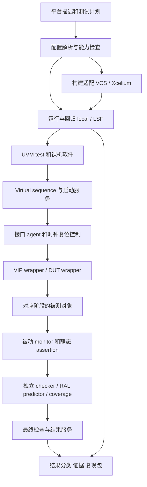

# 服务器 SoC UVM 验证环境总体架构与实施方案

本方案用于指导内网工程师和 agent，把现有 IP 验证资产逐步组织成可维护、可回归、可检查的服务器 SoC 仿真环境。目标是先建立可靠的环境基础，再接入单 die 的 Arm Neoverse N2、CMN 和内存模型，完成不涉及操作系统的最小裸机冒烟。

设计原则是把验证组件、硬件适配和运行流程分开管理。已有 ACVM、BMC、CA55 工程中的可运行配置可作为移植依据，最终环境不依赖 ACVM。所有真实硬件、商业 VIP、软件启动流程都需要在内网根据实际 IP 版本完成适配；缺少这些依赖时应返回明确的配置阻塞，不能切换到空模型后沿用真实 SoC 的 PASS 名称。

与本方案配套的详细接口见 [组件与接口设计](02_组件与接口设计.md)。目录中所述的完整组件是最终工程的目标边界；本次模板的实现范围以模板 README、能力配置和执行结果为准。

## 1 已确认条件与未决条件

| 项目 | 已确认内容 | 对方案的影响 |
|---|---|---|
| 第一目标 | 单 die，最小系统冒烟，不启动操作系统 | 优先数据通路、初始化和裸机完成握手 |
| CPU | 计划使用 Arm Neoverse N2，当前没有可仿真的 RTL | 环境自检不能宣称完成 CPU 验证 |
| 互连 | 计划使用 Arm CMN，型号和 DDR 出口协议待定 | 保留 CHI/AXI 接口适配边界，不先行写死转换关系 |
| DDR | 第一阶段使用内存 VIP 替代 | 验证范围截至内存模型接口，不覆盖 DDRC/PHY/DRAM 时序 |
| 启动意图 | UVM 预装载 DDR 镜像，CPU 直接从 DDR 地址启动 | 需要真实复位向量、地址路径、安全属性和 CPU hold 机制支持 |
| EDA | VCS、Xcelium、UVM 1.2、Synopsys VIP | 两类仿真器分别构建和确认结果，不假定命令完全一致 |
| 调度 | LSF | 统一 local/LSF 执行接口，分开管理调度状态与功能结果 |
| 现有资产 | 已有可运行 AXI VIP 示例，已有 IP/BMC 工程结构 | 优先提取已验证 wrapper、配置、编译依赖，不猜测厂商 API |
| 当前集成 | 尚无集成好的 SoC | 用分阶段配置建立验证能力，防止混淆被测对象 |

下列信息必须在进入对应阶段前确认：CPU/CMN 的 IP 配置及版本，实际 RTL filelist，复位与时钟说明，地址图，CHI 版本及可用 requester 类型，CMN memory 出口协议，安全属性，DDR 模型位宽及地址转换，启动入口，软件工具链和 ISA 选项。当前不需要这些信息即可完成流程工具、合成事务检查和接口契约准备。

## 2 公开实践的采用范围

本方案参考公开、可核对的方法，而不假定了解任何公司的非公开内部流程。Accellera UVM 1.2 用作组件、sequence、寄存器模型及阶段机制的公共基础。[Accellera UVM 1.2 User’s Guide](https://www.accellera.org/images/downloads/standards/uvm/uvm_users_guide_1.2.pdf)

OpenTitan 公开的 DV 方法把测试计划、环境说明、检查和覆盖率及阶段验收联系起来；本项目采用这种可追踪的组织方式，但服务器一致性系统需要另外设计参考模型和场景。[OpenTitan DV Methodology](https://opentitan.org/book/doc/contributing/dv/methodology/index.html)

OpenTitan DVSim 对构建、执行、调度、结果和复现进行分层。本项目借鉴职责分离，保留接入已有运行平台的能力，不要求部署其整套工具。[OpenTitan DVSim Design](https://opentitan.org/book/util/dvsim/doc/design_doc.html)

Arm RD-N2 提供了 N2 与 CMN 组合的公开参考平台，但它具有自己的硬件和软件配置，不能据此推定本项目的 CMN 型号、内存出口或启动方法。[Arm RD-N2 Platform](https://neoverse-reference-design.docs.arm.com/en/latest/platforms/rdn2.html)

后文的组件拆分、状态契约、验收门槛和实施次序是针对本项目提出的工程设计。公开来源用于说明方法出处，不构成本项目已达到签核状态的证明。

## 3 五种验证级别

每次运行必须记录 `validation_level`、编译配置、实际被测对象和能力集合。同一个 `PASS` 仅在该级别内解释。

| 级别 | 实际执行内容 | 可以证明 | 不能证明 |
|---|---|---|---|
| `FLOW_MOCK` | Python 等工具模拟工具进程和结果，CLI 配置可命名为 `mock` | 调度、超时、结果解析、报告和复现流程 | SV 编译、UVM、VIP、总线、RTL 的正确性 |
| `UVM_SELFTEST` | 无商业 VIP 的合成事务路径和独立检查器 | UVM 对象连接、期望值模型、注错检测、结束协议 | AXI 握手、CHI、一致性、真实 CPU 执行 |
| `VIP_SELFTEST` | 真实 Synopsys AXI master/slave 示例经 wrapper 接入 | 商业 VIP 配置、协议链路、内存装载和 monitor 转换 | 真实 CMN/N2/DDR 控制器 |
| `CMN_BFM` | 匹配的 CHI requester VIP、真实 CMN 和匹配出口的 memory VIP | CMN 的实际配置、路由和规定范围内的系统数据行为 | 真实 N2 启动和未覆盖的一致性行为 |
| `N2_BOOT` | N2、CMN、内存 VIP、真实裸机镜像 | 实际 CPU 启动、指令/数据访问和软件完成 | OS 启动、真实 DDR PHY、未经定义的签核目标 |

其中 `UVM_SELFTEST` 的自定义事务不是 AMBA 协议实现。它可以帮助证明某个 checker 能发现数据被改坏，但无法代替真实 AXI/CHI VIP 的协议验证。进入 `VIP_SELFTEST` 时必须补上真实接口、握手、时序和 VIP monitor 适配。

`CMN_BFM` 和 `N2_BOOT` 具有独立 filelist。缺少 N2 RTL 时，编译目标不能通过运行参数“假装 CPU 存在”。未完成的商业适配配置默认 `BLOCKED`，在提供依赖和通过该阶段验收后才启用。

## 4 总体架构

### 4.1 控制路径

控制路径决定“什么时候做什么”。配置解析产生不可随意改变的环境配置，virtual sequence 编排时钟、复位、内存装载、寄存器配置和业务 sequence。UVM driver 只控制获得驱动权的外部接口；真实 RTL 已驱动的接口使用 passive agent 观察。

CPU 启动由 boot service 执行状态机，不能由各个 test 任意写层次信号。clock/reset 控制通过明确的请求/应答与 HDL generator 连接。agent 的运行方式、启动顺序和错误处理在组件契约中定义。

### 4.2 数据与检查路径

数据路径记录“实际发生了什么”。接口 monitor 把完成握手的请求和响应转换为事务，经 analysis port 发给 scoreboard、协议事件收集器和覆盖率组件。checker 不依赖 driver 声称已发送的数据作为唯一观察来源。

参考模型保存独立的期望状态；实际 memory service 操作 VIP 的真实 backing store。两者由明确事件分别更新。禁止将同一个内存对象同时作为 DUT 响应和黄金期望值，否则数据损坏可能在两边同时出现，检查器仍然通过。

### 4.3 结果路径

仿真器退出码、UVM 报告、assertion 失败、checker 状态、软件结束状态以及调度状态都进入统一判定。测试在打印完成信息后还可能崩溃，因此先看到 PASS 字样不能立即把运行定为通过。

必需 checker 未创建、真实 monitor 未连接、样本计数为零、软件没有启动等情况必须显式检查。能否执行是“就绪条件”，执行后是否成功是“功能结果”，两者不能合并成一个布尔开关。

## 5 目录和资产迁移

保留当前团队熟悉的一级结构。下表描述最终目标目录，不要求同一时刻实现全部子目录。

| 位置 | 内容 | 归属规则 |
|---|---|---|
| `config/` | 地址图、接口能力、构建配置、站点配置 | 设计事实与工具站点配置分开；工具路径不写入 UVM class |
| `flist/` | 公共库、合成自检、VIP、CMN、N2 的源码清单 | 展平后的清单作为构建证据；include 文件不重复编译 |
| `tb/common/` | 类型 package、生成的地址常量、少量文本宏 | 不引用 UVM env，防止接口与 package 循环依赖 |
| `tb/interfaces/` | virtual interface、modport、控制握手和状态信号 | 含静态信号定义，禁止堆入测试场景 |
| `tb/hdl_top/` | 总顶层、DUT wrapper、静态模型和连接 | 每个构建配置只指定一个明确总顶层 |
| `tb/hvl_top/` | virtual interface 配置和唯一 `run_test()` 入口 | 设置完成后启动 UVM，不用两个并发 initial 碰运气 |
| `tb/generators/` | clock/reset 等真实信号发生器 | 每根信号唯一驱动；时序命令有应答 |
| `tb/models/` | memory、PLL 等替代模型和厂商 wrapper | 模型替代范围计入能力和结果报告 |
| `tb/assertions/` | SVA 和静态 checker | 检查逻辑尽量通过端口独立复用 |
| `tb/binds/` | checker 的实例选择和信号连接 | 层次路径集中管理，计入 filelist |
| `env/agents/` | 控制 agent 和协议适配 | 模块到 SoC 的复用边界 |
| `env/seq/` | 初始化、复位、boot 和业务 virtual sequence | 可复用流程，不直接拼接私有 RTL 路径 |
| `env/services/` | memory、boot、result、watchdog 服务 | 所有外部调用有超时和错误返回 |
| `env/checkers/` | 数据、路由、事务和状态 checker | 期望模型与 DUT 响应模型分开 |
| `env/ral/` | 聚合的寄存器模型、adapter、predictor | 保留 IP 模型来源和生成版本 |
| `env/coverage/` | 实际事件驱动的功能覆盖率 | 与 requirement 和 testpoint 对应 |
| `native/shared/` | C/SV 通信定义、DPI 适配 | 统一地址、字节序、状态码、ABI 版本 |
| `native/sw_lib/` | target startup、linker、驱动、公共软件库 | CA55/N2 分离，工具链与编译选项显式记录 |
| `test/sv/` 与 `test/c/` | 具体测试和小型裸机程序 | 测试声明 required capabilities |
| `regress/` | build、run、test_list、summary_list 等运行数据 | 可继续沿用现有文件格式，但需归一成明确运行配置 |
| `script/` | 配置生成、构建、执行、检查、报告和复现 | 可被 ACVM 或其他调度器调用 |

原 `bmc_mini_top_define.sv` 先分类再迁移，不机械地改名。原 `env_pkg` 中 include 的 class 不重复放入 filelist。`script/bmc_mini_top.v` 若为 HDL 源码，应明确放置或引用关系；若为生成物，则保留模板、输入与生成记录。`href.txt` 若承载层次路径，转换为集中绑定/后门映射，其具体语义需读原文件确认。

现有 CA55 的 C 配置只作为软件构建流程参考。移植到 N2 时要检查执行状态、异常级、向量表、栈、多核启动、内存属性、链接地址和结束协议，不能仅替换配置名称。

## 6 验证目标与测试分层

### 6.1 最小自检目标

第一批测试应覆盖三个维度：正确路径能完成，错误路径能被抓住，基础设施异常不会被误报为功能通过。

| 目标 | 正向场景 | 必须配套的反向检查 |
|---|---|---|
| 数据一致 | 固定/随机数据读写、部分写、不同长度 | 故意改坏一个字节，checker 必须报错 |
| 内存装载 | 指定地址加载数据，再经前门读取 | 错误装载地址、越界、镜像摘要不一致 |
| 地址完整性 | 低地址及大于 4 GiB 的地址访问 | 截断高位应被检查发现 |
| 事务完成 | 全部发出事务最终匹配 | 丢响应、重复响应、未知 ID |
| 结束判定 | 指定工作量和最终检查完成 | 空测试、零样本、提前完成、PASS 后异常退出 |
| 复位恢复 | 明确定义的保留/清空与重启 | 旧 epoch 响应混入新测试 |
| 流程可靠性 | 同 seed、同构建可复现 | 缺结果、作业取消、仿真卡死、日志冲突 |

合成自检能实现的用例应注明其事务层性质。burst、背压和总线乱序等协议场景必须在真实 VIP 接入后才计入协议覆盖率。

### 6.2 CMN 接入阶段

先验证静态配置与单 requester 基本路径，再逐步加入 outstanding、多个 requester、响应顺序、路由边界和错误响应。每一步都需要对应的观测点和匹配规则。使用 CHI VIP 时，requester 的节点类型、协议版本、cache line 大小、credit 和 snoop 能力必须与 CMN 实例一致。

若 memory 出口是 CHI，则接匹配的 subordinate 模型；若出口是 AXI，则接实际 AXI memory VIP。不存在的 CHI 到 AXI bridge 不能由环境文档默认补出。CMN 的某个 I/O 扩展端口也不能在未核对架构的情况下等同于 coherent DDR 出口。

最初的单点非一致性数据模型用于受控场景。多核一致性验证需要明确的数据所有权、共享状态、snoop、writeback、barrier 和可观察顺序模型，不能把“最后看到的 DDR 写值”当成任意 CPU load 的即时黄金结果。

### 6.3 N2 裸机阶段

第一条软件测试只做最低必要的初始化、可确认的数据访问和完成握手。随后增加异常处理、中断、多个核的启动/同步、不同内存属性、cache 开关与一致性场景。任何新增功能都要更新 required capabilities 和检查策略。

软件生成地址、镜像入口和 UVM 装载地址应来自同一平台描述。真实启动必须观察到有意义的启动进度，例如执行阶段标记或规定的总线访问；仅在 DDR 中预放入 PASS 值不能证明软件运行。

### 6.4 性能与低功耗边界

使用 memory VIP 可以测量所配置内存延迟和背压条件下的互连行为，但这不是实际 DDR 系统的带宽、访问延迟或功耗结论。性能报告必须记录 clock、数据宽度、burst、读写比例、outstanding、warm-up、统计窗口和 memory 响应模型。区分模拟时间性能与主机仿真速度。

门控时钟、停钟/恢复、热复位可以逐步加入 RTL 功能验证。真正 UPF power-aware、retention/isolation、门级/SDF 需要专门 profile、工具选项和检查点，不能由普通 RTL 自检替代。

## 7 测试计划和覆盖率追踪

一个 requirement 可以由多个 testpoint 覆盖；一个测试也可能覆盖多个 requirement。对每项需求记录适用配置、激励、checker、覆盖点、预期结果、责任人和签核证据。测试执行成功与需求覆盖完成是不同字段。

| Requirement 示例 | 适用阶段 | 激励 | 检查 | 覆盖与证据 |
|---|---|---|---|---|
| `MEM_ADDR_64` 地址不得被截断 | UVM 自检起，逐层复核 | 对高低 32 位不同的地址写不同数据 | 独立地址解析和读回比较 | 高位变化覆盖，两个地址无别名 |
| `MEM_BYTE_EN` 部分写保留其余字节 | VIP 起 | 合法 strobe 模式及重叠写 | 按字节更新参考值 | strobe 类别和受影响字节覆盖 |
| `BOOT_PRELOAD` CPU 释放前镜像可见 | N2 | 冷启动及重复启动 | 装载摘要、memory ready、CPU hold | 状态迁移和前门抽查 |
| `RESET_EPOCH` 复位前后响应不混淆 | 具备复位模型时 | outstanding 期间断言指定复位 | epoch、取消/保留规则、恢复超时 | 复位阶段与事务类型交叉 |
| `SYS_PROGRESS` 无永久挂起 | VIP/CMN/N2 | 合法最大背压和持续负载 | 有界进度 watchdog | 请求年龄分布、最长停顿 |
| `RESULT_NO_FALSE_PASS` 错误不能被吞掉 | 流程 mock 起 | UVM_ERROR、missing-end、late-crash | 严格结果解析 | 每种失效类型的工具自测记录 |

覆盖率只从实际观察到的事件采样。sequence 尝试发送但被复位取消的事务不得计入“成功读写”。关键 antecedent 没发生时，assertion 未失败不能视为覆盖完成。

第一阶段避免定义一个没有依据的全局百分比目标。先要求所有适用 requirement 至少有实现的 checker、正反用例和可追踪结果。之后按设计风险规定每类 coverage 的目标、排除项和审查人。豁免必须记录原因、适用配置和证据，不把“当前打不到”直接视为不可达。

## 8 构建和运行流程

### 8.1 配置优先级与构建身份

建议优先级为平台默认、build profile、test、suite、显式命令行覆盖。每次运行保存全部解析完成后的配置，不能只保存用户给出的短命令。结构参数、宏、filelist、VIP 版本、工具版本、调试/覆盖率编译选项都属于构建身份。

运行参数仅用于不改变展开结构的选项，例如种子、镜像路径、事务数和合理范围内的超时。用户覆盖的值必须记录来源。未知 key 和类型错误默认拒绝，避免拼错配置后悄悄采用默认值。

编译缓存需要完整依赖或可信版本标识。只对顶层 filelist 文本做 hash 不足以识别被 include 的 SVH 和内部配置变化。模板若不能解析全依赖，应默认重新构建；内网实现依赖扫描或使用完整版本清单后再安全复用。

### 8.2 local 与 LSF

运行主入口可以由 `script/socflow.py` 实现，命令参数以模板帮助为准。执行器只负责启动、等待、查询、终止和保存退出状态；它不直接决定 RTL 功能是否通过。LSF 的队列、项目、内存、墙钟限制和许可资源来自站点配置。

构建与运行是两个不同资源阶段。确认有可复用构建后再分发多个 seed，避免每条 case 重编译。构建失败时依赖它的运行应标记为未执行/阻塞。并发限制要同时考虑计算资源、仿真许可证、共享文件系统和报告压力。

调度器中的 `PEND`、`RUN`、`DONE`、`EXIT` 是基础设施状态。作业 `DONE` 只说明执行进程以调度器认可的方式结束，仍需检查功能结果。反过来，即使日志出现 PASS，最终进程崩溃或被取消也不能通过。

### 8.3 超时和可恢复收集

至少管理四类时间：排队时间、墙钟运行时间、仿真时间、业务无进展时间。排队延迟不能当成 RTL 死锁；有些时钟停顿是合法场景，无进展阈值必须按当前状态调整。

运行记录采用唯一 run ID，记录 LSF job ID 和实际工作目录。收集器中断后可根据这些记录继续查询，不能简单重复提交。共享文件系统上的结果采用先写临时文件再原子替换的方法，避免报告器读到半个 JSON。

### 8.4 结果、错误分类与复现

建议结果类别至少包括 `PASS`、`FAIL`、`BLOCKED`、`INFRA_ERROR`、`TIMEOUT`、`CANCELLED`、`SKIP`。具体枚举可由模板实现收敛，但必须保留“没有执行”和“执行后失败”的区别。SKIP 需要显式适用性理由，不用于隐藏缺失依赖。

正向测试通过需要：构建成功、仿真正常结束、test completion、必需检查器有效、数据/协议/assertion 无非预期错误、事务收敛、软件成功（适用时）、结果来自当前 run。负向测试的预期失败必须限定具体错误 ID、数量/范围和结束条件，不能仅设置“任意非零退出就通过”。

每次运行保存：解析后的配置、命令与工作目录、源码版本或快照标识、工具和 VIP 版本、构建 ID、镜像摘要、seed、仿真及 LSF 日志、结果、检查器统计、复现指令。只导出需要的环境变量，避免把凭据和完整私有环境无差别复制到报告。

固定 seed 是必要证据，但不同仿真器、版本、编译选项和并发调度实现不保证同一随机轨迹。失败复现先恢复原工具和构建，再讨论跨工具等价性。

## 9 分阶段交付与验收

| 阶段 | 交付物 | 进入下一阶段的门槛 |
|---|---|---|
| A 工程与流程 | 目录、配置 schema、执行器、结果检查、报告、自测 | 缺结果、晚失败、超时、取消、错误退出都不会假 PASS |
| B 合成 UVM 自检 | class 连接、独立参考模型、基础时钟复位、注错 | 至少一项真实比较成功；注入不匹配必然失败；记录样本数 |
| C 商业 VIP 自检 | 内网 VIP wrapper、monitor 适配、memory service | 两端合法传输、协议检查启用、预装载前门验证、背压检查 |
| D CMN BFM | 真实 CMN、节点/路由配置、匹配出口模型 | 合法路径和错误路径；多请求匹配；阶段性一致性验证计划 |
| E N2 裸机 | 真实 CPU、startup/linker、boot/结果契约 | 观察真实软件进度和数据操作，软件与 TB 都完成；可重复冷启动 |
| F 扩展验证 | 多核、中断、RAS、SMMU、低功耗等 | 每类功能另有 requirement、checker、覆盖率及验收 |

建议先让一个仿真器走通所有必要适配，再在第二个仿真器上执行同一阶段的有限兼容性集合。每个受支持的构建配置都至少维护一个快速正向 smoke 和一个适当的检查器自检，不能只保证最常用配置能运行。

每阶段验收包含四份证据：有效的配置清单、通过的正向用例、被检测的反向用例、失败复现包。环境搭建阶段不把“大量测试全绿”作为唯一质量依据，因为全绿可能来自 checker 没连接或测试根本没有执行。

## 10 IP 环境向 SoC 环境复用

IP agent、RAL 和协议 checker 可优先复用；IP 的顶层 test、默认 active 配置、reset 假设和结束条件必须重新审查。SoC 顶层负责全局编排，子环境保留局部观察与检查。

复用前检查清单：

1. 子环境是否可通过 config 切换 active/passive，默认 sequence 是否会意外启动。
2. 是否硬编码顶层路径、地址、时钟名、复位顺序或某一个 CPU。
3. 是否自行调用 `$finish` 或持有永远不释放的 objection。
4. 是否存在局部 scoreboard 将所有复位都当成冷复位。
5. RAL 是否支持 SoC base address 和来自 CPU 的访问预测。
6. 错误严重级别、report ID、coverage 名称是否可辨识且不会被默认过滤。
7. 数据类型能否保留 64 位地址和完整属性，是否把地址放在 `int` 中。
8. 是否使用大量轮询、深层 backdoor 和重复波形造成仿真瓶颈。

对已充分验证的商业 IP，SoC 首先验证连接、配置、系统交互及所用功能，覆盖率范围按实际 IP 交付和团队签核约定确定。不能未经审查就把整个 IP 的内部逻辑从所有检查中排除。

## 11 风险和决策记录

| 风险 | 何时处理 | 处理方式 |
|---|---|---|
| 实际 CMN 出口不是 AXI | CMN 接入前 | 以真实端口和协议配置选 memory adapter |
| N2 不能按当前设想直接 DDR 启动 | CPU 接入前 | 与设计确认复位向量、访问路径、控制核/boot hold；必要时调整启动阶段 |
| VIP preload API 与普通 memory model 不同 | VIP 接入时 | 基于现有示例和版本手册实现，预装载后做前门检查 |
| 复位清除了预装载内容 | 首次系统启动前 | 状态机规定 memory ready、preload 和 CPU release 的关系 |
| 数据 checker 无法表达一致性 | 多 requester 前 | 限制初期场景；另行实现 cache/coherence 检查模型 |
| C/DPI 地址或字节序不一致 | C 接入前 | 64 位 ABI、高地址测试、字节图案测试、接口版本校验 |
| 工具命令跨版本失效 | 两种仿真器接入时 | 以已安装工具和可运行示例确认 adapter，不自动升级企业环境 |
| 构建污染或旧结果误读 | 流程阶段 | 唯一目录、构建依赖、run ID 关联、严格结果检查 |
| 缺失 assertion 被误认为无错误 | checker 接入时 | checker 注册、样本计数、触发覆盖、专门注错 |

每个未决配置记录“问题、受影响组件、负责人、证据来源、截止阶段、最终值”。内网 agent 可以先完成不依赖该配置的工作；进入受影响阶段前必须显式关闭相应问题。

## 12 内网 agent 的实施顺序

第一步读取本方案、组件契约、模板 README 和能力限制，执行模板自带的流程自测。随后检查现有工程的真实 filelist、顶层、VIP 例程、报告机制和工具版本，形成差异表。不得因文档中出现某个组件名，就宣称该组件已经实现。

第二步落实合成 UVM 自检，在真实 VCS/Xcelium 环境编译并保存日志，修正 package、接口和工具兼容问题。用数据注错证明检查器有效；用缺结果、异常退出证明运行流程有效。

第三步从已运行的 Synopsys AXI 示例接入真实 VIP，保持已有厂商编译方法，新增稳定的项目适配接口。先确认单笔读写和 monitor 再做 burst、背压、并发和地址边界。每增加一项能力，同步更新测试计划和检查器要求。

第四步按真实交付的 CMN/N2 文档完成硬件和启动适配。未知接口、商业类名、node ID、复位端口和寄存器值应向团队确认，不能由语言模型推测补齐。完成后提交实际命令、日志、覆盖和失败复现证据供工程师审查。

最终交付应包含稳定的环境源码、配置、测试、运行脚本、实际依赖说明、可复现结果和维护指南。文档中的架构目标与已经验证的实现状态必须始终分别记录。
