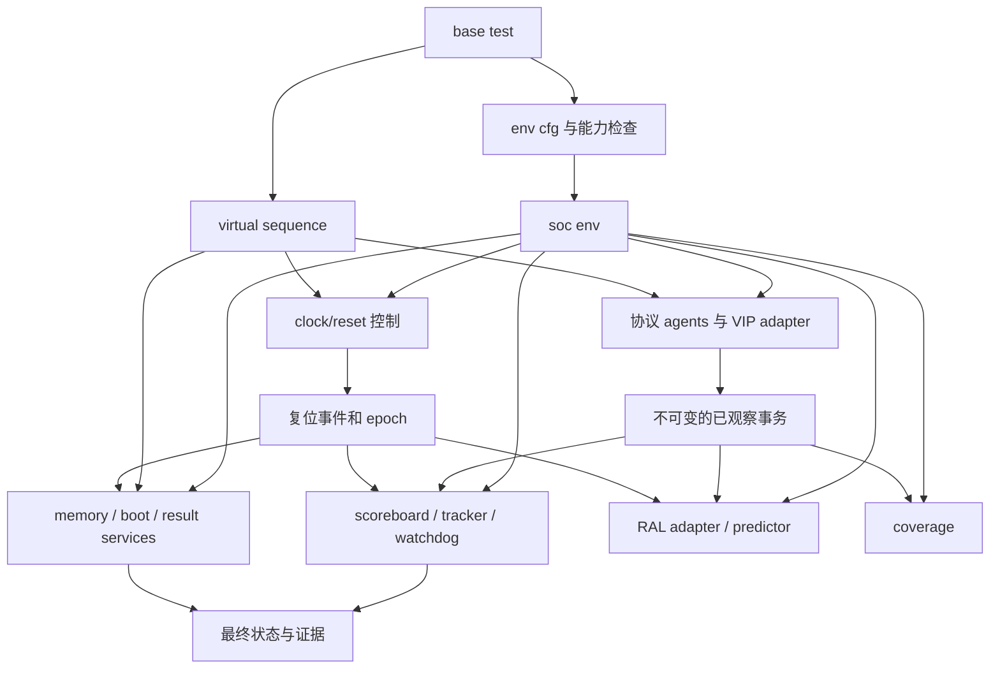

# SoC UVM 组件与接口设计说明

本文规定最终工程中各组件的职责、输入输出、错误处理和验收方法，供内网 agent 接入实际 RTL、商业 VIP 和站点工具时使用。组件名为建议命名，可以保留现有 `bmc_mini_top_*` 前缀，但职责和接口契约应保持一致。完整目标架构见 [总体架构与实施方案](01_总体架构与实施方案.md)。

模板中的合成事务实现用于检验组件连接和错误判定；完整 AXI/CHI 传输、商业 VIP 接入、N2 启动和一致性模型需要内网实现。本文提到的接口是目标契约，不表示每个 API 已经存在于模板或厂商 VIP 中。内部 agent 应先列出“已有、需适配、需新增”的对应关系，再生成代码。

## 1 组件职责和依赖图



依赖方向有三个硬性约束。公共类型包不依赖 env；接口不依赖 test；checker 不通过 driver 的内部对象取得唯一的“实际结果”。服务之间通过定义好的接口通信，避免直接访问其他组件的成员队列或层次路径。

## 2 配置和能力契约

### 2.1 配置分为五类

| 配置类别 | 例子 | 生效时间 | 推荐载体 |
|---|---|---|---|
| 结构配置 | CPU 是否存在、端口数、地址/数据宽度 | 编译或展开前 | build profile、module/interface parameter |
| 设计常量 | 地址区间、支持的复位类型、固定节点信息 | 构建前生成 | 类型化 package 与 C header |
| 场景配置 | 事务数、seed、背压分布、当前镜像 | 运行开始时 | test cfg，命令行统一解析 |
| 站点配置 | VCS/xrun 路径、VIP 安装、LSF 队列 | 启动工具时 | site 配置，环境初始化脚本 |
| 检查策略 | 必需 checker、预期错误、coverage 模式 | 运行开始时 | 带版本的测试/检查配置 |

场景配置不能覆盖结构事实。例如把 `has_cpu` 的运行参数改成 true，不会使没有编译的 CPU 出现。工具应在运行前比较 build manifest 与 test requirements，发现不匹配就停止。

### 2.2 配置对象建议字段

`soc_env_cfg` 至少包含以下语义，字段名可按现有工程风格调整：

- `profile`、`validation_level`、配置 schema 版本和摘要。
- 接口列表：名称、协议版本、位宽、时钟域、复位域、owner、active/passive。
- 地址区间：base、size、权限、目标、可缓存/设备属性、是否允许执行。
- clocks：周期、相位、是否允许停钟、切换规则。
- resets：极性、域、冷/热/局部含义、保持要求、恢复超时。
- memory：后端类型、映射、初始化策略、未初始化读策略、镜像及保留策略。
- 检查器：需要启用的集合、采样要求、错误策略、事务收敛规则。
- 软件：是否需要真实 CPU、入口、结果地址、通信 ABI 版本。
- 超时：初始化、单请求、无进展、整体仿真时间。

配置应在 build/start 前验证并冻结。确需动态修改的值用专门控制事务完成，例如变频请求；不允许 sequence 在任意时刻直接改 cfg 中的周期，让各个组件自行猜测生效点。

### 2.3 能力声明

每个测试声明其 required capabilities，例如 `axi_frontdoor`、`memory_preload`、`cpu_execution`、`chi_snoop`。由实际 wrapper 和配置建立 available capabilities，而不是由 test 自己宣称具备。

必需能力不足返回 BLOCKED，包含缺失项、受影响测试和建议补齐位置。测试本身不适用某配置时可以 SKIP，但必须在选择阶段给出理由。`UVM_SELFTEST` 不具备 `axi_frontdoor`；`FLOW_MOCK` 不具备 `uvm_execution`。

## 3 Define 与公共类型的放置

### 3.1 使用边界

| 需求 | 使用方式 | 避免的做法 |
|---|---|---|
| 工具兼容分支、可选源码段 | build profile 传入有限宏 | 在很多源码中重复定义同一宏 |
| 模块/interface 位宽 | parameter，配置一致性检查 | 用运行 plusarg 改变端口位宽 |
| 地址、mask、固定枚举 | 有类型的 package 常量/typedef | 无宽度十进制宏、隐含有符号地址 |
| 运行时模式、测试数量 | cfg 字段 | 为每个场景增加编译宏 |
| 文本生成辅助 | `.svh` 宏并加 include guard | 用宏隐藏大段控制流程或错误吞噬 |
| RTL 层次路径 | bind/backdoor 适配文件集中映射 | test 中遍地出现 `top.dut...` |

现有 `*_define.sv` 应先盘点内容。若仅含文本宏，可改为 `.svh`；类型和常量移入 package；运行配置进入 cfg；对 DUT 的层次引用进入适配文件。宏不受 package namespace 管理，`import pkg::*` 不会导入宏定义，使用者应显式 include 所需头文件。

SV 地址常量使用明确宽度，例如 `64'h...`；地址运算先检查溢出再比较范围。整数配置中 `-1`、超过最大地址和 size 为零应有独立校验，避免隐式转换为超大无符号值。

### 3.2 单一来源和生成规则

地址图和公共状态码由同一平台描述生成 SV package 与 C header。生成文件包含来源摘要和 generator 版本；CI 或本地检查比较生成结果是否与输入一致。代码不同时手工修改原始配置和生成物。

镜像入口、链接地址、load address 和运行地址是不同字段。即便最初都相同也要分别记录，避免以后搬运镜像或调整虚拟地址时靠隐含假设维持。

### 3.3 编译依赖

推荐依赖顺序为基础库和公共类型、接口、env package、test package、顶层/wrapper、静态 checker 和 bind；厂商 VIP 的实际顺序以其可运行示例为准。SVA 被 bind 引用的模块必须在展开时可见。

被 package include 的 class 文件不再单独编译。`uvm_macros.svh` 由使用宏的编译单元显式 include。跨工具不得依赖某个仿真器把所有文件放在一个隐含 compilation unit 的行为。公共类型包不得引用包含 virtual interface 的 env class，避免 interface 与 env 的循环依赖。

## 4 HDL 与 HVL 的连接

### 4.1 单一总顶层

每个构建配置指定一个总顶层，静态实例可拆在 `tb/hdl_top`，UVM 启动相关代码可拆在 `tb/hvl_top`，但启动顺序只有一个控制点：

```text
初始化外部输入的安全状态
→ 设置所有必需 virtual interface 与公共配置
→ 确认静态 wrapper 的就绪状态
→ 调用唯一 run_test()
```

不允许一个 initial 调用 `run_test()`，另一个无同步 initial 才向 `config_db` 放接口。所需接口 `get()` 失败必须 fatal。参数化 interface 的宽度与 modport 类型必须一致；不能为了消除编译报错把类型检查全部替换为无类型句柄。

### 4.2 层次依赖

普通 test 和 sequence 通过 virtual sequencer、RAL、service 使用接口。DUT 层次路径仅在以下位置允许：bind 连接、经过审查的 backdoor adapter、调试探针以及明确的模型替代。路径不存在或位宽不匹配应早期报错。

Backdoor 是仿真加速或观察工具，不自动代表真实前门功能已验证。测试报告记录哪些操作绕过了 RTL。例如 UVM 预装载 DDR 可以加速软件启动，但镜像可达性还要通过 CPU 或总线前门观察验证。

## 5 时钟组件设计

### 5.1 所有权与接口

外部参考时钟由 HDL generator 唯一驱动。clock agent 的 driver 通过控制 interface 发请求；RTL 内部产生的门控/分频/PLL 输出作为 DUT 行为观察，不由普通测试直接覆盖。

建议控制请求包含 `clock_id`、`command`、`period_ps`、`duty_cycle`、`request_id`；应答包含已接受/已生效、实际生效时间、错误原因。第一版只需要 START/STOP/SET_PERIOD 中实际使用的操作，未实现操作立即拒绝。

| 项目 | 契约 |
|---|---|
| 时间单位 | 跨组件使用明确的整数物理单位，如 ps；进入 HDL 后显式转换 |
| 频率转换 | 校验周期非零、半周期可表示，不允许整数截断造成零延时循环 |
| 生效边界 | 规定安全相位更新周期或停钟，避免意外缩短脉宽 |
| 停止电平 | 每个时钟配置保持高/低的规则 |
| 并发请求 | 串行化或返回 busy，不允许两个 driver 同时改状态 |
| 初始状态 | time zero 定义，不依赖寄存器未初始化值 |
| 故障注入 | 专门模式允许窄脉冲/丢边沿；与正常合法配置分开 |

所有含延时的 module/interface/package 明确 `timeunit` 和 `timeprecision`。不要把一个作用域的裸 `time` 数字直接当成另一个作用域的物理时间。配置解析器应把带单位的输入转换为统一单位，再校验可表示性。

### 5.2 时钟检查

Clock checker 观察真实输出边沿，检查周期范围、高低脉宽、启停应答和预期连续性。停止检测需要独立计时基准，因为只在被检查时钟边沿执行的 checker 无法发现“再也没有边沿”。

合法停钟会暂停对应时钟的周期检查，但控制请求超时、停止前事务未收敛和恢复后状态异常仍需检测。随机时钟抖动只有在定义分布、界限和检查容差后才开启。

验收包含：固定周期、首次启动、重复命令、非法周期、合法停/启、变频边界、意外缺失边沿以及故意脉宽错误。功能无需动态变频时，不必为了目录完整先实现复杂 PLL 模型。

## 6 复位组件和 epoch

### 6.1 复位源与内部复位树

TB 负责外部复位刺激，DUT 负责其内部复位树和同步逻辑。是否异步断言、同步释放以及需要哪些时钟，由设计规范决定。不能一概把外部 reset_gen 做成同步释放后，便认为 DUT 内部的释放问题已经被验证。

reset request 建议包含域集合、复位类型、触发原因、保持时间/周期、释放策略和 request ID。应答指明外部刺激已施加、实际观察到的内部状态及恢复结果。刺激完成和 DUT 恢复就绪是两个不同事件。

### 6.2 每种复位的行为表

在真实设计接入前必须填表，以下是字段示例而不是默认硬件规则：

| 复位类型 | CPU | CMN 状态 | memory contents | RAL | outstanding |
|---|---|---|---|---|---|
| 冷复位 | 按规范重新启动 | 按规范初始化 | 模型保留/清空策略需确认 | 受影响寄存器恢复指定 reset kind | 明确取消或完成规则 |
| 热复位 | 可能仅重启 CPU/部分域 | 不一定复位 | 通常需明确保留策略 | 只更新受影响寄存器 | 不能全局无条件 flush |
| 局部复位 | 指定模块 | 相关链路是否排空需确认 | 通常不应被无关域影响 | 对应 submap 或寄存器集合 | 根据跨域边界处理 |

### 6.3 复位过程中的组件操作

1. Reset service 发出预告（如场景允许预告），driver 停止接收新请求或按故障场景继续。
2. 记录复位断言事件和新的 epoch，monitor 标记跨边界事务。
3. Tracker 按该复位的规则取消、保留或等待已有请求；取消也形成可追踪记录。
4. Scoreboard 只更新受影响状态；RAL 使用对应 reset kind；memory 仅按既定规则处理。
5. 释放外部复位，观察实际恢复条件；超时则失败。
6. 同步完成后重新开放流量，记录恢复后的第一笔成功事务。

事务匹配 key 包含 `reset_epoch`。复位前的迟到响应不能误匹配到复位后同 ID 的新请求。旧响应是否合法由协议和复位规范决定，既不能全部忽略，也不能全部当作新错误。

对无法预告的异步复位，agent 必须能中断等待并把当前事务结局通知 sequencer。不得留下永不调用 `item_done()` 的 driver，或在复位后重复完成同一个 sequence item。必要时为取消定义明确状态码。

### 6.4 预装载时序

Memory model 可能在 reset assert、reset release 或自身 start sequence 时重新初始化。adapter 必须说明哪个事件会改变 backing store。合法初始化顺序为“模型完成其最后一次破坏性初始化，再装载，保持 CPU 尚不能取指，验证装载完成后释放 CPU”。

若硬件没有独立 CPU hold，需与设计共同定义可行启动方法。不得为了满足文档流程强行 force 内部 CPU 状态，再把该结果标成正常启动通过。

## 7 VIP wrapper 和观测事务

### 7.1 Wrapper 必须提供的能力

| 能力 | 输入 | 输出/错误 | 验收 |
|---|---|---|---|
| 配置检查 | 协议、宽度、模式、地址范围 | 能力描述或明确不支持项 | 错误宽度/版本不能静默降级 |
| 激励适配 | 项目事务/sequence 请求 | 完成、响应或取消/超时 | 单笔及并发事务可关联 |
| Monitor 适配 | 厂商实际观察事务 | 项目统一观测事务 | 与波形抽查一致 |
| 内存访问 | byte 地址、数据、byte enable | 已提交数据或失败 | 后门加载后前门读取一致 |
| 报告适配 | 厂商报告和统计 | 项目错误 ID、计数 | 协议注错导致最终失败 |

厂商 package、class、sequence 和 memory API 仅出现在适配层及必要的依赖配置中。使用现有可运行示例确认准确名称、对象获取时机、默认 sequence 和配置锁定方式。没有真实 API 时，留带明确失败行为的接口，禁止编造看似可编译的厂商代码。

### 7.2 统一事务字段

项目事务应保留 `source`、`target`、`protocol`、`channel/event`、`txn_id`、`reset_epoch`、address、length、beat/size、data、byte enable、response、属性、观测时间。涉及 CHI 时保留 node ID、opcode 和用于关联的协议字段，不能为了通用性把区别压平成一个 AXI-like read/write。

地址数据用明确宽度或 byte 数组。未知值在进入二态类型前检查，不能把 X/Z 隐式转换成 0 后继续比较。事务发布给多个 analysis subscriber 后，应视为不可变；monitor 重用句柄时先 clone/copy，否则稍后的修改会同时改变 scoreboard 和 coverage 看到的数据。

### 7.3 Passive 与 active

真实 CPU、CMN 或外设已经驱动的边界使用 passive monitor。需要 TB 模拟请求方或响应方的端口才启用 active driver。每个接口配置检查必须能找出所有驱动者，缺少驱动和重复驱动都应作为接线错误。

VIP 协议 checker 与项目系统 checker 的错误 ID 分开。相同故障可触发多项检查，但报告应保留因果信息，不能通过全局降低 severity 让 nightly 看起来更干净。

## 8 Memory service 与镜像

### 8.1 访问契约

Memory service 使用字节地址和 byte 数组作为公共抽象，提供范围校验、装载、读取、清零、摘要和前门抽查能力。具体 API 可封装真实 VIP 或 RTL backdoor。任何地址/长度组合先检查溢出、越界和区域权限。

Memory service 操作真实响应内存；reference model 是不同对象。初始化时，两者分别根据受信任输入建立状态。后门修改后是否同步更新参考模型由调用目的显式说明：正常预装载要更新期望值，故障注入则应保留原期望以触发比较。

未初始化读必须定义策略：返回固定值、随机稳定值、保留 unknown mask，或报未初始化错误。不能根据实际读回值反向填充期望值，然后宣称第一次读取通过。

### 8.2 镜像描述

建议镜像元数据包含格式、生成工具版本、目标架构、字节序、入口、各段 load address、size、权限、原文件摘要和运行配置摘要。ELF 中段地址与 linker map 应一致，BSS 的初始化策略明确。

若转换为 hex，记录每行/每单元宽度和地址单位。`$readmemh` 的数组元素地址不自动等于 SoC 字节地址；64 位 word 数组、byte 数组和厂商稀疏内存的换算由 adapter 完成，并以有辨识度的字节图案测试。

代码、栈、heap、共享缓冲、结果邮箱及保留区域不重叠。多核栈和结果区按实际 CPU 数分配；不存在的核不能计入完成数量。镜像装载完成前不开放 CPU 启动条件。

### 8.3 功能范围

Memory VIP 替代的是所选协议边界之后的响应系统。其返回延迟、错误、背压和数据保持行为是模型配置。ECC、刷新、训练、低功耗、PHY 模拟行为只有在真实模型或 RTL 纳入且定义了测试时才计入验证范围。

## 9 Scoreboard 和事务跟踪

### 9.1 三类状态分开

Scoreboard 管理期望数据；tracker 管理请求生命周期；协议 checker 管理接口合法性。一个合法响应可能携带错误数据，一个数据正确的响应也可能违反协议或来自错误事务，三种检查互相补充。

基础非一致性参考模型采用按字节的稀疏映射。write 在定义的接受/提交事件上更新期望值，byte enable 为零的字节保持旧值。什么时候允许读观察到写，取决于协议顺序和场景约束，不能对所有请求统一按驱动顺序推导。

### 9.2 请求关联

匹配键至少考虑来源、协议 ID、epoch；接口 ID 重映射、burst 拆分/合并需要显式映射关系。相同 ID 可能有多个按协议规定排序的 outstanding 请求，不能简单用 `map[id]` 存一个项覆盖旧请求。

每个请求记录创建、接受、完成/取消状态和时刻。未知响应、重复完成、遗漏 beat、长度不匹配、非法响应码、超期请求都产生独立错误。测试结束时 tracker 输出剩余请求及年龄，避免只给“队列非空”而无法定位。

### 9.3 初期并发限制

先用互不重叠的地址区间验证并发和乱序，再引入有明确同步的同址冲突。对无同步的多个 master 写同一地址，参考模型必须表达允许的结果集合或已定义顺序；不能任选一个 Python/SV 队列顺序作为硬件期望。

### 9.4 一致性扩展

N2 的缓存、CMN 的 home/snoop 行为使数据可能存在于缓存而尚未写回 DDR。简单内存镜像不适合作为完整 coherence 黄金模型。扩展时至少定义：cache line 状态/所有权、请求者可见版本、snoop 响应和数据来源、eviction/writeback、barrier/atomic 的保证、协议可允许的顺序。

选择方案可包括有状态 CHI VIP 检查、独立协议/系统参考模型、软件 litmus 场景和最终内存核对的组合。具体采用哪一类取决于 IP 交付的 checker 能力和验证目标。先限制场景并明确覆盖范围，比用一个过度简化模型接受所有响应更可靠。

## 10 RAL 及寄存器访问

RAL 聚合现有 IP 的寄存器模型，SoC 层添加 submap、base address 和访问路径。保留每个模型的规格来源、生成器、版本及手工 patch。不同安全/特权入口可能映射到相同寄存器，但权限检查不能只靠地址相同来替代。

UVM 的显式 predictor 可从 monitor 观察到的总线访问更新 mirror；本环境优先用实际访问观察来覆盖 CPU/VIP 等不同 master 的访问。[UVM 1.2 User’s Guide 第 5 章](https://www.accellera.org/images/downloads/standards/uvm/uvm_users_guide_1.2.pdf)

工程要求如下：

1. 明确每张 map 采用 auto prediction 还是显式 predictor，避免同一访问被重复预测。
2. Predictor 只接收已达到所定义完成点的访问；复位取消、错误响应和分段事务按规范处理。
3. 明确寄存器宽于总线时的拼接、字节序和 byte enable。
4. 热复位仅更新受影响寄存器，不能对整个模型无条件 `reset()`。
5. W1C、RC、RO、volatile、自清零、硬件自主更新字段需要各自的预测/检查策略。
6. Bit-bash 和随机读写使用明确的可测试集合；对触发 DMA、关时钟、复位或安全锁定的寄存器定义安全前置条件。
7. 后门读取用于状态观测时要标注其语义；对有读清副作用的前门寄存器，后门值不等同于一次软件读。

验收包含正常访问、不同 master 访问、错误响应不误更新、reset kind、side effect 和跨宽度访问。没有真实寄存器规格时，模板不生成臆测的 N2/CMN register map。

## 11 SVA 和静态 checker

### 11.1 放置与绑定

周期级握手、状态转移、复位条件和 X 检查放在 `tb/assertions` 的 module/interface 中。`tb/binds` 只负责选择实例和连接信号。bind 文件应纳入构建身份，记录目标模块/实例数量。

对模块类型 bind 会作用于该类型的多个实例，实例级 bind 则只作用于指定路径。必须避免显式实例化与 bind 重复，以及 pattern 过宽绑定到不适用的实例。检查器的目标范围在日志或 manifest 中可查。

### 11.2 采样与禁止条件

检查时钟、reset 极性和有效窗口由信号规范决定。`disable iff` 的条件只覆盖不适用周期；不能用一个长时间为真的初始化标志把所有断言屏蔽。复位本身的检查往往需要单独处理，不能随复位一起禁用。

有效控制信号上的 X 需要直接检查；对有效位为零的数据是否允许 X，则按接口契约处理。不要无条件要求所有总线位在所有周期都已知，也不要在转换成二态 transaction 后才做 X 检查。

### 11.3 错误汇聚

Assertion failure 通过统一入口记录错误 ID、实例、时刻及关键信号，并进入 UVM 报告或独立 assertion 计数。原生 `$error` 不应被假定为自动增加 UVM report server 的错误数，因此结果解析还应识别工具端 assertion 错误。

必需 checker 注册其存在、启用状态和样本数。重要 property 配套触发覆盖或 antecedent 计数，区分“成功检查”与“从未触发”。对于配置禁用的 property，记录理由和适用范围。

负向验收至少选一个可控 fault：违反握手稳定性、在错误时机释放启动、短复位脉冲或其他实际支持的错误。要求看到预期 ID，且普通结果判定失败。不得为了测试注错给所有 assertion 添加永久豁免。

## 12 Boot service 和软件通信

### 12.1 Boot 状态机

```text
CONFIG_VALIDATED
  → CLOCK_STABLE
  → RESET_ESTABLISHED
  → MEMORY_READY
  → ROUTE_CONFIGURED
  → IMAGE_LOADED_AND_VERIFIED
  → BOOT_CONTROLS_STABLE
  → CPU_RELEASED
  → SOFTWARE_PROGRESS
  → SOFTWARE_DONE
  → FINAL_CHECKS
```

上述状态表达依赖关系，具体 CMN 配置与 memory 初始化先后由实际平台实现。每个状态有进入条件、超时、完成证据和失败信息。固定延时可以作为硬件规范规定的最小等待，但不能替代 ready/ack。

当前“DDR 直接启动”是已选方案意图，仍需确认 N2 子系统复位向量、异常级、地址权限及平台控制流程。若真实 SoC 先由控制核或 boot ROM 初始化 CMN，则应把它纳入启动适配；不使用不可见 force 跳过后宣称正常 boot。

### 12.2 C 与 SV 公共契约

公共通信字段采用固定宽度：地址和物理数据偏移至少使用 `uint64_t` 对应的明确 SV 类型，状态码使用明确 32 位宽度，长度单独检查范围。DPI 声明以仿真器生成的头文件和 `svdpi.h` 为准，不把 C 的 `unsigned long` 假定为所有平台上的 64 位类型。

至少规定：ABI 版本、字节序、访问单位、对齐、最大传输、返回码、超时、是否可重入、线程/仿真上下文要求。C 结构体不能直接按内存布局与 SV packed struct 对拷，除非明确规定布局、padding 并有互操作测试。

Host C-DPI 和 target 裸机 C 是两个后端。前者由宿主 CPU 执行，通过 SV task/VIP 产生总线事务；后者由 N2 实际执行 load/store。两者可以共享测试算法和访问抽象，但不能将 host C 运行结果解释为 Arm 指令、cache 或内存屏障正确性。

需要消耗仿真时间的 DPI 操作应按仿真器支持方式使用 context/task 调用链并验证时间前进。普通零时间 function 不应执行等待时钟的动作。SV 的 analysis `write()` 等 function 中不能调用阻塞式 C/SV 访问。

### 12.3 完成协议

软件提供 `report_progress()`、`report_failure()` 和 `request_finish()` 的语义。软件 PASS 代表本程序检查完成，TB 仍需检查协议、数据、assertion、未完成请求和最终进程状态。OpenTitan 的公开软件测试框架展示了显式软件状态传递给 UVM 的做法；本项目在此类交互基础上定义适合 N2 的可见性和最终检查。[OpenTitan On-Device Test Framework](https://opentitan.org/book/sw/device/lib/testing/test_framework/index.html)

建议完成邮箱包含 magic、ABI 版本、当前运行 token、CPU ID、状态、失败码、进度序号和最终 commit 字段。开始时由 TB 清理或设置新 token，防止保留内存中的上次 PASS 被误用。软件先写内容，再按约定提交状态；TB 只接受属于本次运行的完整提交。

开启 cache 后必须保证邮箱的可见性。选择明确的 non-cacheable 映射或按架构执行必要的 cache maintenance 和 ordering，并用相应访问路径观察。C 的 `volatile` 只约束部分编译器行为，不代表缓存清理和系统级屏障。具体指令、shareability 和内存属性由平台软件实现确认。

多核场景规定哪些核必须完成、谁负责最终提交、异常如何汇总以及被禁用核如何处理。任何核报失败均锁存，不允许后续另一核 PASS 覆盖。

## 13 生命周期和结束控制

Test 或顶层协调者持有主要 objection，覆盖初始化、业务、drain 和最终检查。无限运行的 monitor/reactive slave 通常不持有永不释放的 objection；它们由阶段结束有序停止。UVM objection 用于阻止活动尚未完成时结束阶段，但不直接证明功能正确。[UVM 1.2 User’s Guide 第 3 章](https://www.accellera.org/images/downloads/standards/uvm/uvm_users_guide_1.2.pdf)

建议主流程：

```text
raise objection
→ 验证配置和必需组件
→ reset/初始化/装载
→ 启动场景
→ 等待受检场景完成
→ 停止新增刺激
→ 等待本测试相关事务收敛
→ 执行服务、checker、assertion最终检查
→ 锁存结果和证据
→ drop objection
→ 由统一结果出口完成报告
```

不使用固定 drain time 代替实际 tracker 检查。某些系统存在后台维护流量，应定义“测试相关请求已完成”和允许背景活动的边界；既不能要求所有后台流量永久消失，也不能把未完成业务都归为背景。

`run_phase` 中有等待外部事件的线程必须有超时和可取消路径。禁止孤立的 forever 阻碍结束、重复 run_test、各个 agent 自行 `$finish`、测试中途重置全局错误计数。

最终结果采用失败锁存：已经出现的非预期错误不能被后续 PASS 消除。脚本应继续检查结果生成之后的日志和实际退出状态，防止 final 阶段出错或进程崩溃造成假通过。

## 14 结果数据和 watchdog

### 14.1 最小结果证据

结果至少应能表达 run ID、test、seed、profile、validation level、build ID、功能状态、完成阶段、软件状态、错误计数、assertion 状态、每个必需 checker 的样本数及最终状态、未完成请求、模拟时间和失败原因。模板字段以实际 schema 为准，扩展字段需要版本化。

存在终止记录不等于通过。下面的情况都不得 PASS：

- 错误后仍然打印完成。
- 软件结束但 scoreboard 未完成。
- 必需 checker 未启用或样本数不达测试要求。
- 日志结束而结果文件缺失。
- 结果来自别的 run 或上一次运行。
- 出现 PASS 后仿真器异常退出。
- 解析结果出错、关键字段缺失、schema 不支持。

负向用例保留其实际故障结果，再由外层验收判断是否匹配预期 ID 和阶段。不要把所有非零退出都转换为成功，否则许可证失败也会“通过注错测试”。

### 14.2 Watchdog 分类

| Watchdog | 触发依据 | 典型定位信息 |
|---|---|---|
| 阶段超时 | 当前 boot/reset/初始化状态超出预算 | 尚未满足的 ready 条件 |
| 请求超时 | 已接受请求长时间无完成 | source、ID、地址、epoch、等待通道 |
| 无进展 | 规定窗口内没有有效业务进展 | 上一次进展事件、队列和状态摘要 |
| 总仿真时间 | 达到允许模拟时间上限 | 所有关键组件的状态 |
| 墙钟时间 | 外部进程运行过久 | 进程/LSF 状态、日志尾部、模拟时间 |

Heartbeat 只证明某个线程还在执行，不能替代有意义的业务进展。合法长延迟和停钟有状态化阈值，不用简单把全部 timeout 调大来掩盖卡死。

## 15 Coverage 和组件可观测性

每个重要组件提供简短可查询状态：是否创建、是否启用、配置摘要、处理请求数、完成数、错误数、最近事件、未完成列表。诊断打印放在关键阶段和错误时，避免每周期无差别日志拖慢仿真。

功能覆盖率从 monitor/checker 实际确认的事件采样。coverage 与 scoreboard 可以共享只读事务，但 coverage 不能修改期望状态。需要覆盖错误事件时，明确区分合法操作覆盖、预期错误覆盖和非预期故障。

Cross coverage 按需求选择，不把地址、所有 opcode、每个 ID、所有时钟和所有 reset 类型盲目相乘。不可达项和当前不适用项分别记录。性能覆盖和性能阈值基于规范及模型前提，不由随机测试的历史最大值自动推导设计指标。

## 16 组件验收矩阵

| 组件 | 最低正向验收 | 必需负向验收 | 需要内网补齐的证据 |
|---|---|---|---|
| 配置解析 | 有效配置解析并固定摘要 | 未知字段、缺能力、结构冲突 | 实际工具/平台配置 |
| 顶层与 VIF | 所需接口获得且类型匹配 | 缺接口立即失败 | 展开层次、连接检查 |
| Clock | 规定周期和启停正确 | 零周期、失钟、窄脉冲可检测 | 真实时钟规范 |
| Reset | 指定复位与恢复 | 恢复超时、旧响应误匹配被抓住 | 冷/热/局部行为表 |
| Memory service | 装载后前门读回 | 越界、错误映射、高位截断 | VIP API 和内存映射 |
| Scoreboard | 基础及部分写正确 | 字节损坏、重复/未知响应 | 实际协议对应关系 |
| SVA/bind | 实例和采样状态可查 | 注错触发指定错误 ID | 真实信号及采样时钟 |
| RAL | CPU/VIP 访问更新正确 | 错误响应、side effect 不误判 | 寄存器规格和访问属性 |
| Boot/software | 真实进度、数据操作、完成 | 旧 token、错误镜像、软件异常 | N2 启动与可见性实现 |
| Result | 完整正向通过 | 空测试、晚失败、缺结果不能通过 | EDA/LSF 实际退出行为 |

验收证据要包含真实命令、配置、日志和结果，不只有“已实现”描述。合成自检通过后仅提升合成级别的状态，真实 AXI、CMN、N2 仍保持未接入状态，直到各自适配和验收完成。

## 17 提交前工程审查

每次增加组件或功能时，审查下列问题：

1. 谁拥有信号驱动权，是否存在隐式 default sequence 或 force。
2. 输入来自真实 monitor 还是来自激励方的猜测，期望模型是否独立。
3. 哪些字段是 64 位或包含 unknown，是否发生截断或二态转换。
4. reset 中断如何结束等待、取消请求和更新 epoch。
5. 错误如何进入最终结果，是否可能被 severity override 或晚来的 PASS 覆盖。
6. checker 不存在、未启用或从未采样时如何被发现。
7. 新功能改变了哪些编译依赖，缓存和两种仿真器是否受影响。
8. 模型和后门绕过了哪些硬件行为，结果报告是否说明验证边界。
9. 是否有真实正向测试和能证明检查有效的注错测试。
10. 是否保留失败现场、完整配置和可执行的复现路径。

这十项是代码审查和 agent 生成代码的实用检查点。优先把闭环做正确，再扩展随机化规模、覆盖率维度和系统功能。
