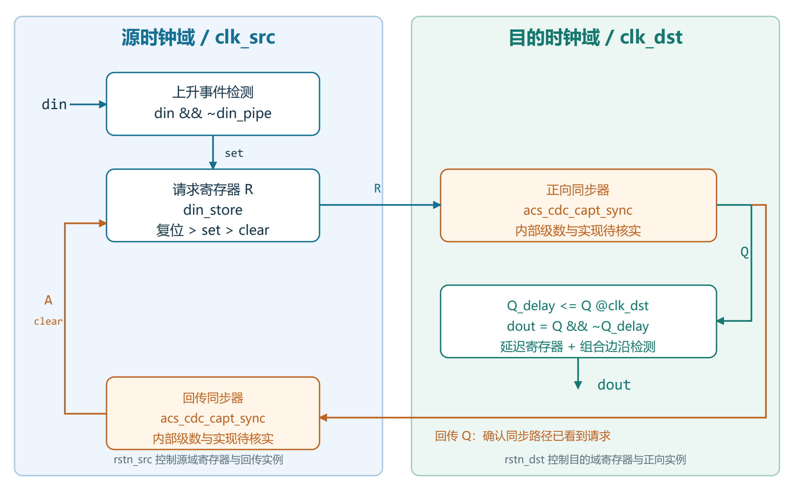
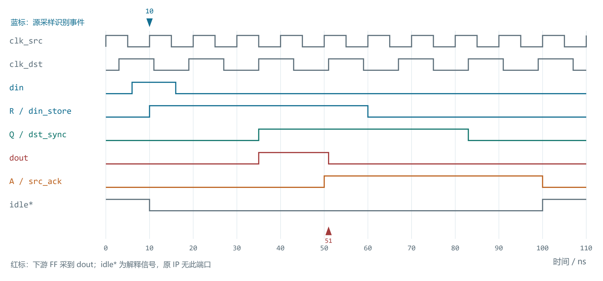
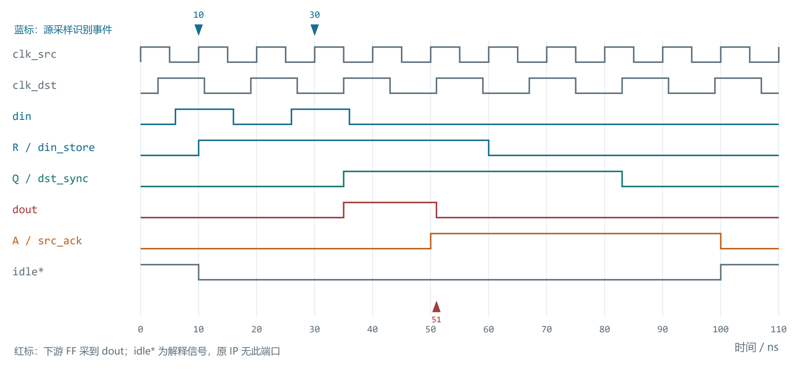
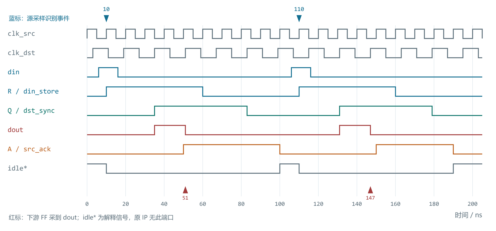

# acs_cdc_pulse_handshake IP设计与接口说明

## 1. 功能概述与使用边界

版本：基于代码照片的分析稿。日期：2026-10-28。模块名：`acs_cdc_pulse_handshake`。

本 IP 将源时钟域 `clk_src` 中被采样识别的一次输入上升事件，转换成目的时钟域 `clk_dst` 中的一个输出脉冲。实现先把事件保存为电平请求，再将请求同步到目的域，并把目的域观察到的请求回传到源域，使源请求自动清零。回零继续经过同步链，完成下一事件前的恢复。

其核心用途是低频、离散控制事件跨时钟域，例如启动通知、配置更新通知或状态变化通知。代码没有数据总线、事件计数器、FIFO，也没有对外的 `busy`、`ready` 或 `ack` 端口。因此不能把它当成可无限连续接收事件的通道。

**单事件传输的协议前提（数字逻辑层面）**：两域正常运行、同步器实现满足要求、复位状态一致，并且每次输入事件之间留出完整握手回零时间。忙期再次输入的事件可能与前一事件合并。两个相邻事件之间，`din` 必须先被源时钟采到低电平，之后再被采到高电平，才能识别为下一次事件；复位后的首个事件另见第 8 节。

本文区分三类结论：从照片可直接确认的 RTL 行为；为绘图而明确声明的同步器模型假设；需要真实子模块、约束或验证结果才能确认的工程指标。本文不代表 CDC 签核、综合网表分析或 VCS 仿真报告。

<!-- PAGE -->

## 2. 代码来源与端口定义

三张照片相互重叠，覆盖顶层模块第 23-93 行。读取顺序如下；照片是本说明的代码依据。

| 照片 | 可见范围 | 主要内容 |
|---|---|---|
| 20261028-180433.jpg | 第 23-55 行 | 模块接口、内部声明、输入边沿检测 |
| 20261028-180441.jpg | 第 56-89 行 | 请求保存、正向同步、目的边沿检测、回传同步 |
| 20261028-180448.jpg | 第 74-93 行 | 重叠核对及最终输出连接 |

| 端口 | 方向/位宽 | 所属域与含义 |
|---|---|---|
| `clk_src` | 输入，1 bit | 源时钟；源逻辑在上升沿工作 |
| `rstn_src` | 输入，1 bit | 源域低有效异步复位，作用于可见源寄存器 |
| `clk_dst` | 输入，1 bit | 目的时钟；目的逻辑在上升沿工作 |
| `rstn_dst` | 输入，1 bit | 目的域低有效异步复位，作用于可见目的寄存器 |
| `din` | 输入，1 bit | 源域同步事件输入；识别采样值的低到高变化 |
| `dout` | 输出，1 bit | 目的域上升事件脉冲，正常条件下持续一个目的周期 |

照片中没有顶层参数。子模块 `acs_cdc_capt_sync` 被实例化两次，但其定义没有出现。不能确认它的级数、复位值、复位释放策略、同步属性、器件实现及亚稳态性能。端口名 `nreset` 本身不足以证明所有内部复位细节。

<!-- PAGE -->

## 3. 内部结构与信号路径



图1应按两个时钟域阅读。源域用 `din_pipe` 保存上一拍输入，组合逻辑 `din && ~din_pipe` 形成 `din_re`。事件在源上升沿到来时被 `din_store` 锁存为 1，使短输入脉冲变成可等待目的域观察的电平。

正向 `acs_cdc_capt_sync` 以 `clk_dst` 为时钟，把 `din_store` 送为 `din_store_sync2dst`。目的域寄存器 `din_store_sync2dst_pipe` 保存该同步结果的上一拍，二者相与取反得到上升沿指示，直接连接到 `dout`。

反向同步器以 `clk_src` 为时钟，其异步输入接的是 `din_store_sync2dst`，输出为 `din_store_sync2src`，再接到源域清零条件。反馈不来自 `dout`，也不包含下游处理结果。

| 本文简称 | 实际 RTL 信号 | 作用 |
|---|---|---|
| R | `din_store` | 源域保持的请求 |
| Q | `din_store_sync2dst` | 目的域同步请求 |
| Qd | `din_store_sync2dst_pipe` | Q 的目的域延迟拍 |
| A | `din_store_sync2src` | Q 回传源域后的确认 |

关键边界是 R 到正向同步器、Q 到反向同步器这两条 CDC 路径。同步器输出的正确性依赖子模块和物理实现；图中的逻辑连接可以由照片确认。

<!-- PAGE -->

## 4. 四相握手及置位优先级

正常一次传输经历 `R↑ -> A↑ -> R↓ -> A↓` 四个阶段，Q 是目的端观察请求的中间状态。

| 阶段 | R/Q/A 的典型值 | 行为 |
|---|---|---|
| 空闲 | 0/0/0 | 等待新的源域事件 |
| 请求在途 | 1/0/0 | 源端保持请求，等待正向同步 |
| 目的域已观察 | 1/1/0 | 目的域产生上升沿脉冲，确认尚在回传 |
| 确认返回 | 1/1/1 | 源域即将清除请求 |
| 请求回零 | 0/1/1 | 等待低电平传播到目的域 |
| 确认回零 | 0/0/1 | 等待低电平回传源域 |
| 再次空闲 | 0/0/0 | 本轮握手结束 |

源端状态更新优先级由 `if/else if` 明确决定：复位优先；`din_re=1` 时置 R=1；否则 A=1 时清 R=0；其余时间保持。即 set 优先于 clear。

当 `din_re` 与 A 同时为 1 时，R 保持为 1，不会增加一个待处理事件，也不会自动排队。置位优先仅决定同一源时钟沿的寄存器结果，不能据此承诺忙期事件不会丢失。

**确认语义**：A 表示 Q 已经经过反向同步，说明目的域同步路径观察到了请求。它不是下游完成信号；本模块既没有下游 ready，也没有业务完成输入。因此系统不能使用 A 推断某个操作已经执行完毕。

<!-- PAGE -->

## 5. 正常单次事件的接口时序



本节及后续数值时序均为说明性数字模型：源时钟周期 10 ns、上升沿在 0/10/20 ns；目的时钟周期 16 ns、上升沿在 3/19/35 ns；正反向同步器各假设为两级，正向由 `clk_dst` 上升沿采样，回传由 `clk_src` 上升沿采样，复位值均为 0；不模拟亚稳态。两域复位已完成，初始内部状态均为 0。该模型不代表照片中子模块已经确认采用两级实现。

| 时刻 | 事件 |
|---|---|
| 6-16 ns | `din` 为高；10 ns 源采样沿识别事件，R 置 1 |
| 35 ns 沿后 | Q 变 1、Qd 仍为 0，`dout` 拉高 |
| 50 ns 沿后 | A 变 1；同一沿源状态逻辑看到旧 A，尚未清 R |
| 51 ns 上升沿 | 下游同步逻辑采到 `dout=1`；沿后 Qd 更新，`dout` 撤销 |
| 60 ns 沿后 | 源逻辑根据此前的 A=1 清 R |
| 83 ns 沿后 | Q 回到 0 |
| 100 ns 沿后 | A 回到 0，握手恢复空闲 |

`dout` 是组合输出。其高电平从 35 ns 沿后持续到 51 ns 沿后；常规目的域寄存器在 51 ns 采到它。示例中 A 在 50 ns 已经返回，更说明确认不等于下游业务完成。真实时延随同步级数、相位和实现变化，不应固定标为两拍。

<!-- PAGE -->

## 6. 忙期输入事件合并的时序



沿用图2模型，在第一次 `din=1` 的 6-16 ns 窗口之外，再于 26-36 ns 输入第二个高脉冲。20 ns 源沿已经采到中间低电平，所以 30 ns 确实会识别第二个 `din_re`。

但是 30 ns 时 R 已经为 1。执行第二次置位，只得到 `R<=1`，没有计数或额外状态变化。目的端仍只观察到 Q 的一次 0 到 1，因此该场景只有 35-51 ns 的一个 `dout`，两个输入事件合并为一次输出事件。

| 新事件出现阶段 | 代码动作 | 对额外事件的保证 |
|---|---|---|
| R=1，A=0 | 再次把 R 置 1 | 不形成独立请求；可能合并 |
| R=1，A=1 | set 胜过 clear | 延迟旧请求回零；没有额外排队 |
| R=0，A=1 | 短暂重新置 R | 旧 A 可能很快又清 R，不能保证被目的域捕获 |

回零阶段输入新事件有时可能恰好被观察到，但结果依赖时钟相位和同步链状态，不能作为支持的接口行为。规格应把这些情况定义为上游违反事件间隔约束，而不是给出固定的第二输出时刻。

测试该场景时，应同时记录源端识别事件数、目的端输出数及内部 R/Q/A。仅观察 `dout` 波形容易误以为第二个 `din` 没有被源域检测到；实际原因是事件存储只有一个电平状态。

<!-- PAGE -->

## 7. 安全重发、延迟与吞吐



图4沿用相同模型。首轮 A 在 100 ns 沿后回零，第二个输入高脉冲放在 106-116 ns，110 ns 源沿识别新事件。第二次 `dout` 在 131-147 ns 为高，下游在 147 ns 采到事件；确认上升在 150 ns，R 在 160 ns 清零，Q 在 179 ns 回零，A 在 190 ns 回零。

正常串行协议下，内部 `R=0 && A=0` 可作为握手空闲判断；下一事件还要求输入检测器已重新置备，即此前有源沿采到 `din=0`。该判据依赖正常初态和此前没有协议违规，不适用于任意单边复位后的瞬间。

**现有端口没有导出这一空闲状态**。若系统需要严格无丢失地连续发送事件，可考虑修改接口以导出源域 ready/busy，并由上游遵守；若必须吸收突发事件，应评估事件计数器或异步 FIFO。这些属于集成或改版建议，不是当前 RTL 已有功能。

应分别描述三种时间：输入被源域识别到 `dout` 产生的传输延迟；到下游目的沿采到脉冲的接收延迟；到 A 回零的完整恢复时间。吞吐受完整恢复时间限制，不仅取决于第一条正向同步路径。

示例的 100 ns、190 ns 不能作为通用间隔指标。没有同步器级数、两域频率范围、相位与停钟约束，不能给出固定最小输入间隔。即便以最坏情况计算固定间隔，也应留足工程余量并在系统频率组合下验证。

<!-- PAGE -->

## 8. 复位与停钟行为

可见的源寄存器 `din_pipe`、`din_store`，以及目的延迟寄存器 Qd，均使用低有效异步复位并清 0。同步器内部的具体复位实现仍待确认。

| 情况 | 需要关注的后果 |
|---|---|
| 源域单独复位 | R 被清零，尚未到达目的域的事件可能丢失 |
| 目的域单独复位 | 若同步状态被清零而 R 仍高，释放后可能重新产生输出；旧事件此前已输出时可能重复 |
| 两域共同复位 | 状态通常用于清空协议；不能承诺复位前后的事件数守恒 |
| 源复位释放时 `din=1` | 因 `din_pipe=0`，首个有效源沿会把该高电平识别为事件 |
| 目的时钟停止 | 请求保持可能延续到恢复时，但输出与恢复时延不再有固定上界 |
| 源时钟停止 | 请求清零和回传处理停顿，握手无法正常完成 |

推荐系统在启动与复位期间禁止输入事件，协调两域复位，并在状态恢复后开始业务。复位释放是否由外部按各自时钟同步，应根据芯片复位架构和子模块实现确认；可见顶层代码没有实现独立的复位释放同步器。

若 `dout` 拉高后目的时钟停止，Qd 无法按正常节奏更新，物理高电平时间可能显著拉长。因此“一拍脉冲”以有效目的时钟边沿为基准，并要求运行期间没有复位打断。下游也必须与 `clk_dst` 同步使用该输出。

<!-- PAGE -->

## 9. 集成约束与实现注意事项

1. `din` 应来自源域寄存逻辑，并满足源采样沿的建立/保持要求。异步外部脉冲、组合毛刺或完全落在两个源沿之间的窄脉冲，不属于当前输入检测器的可靠捕获范围。
2. 两个同步器应使用项目批准的 CDC 实现。核对级数、复位值、同步属性、综合保护、布局要求和静态 CDC 识别结果，防止工具把同步链当作普通逻辑处理。
3. 完成双向 CDC 的时序约束审查。异步路径例外应指向正确边界；同步链内部和同域逻辑仍需满足项目的时序要求，不宜用宽泛的 false path 隐藏所有相关路径。
4. 明确上游最大事件频率和最小事件间隔。现有模块没有反压端口；仅降低平均事件频率不足以保证突发情况下不丢失。
5. `dout` 应用作目的域同步使能或事件指示，不能直接当作新时钟。它没有输出业务确认，也不能与某个下游动作完成画等号。
6. 本 IP 只传递事件，不保证并行多位数据的一致性。若事件同时表示数据有效，数据稳定窗口和目的捕获协议需另行设计。

资料中的 XPM 宏与当前模块不是同一实现。AMD 握手宏文档可用于理解完整握手后再传输的原则；复位宏文档可辅助复位架构审查；Altera MTBF 文档说明同步可靠性还取决于时序和器件因素。它们不能证明本 IP 已满足这些要求，链接见末页。

<!-- PAGE -->

## 10. 验证检查与 SVA 示例

建议在实际 VCS 环境中覆盖：正常孤立事件；源快目的慢及反向频率关系；相位扫描；输入保持高；低电平未被源沿采到；忙期连续事件；set/clear 同拍；回零阶段再发；启动输入高；两域复位及单边复位；在不同握手阶段停钟/恢复。

端到端 scoreboard 应只对满足输入契约的事件承诺一进一出，并把复位定义为明确的清空边界。违规间隔测试用于确认限制，不能与正常无丢失测试混为同一预期。覆盖应证明输入与输出实际触发，避免没有事件时所有断言空通过。

以下三条为建议性检查，**尚未编译或仿真**。内部信号名必须放在本模块中使用，或通过 `bind` 检查器显式连接；不能直接当成顶层端口。复位后的有效观察窗口及同步器模型需由测试平台进一步约束。

```systemverilog
// 上游契约：新事件只能在完整空闲时出现。
ap_src_spacing: assert property (
  @(posedge clk_src)
  disable iff (!rstn_src || !rstn_dst)
  din_re |-> (!din_store && !din_store_sync2src));

// 在未收到确认时，请求不得自行撤销。
ap_hold_request: assert property (
  @(posedge clk_src)
  disable iff (!rstn_src || !rstn_dst)
  (din_store && !din_store_sync2src) |=> din_store);

// 正常连续运行时，输出不能连续两个目的采样点为高。
ap_dst_one_cycle: assert property (
  @(posedge clk_dst)
  disable iff (!rstn_src || !rstn_dst)
  dout |=> !dout);
```

这些检查不证明端到端不丢失，也不模拟亚稳态或证明 MTBF。应结合正反向用例、事件计数和 CDC/RDC 工具检查。

<!-- PAGE -->

## 11. 附录：可见 RTL 转录，第 23-65 行

以下按照片人工转录，保留可见功能逻辑。它不是从工作服务器取得的原始源文件，也不含未展示的文件头及同步器定义。实例名在第二页按照片可辨文字保留，工程导入前应与原文件比对。

```verilog
module acs_cdc_pulse_handshake
(
    input  wire clk_src,
    input  wire rstn_src,
    input  wire clk_dst,
    input  wire rstn_dst,

    input  wire din,
    output wire dout
);

reg din_pipe;
wire din_re;
reg din_store;
wire din_store_set;
wire din_store_clr;
wire din_store_sync2dst;
reg din_store_sync2dst_pipe;
wire din_store_sync2dst_re;
wire din_store_sync2src;

assign din_re = din && ~din_pipe;

always @ (posedge clk_src or negedge rstn_src) begin
    if (~rstn_src) begin
        din_pipe <= 1'h0;
    end else begin
        din_pipe <= din;
    end
end

assign din_store_set = din_re;
assign din_store_clr = din_store_sync2src;

always @ (posedge clk_src or negedge rstn_src) begin
    if (~rstn_src) begin
        din_store <= 1'h0;
    end else if (din_store_set) begin
        din_store <= 1'h1;
    end else if (din_store_clr) begin
        din_store <= 1'h0;
    end
end
```

<!-- PAGE -->

## 12. 附录：可见 RTL 转录，第 67-93 行

本页接续上一页。照片中正向同步器实例名可辨为 `u_acs_cdc_sync_din_store_2mst`；实例名本身不决定同步方向，实际方向由 `.clk(clk_dst)` 与输入/输出连接决定。

```verilog
acs_cdc_capt_sync u_acs_cdc_sync_din_store_2mst (
    .clk     (clk_dst),
    .nreset  (rstn_dst),
    .d_async (din_store),
    .q       (din_store_sync2dst)
);

assign din_store_sync2dst_re =
    din_store_sync2dst && ~din_store_sync2dst_pipe;

always @ (posedge clk_dst or negedge rstn_dst) begin
    if (~rstn_dst) begin
        din_store_sync2dst_pipe <= 1'h0;
    end else begin
        din_store_sync2dst_pipe <= din_store_sync2dst;
    end
end

acs_cdc_capt_sync u_acs_cdc_sync_din_store_2src (
    .clk     (clk_src),
    .nreset  (rstn_src),
    .d_async (din_store_sync2dst),
    .q       (din_store_sync2src)
);

assign dout = din_store_sync2dst_re;

endmodule
```

代码事实与模型的边界：上述转录只有两个同步器的实例连接。正文时序图所采用的两级寄存器模型、复位清 0 和相应数值时刻，是便于解释的假设，均不在这段代码中展开。

<!-- PAGE -->

## 13. 待确认事项、交付范围与参考资料

| 待确认事项 | 对规格与验证的影响 |
|---|---|
| `acs_cdc_capt_sync` 完整定义 | 确认同步级数、输出寄存属性、复位值与同步释放方式 |
| 工作时钟范围及停钟策略 | 确认端到端时延、恢复时间及超时上界 |
| 上游事件间隔契约 | 决定现有无 busy/ready 接口能否满足无丢失要求 |
| 两域复位关系 | 定义事件丢弃、重放和复位后有效观察窗口 |
| 下游如何消费 `dout` | 确认采样沿及是否需要真正的业务完成握手 |
| CDC/RDC 与 STA 约束、物理实现 | 确认同步路径识别、时序例外和亚稳态可靠性 |
| 原始 RTL 与照片转录核对 | 排除拍摄分辨率或人工转录误差 |

交付包含基于照片的功能分析、一张结构图、三组说明性时序图、接口限制、验证建议以及可见 RTL 转录。尚未执行原始 RTL 的编译、VCS 仿真、综合、STA、形式验证或 CDC/RDC 签核；示例波形不应作为已完成这些工作的证据。

代码来源为用户提供的三张本地照片：`20261028-180433.jpg`、`20261028-180441.jpg`、`20261028-180448.jpg`。照片未展示同步器源码，未从截图中的远程路径读取服务器文件。

参考资料用于补充工程原则，不代表与本 IP 的实现等价：

1. [AMD XPM_CDC_HANDSHAKE](https://docs.amd.com/r/2023.2-English/ug1344-versal-architecture-libraries/XPM_CDC_HANDSHAKE)：跨时钟域握手传输及完整握手要求。
2. [AMD XPM_CDC_ASYNC_RST](https://docs.amd.com/r/2022.2-English/ug1485-versal-architecture-premium-libraries/XPM_CDC_ASYNC_RST)：异步断言、同步释放的复位同步宏说明。
3. [Altera Timing Analyzer - Metastability Analysis](https://docs.altera.com/r/docs/683068/18.1/quartus-prime-standard-edition-user-guide-timing-analyzer/metastability-analysis)：同步链与亚稳态可靠性分析。
