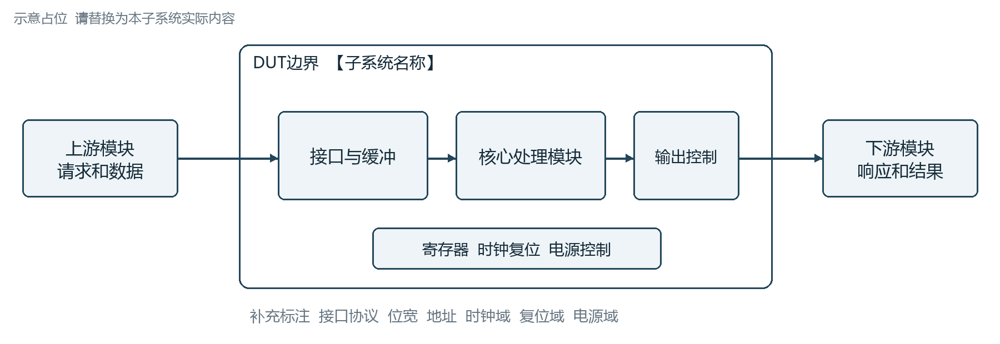
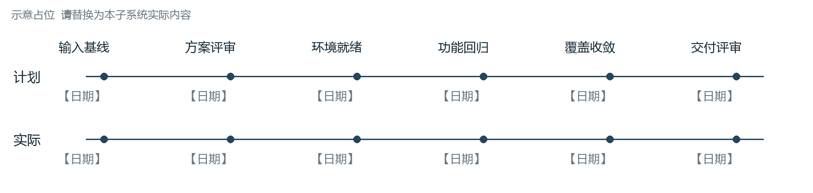
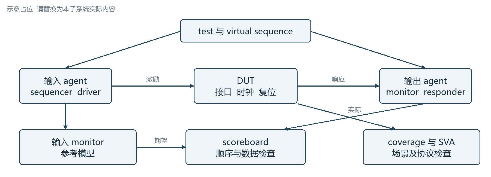
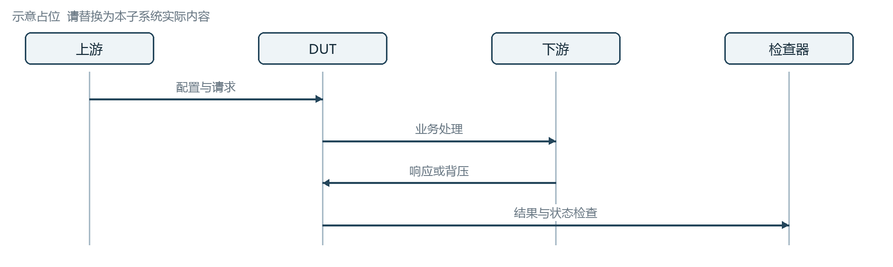
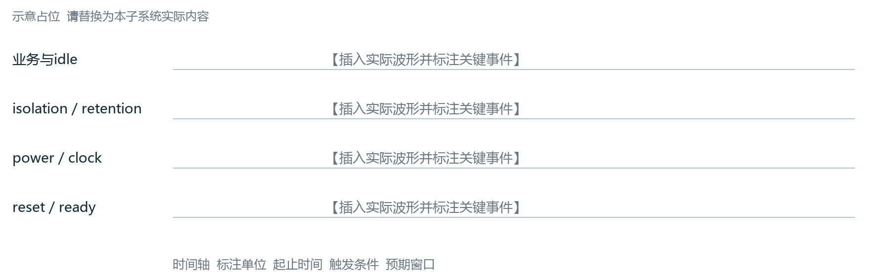
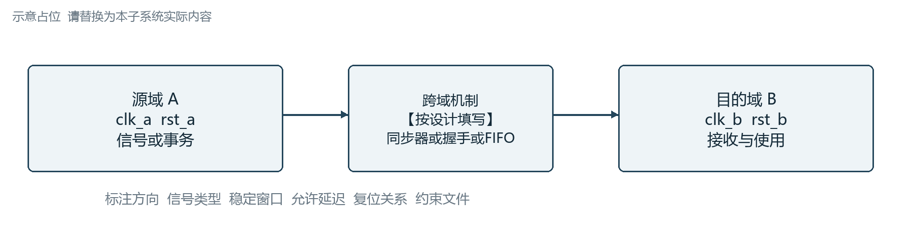
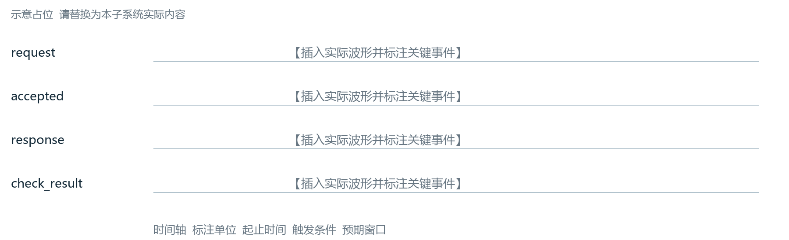

# SoC子系统验证方案模板

适用对象为各子系统验证负责人及验证工程师。本方案用于约定验证范围、环境与场景、上下游交付和验收证据；由设计、SoC集成、软件及相关平台负责人共同评审。

**填写约定**

- 将【填写】替换为实际内容；所有简图均为可替换占位，不代表项目已采用该架构或流程。表格可按实际增删记录。
- 不适用项写明“不适用、原因、确认人”；尚未明确的事项写明责任人和完成时间，不用空白代替结论。
- 第1至6章在方案阶段填写并随基线变化更新；第7章先填写计划口径，执行后补充实际结果。模板中的待填项不代表已完成或已通过。
- 需求、验证点、场景、用例、检查器、覆盖率对象及问题单使用稳定ID关联。长清单放飞书表格或代码仓，本方案保留版本和链接。

**基本信息**

| 字段 | 填写内容 | 字段 | 填写内容 |
| --- | --- | --- | --- |
| 项目与芯片 | 【填写】 | 子系统与DUT顶层 | 【填写】 |
| 方案版本与状态 | 【版本；草稿或评审中或已批准】 | 适用里程碑 | 【填写】 |
| 验证负责人 | 【姓名及联系方式】 | 设计与集成接口人 | 【填写】 |
| 适用配置与变体 | 【参数；SKU；功能开关】 | 文档与附件位置 | 【飞书或代码仓链接】 |

**修订与评审记录**

| 版本与日期 | 变更范围 | 修改人 | 评审记录 |
| --- | --- | --- | --- |
| 【填写】 | 【填写本次范围及影响】 | 【填写】 | 【链接或待评审】 |

文档导航  1 DUT概述  2 交付件及计划节点  3 验证方案  4 EDA验证环境  5 重点和边界场景  6 上下游约束和交付  7 验证报告

## 1. DUT概述

说明本子系统在SoC中的职责、验证边界及适用配置。读者应能据此判断哪些设计和接口由本方案负责，哪些依赖外部团队。

### 1.1 功能框图

填写区  概括DUT边界、主要数据路径、控制路径及外部依赖。

图1-1 DUT功能框图占位  替换并标注接口和时钟复位电源域

**表1-1 外部接口与域清单**

| 接口或域 | 方向与对端 | 协议及关键参数 | 验证边界与说明 |
| --- | --- | --- | --- |
| 【数据接口】 | 【输入或输出；对端】 | 【协议；位宽；速率】 | 【真实模块或模型替代】 |
| 【配置与中断】 | 【对端】 | 【地址；中断号；访问属性】 | 【归属及检查点】 |
| 【时钟复位电源】 | 【来源】 | 【频率；复位关系；状态】 | 【约束及规格链接】 |

### 1.2 功能模块

填写区  描述模块分工、关键参数、可选功能及禁用组合；引用IP级验证结论时注明版本、参数与集成假设。

**表1-2 功能模块分解**

| 模块或IP | 功能及关键配置 | 规格与版本 | 本级验证责任 |
| --- | --- | --- | --- |
| 【模块A】 | 【功能；配置范围】 | 【规格链接及版本】 | 【本级新增或复用证据】 |
| 【模块B】 | 【功能；配置范围】 | 【规格链接及版本】 | 【接口与交互验证责任】 |

### 1.3 系统应用

填写区  说明本子系统参与的系统业务、软件使用方式和端到端数据流，列出影响配置或验收的外部前提。

图1-2 系统应用与业务数据流占位

**表1-3 系统应用场景**

| 应用场景ID | 业务目标 | 参与模块与配置 | 系统级成功判据 |
| --- | --- | --- | --- |
| APP-001 | 【填写】 | 【路径；配置；资源】 | 【数据或状态或性能判据】 |
| APP-002 | 【填写】 | 【路径；配置；资源】 | 【填写】 |

## 2. 交付件及计划节点

本章约定输入依赖和交付承诺。技术接口与验收细节见第6章，实际执行证据见第7章。日期、资源和出口标准由项目评审确认。

### 2.1 输入输出件

填写区  填写输入件提供方、可用版本和验收条件；输入延迟时说明影响及替代方案。输出件明确接收方和交付基线。

**表2-1 输入依赖清单**

| 输入件与编号 | 提供方 | 版本及到位时间 | 验收条件或缺口 |
| --- | --- | --- | --- |
| IN-001 规格与需求 | 【填写】 | 【版本；计划与实际日期】 | 【范围完整；需求ID；待定项】 |
| IN-002 RTL与配置 | 【填写】 | 【仓库；commit或tag；日期】 | 【可编译；参数；文件清单】 |
| IN-003 接口与约束 | 【填写】 | 【寄存器；地址；CRG等版本】 | 【时钟复位；协议及集成约束】 |
| IN-004 模型和软件 | 【填写】 | 【模型或VIP；软件或镜像版本】 | 【接口；一致性；授权及可用性】 |
| IN-005 专项输入 | 【填写或不适用】 | 【UPF；CDC约束；DFX等】 | 【适用范围；缺口影响；责任人】 |

**表2-2 输出交付件清单**

| 输出件与编号 | 交付内容 | 接收方及日期 | 验收标准与链接 |
| --- | --- | --- | --- |
| OUT-001 方案与VFL | 【方案；映射表；评审记录】 | 【填写】 | 【评审待办处理；链接】 |
| OUT-002 环境与用例 | 【TB；模型；checker；覆盖率；脚本】 | 【填写】 | 【可复现运行；版本与说明】 |
| OUT-003 结果与交付包 | 【报告；数据库；问题及豁免；集成用例】 | 【填写】 | 【目标；归档；接收记录】 |

### 2.2 计划节点

填写区  采用本项目正式里程碑名称；注明评审、环境就绪、回归和交付的依赖关系。示例节点不是默认日期承诺。

图2-1 计划与实际里程碑时间线占位

**表2-3 里程碑与出口条件**

| 节点 | 计划与实际日期 | 进入条件 | 交付及出口条件 | 负责人 |
| --- | --- | --- | --- | --- |
| 【方案评审】 | 【计划；实际；状态】 | 【关键规格到位】 | 【方案及VFL评审；待办要求】 | 【填写】 |
| 【环境就绪】 | 【填写】 | 【RTL及模型可用】 | 【sanity通过；检查机制可用】 | 【填写】 |
| 【验证收敛】 | 【填写】 | 【配置与需求基线稳定】 | 【用例及覆盖目标；问题处置】 | 【填写】 |
| 【交付评审】 | 【填写】 | 【报告与证据完整】 | 【接收验收；遗留风险决策】 | 【填写】 |

填写区  关键依赖及偏差处理：【依赖项；最晚需求时间；延迟影响；措施；决策人】。

## 3. 验证方案

本章说明验证选择及其依据。第4章描述环境如何实现这些选择，第5章给出具体场景。通过需求ID和VP_ID关联，避免重复维护三份清单。

### 3.1 方案要素

填写区  概括验证范围、方法、责任分界和关闭证据。明确纳入范围、明确不纳入范围以及尚待确认的事项。

**表3-1 验证方案要素**

| 要素 | 本子系统选择 | 依据或依赖 | 责任人 |
| --- | --- | --- | --- |
| 范围及配置 | 【功能；接口；合法配置；排除项】 | 【规格及基线】 | 【填写】 |
| 验证层级与平台 | 【IP或子系统或SoC；EDA或Formal或EMU或FPGA】 | 【分工；适用条件】 | 【填写】 |
| 激励与检查 | 【UVM或软件；参考模型或SVA或签名】 | 【可观察性；模型依赖】 | 【填写】 |
| 覆盖与收口 | 【功能；代码；断言；需求追踪目标】 | 【目标审批；豁免口径】 | 【填写】 |
| 资源与复现 | 【机器；许可证；回归预算；seed和配置】 | 【资源计划及执行流程】 | 【填写】 |

图3-1 需求到验证证据的关联关系占位

**表3-2 验证责任与证据分界**

| 需求或VP_ID | 本级验证内容 | 复用的下层证据 | 上交SoC验证内容 |
| --- | --- | --- | --- |
| 【填写】 | 【本级接口与交互】 | 【版本；参数；报告链接】 | 【系统配置或跨域场景】 |
| 【填写】 | 【填写】 | 【适用假设及缺口】 | 【责任人及验收点】 |

### 3.2 要素分析

填写区  解释高风险功能为何采用所选方法，说明可观察性、模型精度、场景复杂度和资源开销的取舍。对无法在本级完成的验证给出承接团队。

**表3-3 验证难点与策略分析**

| 需求或风险ID | 难点及影响 | 验证策略 | 检查证据与承接人 |
| --- | --- | --- | --- |
| 【填写】 | 【并发；低可观察性；长延迟等】 | 【定向或随机；分层；模型或形式验证】 | 【checker；覆盖项；负责人】 |
| 【填写】 | 【环境或规格缺口】 | 【替代方法；解除条件】 | 【证据限制；负责人】 |

填写区  关键假设和约束：【假设；适用配置；依据；失效影响；验证或确认方式】。

## 4. EDA验证环境

描述可运行、可检查、可复现的EDA环境。环境接口、参数和运行方式应能支持后续向SoC集成平台移植。

### 4.1 子系统验证环境

填写区  说明顶层TB、DUT连接、agent模式、寄存器模型、参考模型、scoreboard、SVA及覆盖率采集点；标出真实IP、VIP与stub的替代边界。

图4-1 子系统验证环境框图占位

**表4-1 环境组件与替代边界**

| 组件 | 模式及职责 | 连接与输入输出 | 版本或限制 |
| --- | --- | --- | --- |
| 【agent或VIP】 | 【active或passive；协议职责】 | 【接口；时钟；事务类型】 | 【填写】 |
| 【参考模型与scoreboard】 | 【预测与比对职责】 | 【期望流；实际流；关联键】 | 【精度；未覆盖行为】 |
| 【RAL与软件入口】 | 【配置与状态检查】 | 【访问通路；镜像更新】 | 【寄存器基线】 |
| 【时钟复位及电源控制】 | 【驱动和监视】 | 【各域控制及约束】 | 【适用功能】 |

填写区  复现入口：【仓库及tag；filelist；工具版本；编译命令；运行命令；test/config/seed；日志与波形位置】。命令参数和默认值应随交付包提供。

### 4.2 随机控制

填写区  列出随机变量、合法范围、偏置和关联约束，区分协议合法约束与测试场景选择。说明如何使用覆盖率反馈调整分布。

**表4-2 随机控制矩阵**

| 随机对象 | 合法约束 | 分布与组合 | 复现及覆盖反馈 |
| --- | --- | --- | --- |
| 【事务字段】 | 【地址；长度；属性；对齐】 | 【均匀或边界偏置；必要cross】 | 【seed；配置；目标bins】 |
| 【流量及背压】 | 【并发；顺序；资源限制】 | 【突发；间隔；拥塞组合】 | 【权重版本及命中结果】 |
| 【时钟及复位关系】 | 【仅限设计支持的配置】 | 【比例；相位；允许时序】 | 【参数记录；专项检查】 |

### 4.3 注错控制

填写区  描述注错接口、位置、触发条件、持续时间、恢复及清理机制。区分设计必须处理的异常与协议禁止输入；后者按环境约束或违规检测处理。

**表4-3 注错能力与控制**

| 注错ID与类型 | 入口与触发 | 注入及撤销控制 | 关联场景与检查 |
| --- | --- | --- | --- |
| INJ-001 【填写】 | 【接口或存储或内部节点】 | 【API或配置；持续时间；撤销】 | 【ERR_ID；checker；期望响应】 |
| INJ-002 【填写】 | 【配置与触发条件】 | 【可复现记录；清理检查】 | 【检测窗口；恢复检查】 |

### 4.4 比对

填写区  定义事务接受条件、采样时机、关联ID、乱序处理、允许延迟、超时和复位清空规则。算法类比对明确位精度、舍入及容差；无效周期不强行约束未定义数据。

**表4-4 检查机制及有效性**

| 检查器ID | 期望值与实际值来源 | 比对及判错规则 | 有效性确认 |
| --- | --- | --- | --- |
| CHK-001 数据检查 | 【模型；输入输出monitor】 | 【ID；顺序；容差；数据有效时机】 | 【构造错误能被检出】 |
| CHK-002 协议或时序 | 【SVA或协议monitor】 | 【时钟；复位屏蔽；超时窗口】 | 【触发覆盖；失败自检】 |
| CHK-003 结束检查 | 【队列；状态；软件签名】 | 【未完成事务；残留队列；结束条件】 | 【提前结束及残留检测】 |

填写区  多时钟事件处理：【同一仿真时刻的事件顺序；本域采样；事务归属；避免参考模型调度竞争的方法】。

### 4.5 覆盖率度量

填写区  将需求及VP映射到coverpoint、cross、assertion或其他证据。代码覆盖率用于发现结构空洞，不直接代替功能点完成证据。

**表4-5 覆盖率与证据目标**

| 指标 | 采集范围与对象 | 目标及审批 | 缺口与排除规则 |
| --- | --- | --- | --- |
| 功能覆盖率 | 【covergroup；bin；必要cross；配置】 | 【目标及批准记录】 | 【有效分母；不可达及未实现项】 |
| 代码覆盖率 | 【Line；Branch；Cond；Toggle等适用项】 | 【各项独立目标】 | 【配置差异；排除理由与版本】 |
| 断言或形式结果 | 【启用范围；触发或证明状态】 | 【失败及未触发处理口径】 | 【vacuous；超时；假设审查】 |
| 需求及VP覆盖 | 【需求到验证证据的映射】 | 【映射完整性及关闭条件】 | 【未覆盖需求；变更影响】 |

填写区  反标和合并流程：【VFL或HVP版本；对象映射；VDB清单；兼容基线；排除文件；执行命令；报告位置】。

### 4.6 用例规划

填写区  一行记录一个可执行用例或明确的用例族，关联VP与场景；区分定向、约束随机、软件及专项用例。详细清单链接：【填写】。

**表4-6 用例规划与追踪**

| 用例ID及VP | 场景与配置 | 激励及检查 | 优先级与节点 | 负责人及状态 |
| --- | --- | --- | --- | --- |
| TC-001／VP-001 | 【功能；参数配置】 | 【sequence或软件；checker】 | 【P级；里程碑】 | 【负责人；计划中】 |
| TC-002／VP-002 | 【边界或异常】 | 【注错；检查；coverage】 | 【填写】 | 【填写】 |
| TC-003／多个VP | 【并发或长期压力】 | 【分布；时长；结束条件】 | 【填写】 | 【填写】 |

填写区  回归分层：【sanity；日常回归；全量回归；专项回归】；每层填写配置集合、seed策略、资源预算、超时、失败处理和归档规则。

## 5. 重点和边界场景

本章定义可检查的设计行为。每个场景关联VP、用例和checker；阈值、时序和异常响应以对应规格为依据。

### 5.1 重点功能场景

填写区  选择对主要业务、跨模块交互或项目风险最重要的端到端场景，说明为什么需要在本子系统层级验证。

图5-1 重点业务端到端时序图占位  标注接受条件和检查点

**表5-1 重点功能场景**

| 场景ID与VP | 前置配置 | 操作及关键交互 | 预期结果与检查 |
| --- | --- | --- | --- |
| SCN-001／【VP】 | 【初始化；资源；运行模式】 | 【事务链；并发；响应】 | 【数据；状态；时序；checker】 |
| SCN-002／【VP】 | 【填写】 | 【填写】 | 【目标覆盖项及证据】 |

### 5.2 边界功能场景

填写区  从规格允许范围出发，覆盖极值、相邻值、状态转换及组合边界。区分合法边界、应处理异常和禁止输入。

**表5-2 边界场景矩阵**

| 边界类别 | 边界取值或条件 | 必要组合 | 预期行为与关联VP |
| --- | --- | --- | --- |
| 参数与地址 | 【最小；最大；边界相邻值；对齐】 | 【配置及访问属性】 | 【填写】 |
| 队列与资源 | 【空；近空；近满；满；资源耗尽】 | 【并发；背压；回绕】 | 【接受或拒绝条件；数据完整性】 |
| 顺序与时序 | 【乱序；延迟；超时边界】 | 【重试；取消；状态转换】 | 【协议规定行为】 |
| 复位及模式切换 | 【规格支持的转换时刻】 | 【未完成业务；域间关系】 | 【恢复；残留状态；影响范围】 |

### 5.3 低功耗场景

填写区  适用性：【适用或不适用及原因】。列出支持的电源状态、转换前提、业务排空、隔离、保持、恢复、时钟复位及唤醒条件；引用电源管理规格及适用的UPF版本，无UPF时说明低功耗建模方式。

图5-2 电源状态转换占位  示例状态及顺序需按规格替换

图5-3 低功耗时序占位  标注隔离保持电源时钟复位关系

**表5-3 低功耗场景与验收条件**

| 转换或场景ID | 前置条件与触发 | 检查内容 | 用例及依据 |
| --- | --- | --- | --- |
| LP-001 【状态A到B】 | 【业务条件；请求；握手】 | 【排空；隔离；保持；时钟及电源顺序】 | 【TC；规格；UPF版本如适用】 |
| LP-002 【状态B到A】 | 【唤醒源；允许条件】 | 【恢复；状态保留；服务恢复时间】 | 【填写】 |
| LP-003 【异常转换】 | 【规格支持的超时或拒绝条件】 | 【拒绝或回退或升级；影响范围】 | 【填写或不适用】 |

### 5.4 设计异步路径

填写区  覆盖CDC及适用的RDC路径，列出跨域机制与协议约束。动态仿真检查功能及场景，结构CDC/RDC分析检查跨域实现，两类证据分别记录。

图5-4 时钟复位域与跨域路径占位

**表5-4 异步路径与检查清单**

| 路径ID与信号类型 | 源域到目的域 | 机制及约束 | 检查与证据 |
| --- | --- | --- | --- |
| CDC-001 【控制或脉冲】 | 【时钟；频率；复位关系】 | 【同步器或握手；稳定窗口；允许延迟】 | 【静态结果；SVA；场景覆盖】 |
| CDC-002 【多位数据】 | 【填写】 | 【FIFO或其他机制；数据一致性条件】 | 【数据检查；边界；报告链接】 |
| RDC-001 【复位相关】 | 【复位源及释放关系】 | 【协议；复位顺序；例外依据】 | 【专项报告；批准记录】 |

运行中单边复位、停钟或动态变频仅在设计支持时作为功能要求；功能仿真通过不作为亚稳态或MTBF结论。

### 5.5 异常以及异常的监测

填写区  为每类异常定义可检测条件、错误上报、影响范围、恢复或升级、清除条件及检测超时。注错实现引用4.3，不重复维护注错接口。

图5-5 异常检测上报与恢复路径占位

**表5-5 异常监测与恢复矩阵**

| 异常ID及注错入口 | 检测及响应窗口 | 上报与影响范围 | 恢复和清除判据 |
| --- | --- | --- | --- |
| ERR-001／INJ-001 | 【可检测条件；最长允许时间】 | 【错误码；中断；受影响事务】 | 【清除顺序；重试或复位；checker】 |
| ERR-002／INJ-002 | 【填写】 | 【错误传播与隔离】 | 【升级条件；残留状态检查】 |

## 6. 上下游约束和交付

本章约定交付物如何被上下游使用和验收。交付件编号引用2.1，避免维护两套日期；每项契约由提供方与接收方确认。

### 6.1 前后级算法或数据流的级联

填写区  明确前级、本级、后级的数据契约；无算法处理的子系统也应说明事务格式、顺序、流控和错误传播。

图6-1 前后级级联与检查边界占位

**表6-1 上下游接口契约**

| 接口契约项 | 上游保证 | 本级处理及输出保证 | 接收方确认 |
| --- | --- | --- | --- |
| 数据与精度 | 【格式；单位；对齐；帧边界】 | 【位精度；舍入；容差或透明传输】 | 【负责人及版本】 |
| 顺序与流控 | 【并发；ID；背压能力】 | 【排序；缓存；延迟及阻塞条件】 | 【填写】 |
| 异常与复位 | 【错误标记；终止或重试条件】 | 【传播；恢复；状态清理】 | 【填写】 |

### 6.2 集成验证交付用例

填写区  选择能够验证系统连接、配置和端到端业务的可移植用例；说明对子系统内部层级、后门访问或替代模型的依赖及替代方法。

**表6-2 集成用例交付清单**

| 用例与交付件ID | 系统场景及前置资源 | 运行及判定方式 | 接收验收 |
| --- | --- | --- | --- |
| 【TC；OUT编号】 | 【VP；外设；内存；配置】 | 【入口；参数；checker或软件签名】 | 【接收人；基线；验收条件】 |
| 【填写】 | 【依赖及支持的平台】 | 【超时；日志；失败定位】 | 【实际验收记录链接】 |

填写区  交付包清单：【文件清单；tag或commit；工具依赖；README；示例命令；期望输出；已知限制；验收日志】。

### 6.3 软件约束和配置流程

填写区  给出软件能够执行的配置顺序与完成判断，注明寄存器访问副作用、访问权限、地址约束、轮询超时和异常处理。缓存维护或屏障要求仅按实际架构规定填写。

图6-2 软件初始化和配置流程占位

**表6-3 软件配置与约束步骤**

| 步骤 | 操作及寄存器或接口 | 前提及顺序约束 | 完成及失败处理 |
| --- | --- | --- | --- |
| 1 | 【初始化与配置】 | 【时钟；复位；电源；权限】 | 【读回或状态检查】 |
| 2 | 【使能和提交任务】 | 【资源准备；必要同步】 | 【接受条件；超时阈值】 |
| 3 | 【等待与结果读取】 | 【轮询或中断；访问副作用】 | 【完成标志；错误码；恢复流程】 |

### 6.4 性能功耗交付内容

填写区  明确交付的是测量方法、工作负载、活动数据还是分析结果；记录工作频率、并发、背压、预热与测量窗口，以及接收方需要的配置和文件。

**表6-4 性能与功耗交付口径**

| 指标或交付项 | 场景与测量口径 | 计划目标 | 交付内容及接收方 |
| --- | --- | --- | --- |
| 吞吐与带宽 | 【有效事务或字节；时间窗口；负载】 | 【数值；单位；依据】 | 【脚本；日志；统计表；接收方】 |
| 时延与公平性 | 【起止事件；分位数；拥塞条件】 | 【数值及适用条件】 | 【时间戳；分析方法；结果】 |
| 功耗分析输入 | 【运行状态；活动窗口；频率配置】 | 【交付要求或不适用】 | 【活动文件；层级映射；基线；接收方】 |

EDA活动文件只作为指定功耗流程的输入；未完成相应分析时，不将其写成实际功耗结论。

### 6.5 EMU/FPGA平台交付的内容

填写区  适用性：【适用或不适用及原因】。说明移植范围、时钟复位方案、模型替换、可综合限制、软件镜像、观察点及平台不能执行的检查。

**表6-5 EMU及FPGA移植与验收**

| 平台及交付件 | 移植修改与依赖 | 运行与观察方式 | 验收及补充验证 |
| --- | --- | --- | --- |
| EMU／【OUT编号】 | 【配置；模型；编译；时钟复位】 | 【软件；触发；日志；采样点】 | 【目标场景；缺失检查的补证】 |
| FPGA／【OUT编号】 | 【资源映射；频率；外设替代】 | 【镜像；运行步骤；通过标志】 | 【接收人；验收记录；限制】 |

## 7. 验证报告

方案阶段填写目标和统计口径，执行阶段填写实际结果与证据。报告结论必须绑定同一可追溯基线；不同配置或版本的合并需说明兼容依据。

**表7-1 报告基线**

| 基线项目 | 实际记录 |
| --- | --- |
| 报告范围与日期 | 【本次里程碑；覆盖配置；报告日期】 |
| 设计与环境版本 | 【RTL；TB；模型；VIP；软件；UPF及约束版本】 |
| 工具与执行记录 | 【工具版本；回归ID；run清单；配置及seed】 |
| 覆盖与排除记录 | 【VDB合并清单；VFL或HVP；排除文件及审批版本】 |
| 证据归档位置 | 【报告；必要日志和波形；复现入口；保留期限】 |

### 7.1 覆盖率

填写区  按配置和指标报告原始结果、批准排除项及处理后结果。无采集数据标为“未采集”，无适用对象标为“N/A并说明原因”，均不得默认计为100%。

图7-1 覆盖率趋势与回归统计图位  使用实际结果替换空图

**表7-2 覆盖率与证据结果**

| 指标与范围 | 计划目标 | 实际值与有效分母 | 缺口及排除 | 评审结论 |
| --- | --- | --- | --- | --- |
| 功能覆盖率／【配置】 | 【填写】 | 【命中或工具分数；有效bins】 | 【未覆盖原因；批准记录】 | 【待填写】 |
| 代码覆盖率／【指标】 | 【填写】 | 【原始；处理后；统计口径】 | 【版本；对象；理由】 | 【待填写】 |
| 断言或形式结果 | 【填写】 | 【触发；失败；未触发或未收敛】 | 【vacuous或假设检查】 | 【待填写】 |
| 需求映射完整率 | 【填写】 | 【已建立验证映射的需求数／适用需求总数】 | 【缺失映射及责任人】 | 【待填写】 |
| VP关闭率 | 【填写】 | 【满足关闭条件的VP数／适用VP总数】 | 【未关闭原因及证据】 | 【待填写】 |

覆盖率目标不统一预填100%；不同指标和配置采用已批准目标。断言无失败还需结合启用范围、触发及非空洞检查；形式结果另列证明、反例、超时和假设。

### 7.2 用例和回归状态

填写区  先声明统计单位是testcase还是testcase×配置×seed。实现完成率、执行率和run通过率分别记录，编译失败、阻塞及中止单列，不静默移出分母。

**表7-3 回归统计口径与结果**

| 统计项 | 分子与分母口径 | 计划目标 | 实际结果与证据 |
| --- | --- | --- | --- |
| 用例实现完成率 | 已完成实现及评审的适用用例／计划适用用例 | 【填写】 | 【填写；清单链接】 |
| 执行进度 | 已执行单元／计划执行单元；单元定义【填写】 | 【填写】 | 【填写；Not Run及Blocked数】 |
| run通过情况 | Pass；Fail；Aborted；编译失败分别计数；通过率分母【填写】 | 【填写】 | 【填写；回归ID与日志】 |

**表7-4 回归异常与未完成项**

| 用例或失败分类 | 配置及run或seed | 实际状态 | 问题单及处理 | 证据 |
| --- | --- | --- | --- | --- |
| 【TC或分类】 | 【填写】 | 【Pass或Fail等】 | 【根因；修复；重跑】 | 【链接】 |
| 【填写】 | 【填写】 | 【填写】 | 【责任人与完成时间】 | 【链接】 |

### 7.3 波形检查

填写区  选择关键时序及自动检查难以覆盖的可观察行为，标注时间单位、触发事件、预期窗口和实际结论。波形检查作为自动checker的补充，并说明人工检查范围。

图7-2 实际波形截图占位  标记关键事件和预期时序

**表7-5 波形检查记录**

| 场景与VP | 观察信号及预期 | run及时间窗口 | 实际结果与检查人 |
| --- | --- | --- | --- |
| 【SCN；VP；TC】 | 【信号；事件关系；checker】 | 【回归ID；seed；起止时间】 | 【结论；姓名；波形链接】 |
| 【填写】 | 【人工检查理由及边界】 | 【填写】 | 【待填写】 |

### 7.4 环境清理

填写区  清理临时调试行为并验证交付可复现性。保留必要日志、波形、数据库和复现信息；证据归档完成前不以清理为由删除。

**表7-6 环境交付检查清单**

| 检查项 | 验收条件 | 状态与负责人 | 证据 |
| --- | --- | --- | --- |
| 临时修改与屏蔽 | 【force；绕过；临时约束及豁免已移除或批准】 | 【填写】 | 【review或diff链接】 |
| 检查机制与用例 | 【无无效checker；结束检查有效；重复用例有说明】 | 【填写】 | 【自检与回归记录】 |
| 路径与依赖 | 【无个人硬编码路径；依赖版本完整】 | 【填写】 | 【README与配置】 |
| 干净环境复现 | 【从指定tag按文档编译运行并复现结果】 | 【填写】 | 【命令；日志；接收验证】 |
| 归档与保留 | 【证据清单；保留范围和期限；访问可用】 | 【填写】 | 【归档链接及清单】 |

### 7.5 问题单说明

填写区  分别记录设计问题、环境问题和规格问题。修复合入、验证通过和问题关闭不是同一状态，应保留修复版本与复验记录。

**表7-7 问题单与关闭证据**

| 问题单与严重度 | 影响范围与根因 | 修复及复验 | 当前状态与证据 |
| --- | --- | --- | --- |
| 【ID；等级】 | 【功能；配置；版本；根因】 | 【修复commit；回归ID；结果】 | 【Open或Fixed或Verified或Closed；链接】 |
| 【填写】 | 【填写】 | 【未修复则填规避措施】 | 【责任人；下一步及日期】 |

### 7.6 遗留任务和潜在风险说明

填写区  说明尚未完成或无法充分验证的范围，以及触发条件、后果、规避措施和承接人。批准带风险交付与问题关闭分别记录。

**表7-8 遗留任务和风险接受记录**

| 任务或风险ID | 未完成内容及影响 | 措施与完成时间 | 承接与决策记录 |
| --- | --- | --- | --- |
| RSK-001 | 【触发条件；影响配置；剩余风险】 | 【补验或规避；责任人；日期】 | 【接收方；批准人；适用范围；链接】 |
| TASK-001 | 【遗留工作；依赖或阻塞】 | 【后续计划与验收条件】 | 【承接人及跟踪链接】 |

**表7-9 最终评审与交付结论**

| 关闭条件 | 实际判断与证据 |
| --- | --- |
| 用例与检查机制 | 【执行结果；checker有效性；未完成项处置】 |
| 覆盖与需求追踪 | 【批准目标；缺口分析；豁免记录】 |
| 缺陷及风险 | 【阻断问题；风险接受；后续承接】 |
| 交付及可复现性 | 【版本；文档；接收验收；归档】 |
| 最终评审结论 | 【通过或附条件通过或不通过；条件；批准人及日期】 |
